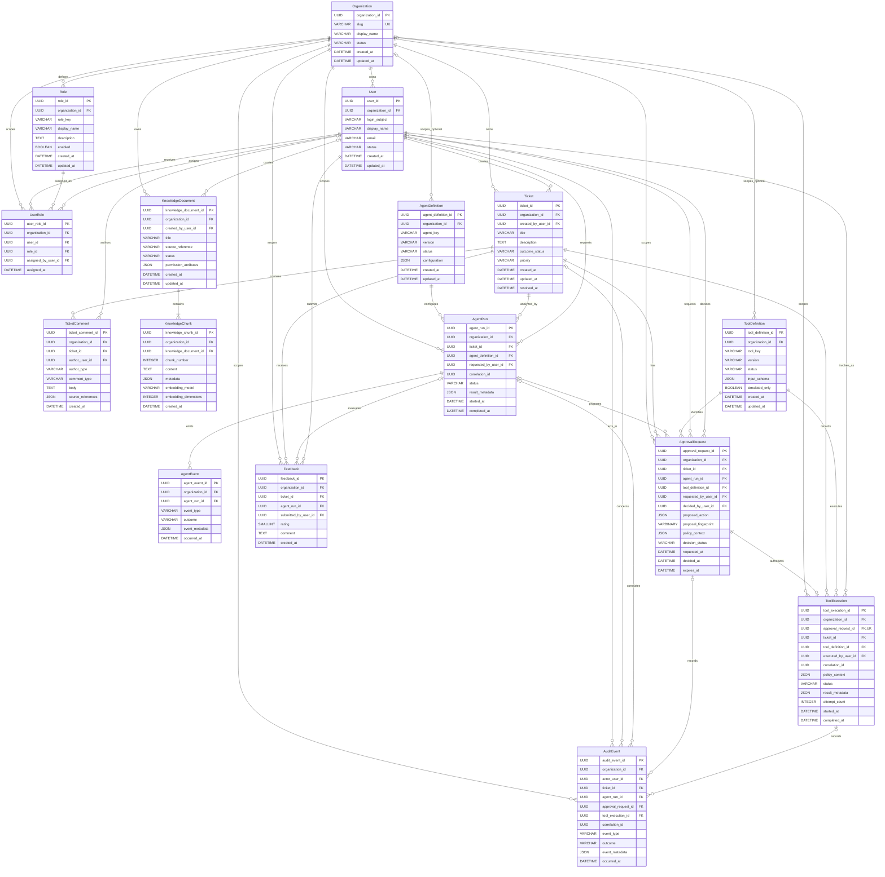

# Logical Database Model: Autonomous Enterprise AI System

## 1. Document Control

| Field | Value |
|---|---|
| Document | Logical Database Model and ER Diagram |
| Project | Autonomous Enterprise AI System |
| Version | 1.0 |
| Status | Draft |
| Date | 2026-11-13 |
| Authority | Approved PRD, SRS, Use Cases, Threat Model, System Architecture, and Sequence Diagrams |

This is a logical design, not an implemented schema or migration. The approved relational target is MariaDB 10.11.16, database `autonomous_enterprise_ai`; XAMPP is the local environment and phpMyAdmin is the management interface. Physical DDL, indexes, migrations, and operational controls require implementation and review.

## 2. Database Design Objectives

- Support the approved AI IT Support MVP with MariaDB 10.11.16 as the authoritative relational store.
- Preserve organization and user permission constraints before Knowledge Agent content reaches model input; retrieval technology is unresolved.
- Preserve request, agent, proposal, approval, simulated execution, and audit traceability.
- Represent tenant-scoped RBAC and apply tenant boundaries to all organization-owned records and relationships.
- Avoid unnecessary entities and infrastructure; Redis, live integrations, and production deployment assumptions are excluded.
- Keep optional feedback and organization administration distinguishable from MVP-Must data.
- Leave embedding dimensions, retention periods, and unspecified authentication/provider choices unresolved.

## 3. Database Technology

- **Primary database:** MariaDB 10.11.16 is the source of truth for application and knowledge metadata. Local environment: XAMPP; management interface: phpMyAdmin.
- **Retrieval:** A separate vector database, an external vector-search service, and a temporary non-vector retrieval approach remain under evaluation.
- **Relational persistence:** Spring Data JPA/Hibernate may persist relational entities; InnoDB transactions, foreign keys, and constraints must be validated for integrity and tenant-aware references.
- **Structured fields:** MariaDB `JSON` is an alias for `LONGTEXT` with JSON validation; do not assume native binary JSON behavior. Use bounded, validated documents and MariaDB-supported indexing only when justified by measured queries.
- **Optional infrastructure:** Redis is not required and is not part of this logical model.
- **Compatibility constraints:** Use InnoDB for transactional tables and foreign keys. Composite foreign keys require indexed parent columns and matching compatible types; validate key types, signedness, character sets, and collations. MariaDB 10.11 enforces `CHECK` constraints. `BOOLEAN` is a logical flag whose physical mapping must be verified.
- **Search capability:** InnoDB supports `FULLTEXT` indexes on supported character/text columns; token length, stopwords, and language behavior can affect recall. This is not equivalent to semantic vector search.
- **ORM and migrations:** Hibernate ORM 6.6 includes `MariaDBDialect` with a documented minimum server version of 10.4. Verify the selected Spring Boot, Hibernate, JDBC driver, migration tool, and MariaDB 10.11.16 combination. No migration tool or physical key mapping is selected.

## 4. Database Design Principles

1. **Business authority remains in Spring Boot.** Database records do not make AI output an authorization decision.
2. **Tenant scope is explicit.** Organization-owned rows carry `organization_id`; application policy and query predicates enforce scope on every read, search, write, and delete.
3. **Same-tenant relationships are constrained.** Tenant-owned entities expose `(organization_id, id)` alternate keys for composite foreign keys where practical.
4. **Least data necessary.** Do not persist full prompts, provider secrets, credentials, or unnecessary personal content in routine event records.
5. **Untrusted AI content stays untrusted.** Stored model output, proposals, document text, and tool arguments require validation before use.
6. **Approval is exact and time-bounded.** Approval is bound to the proposal and revalidated by deterministic policy before simulation.
7. **No live side effects.** Tool definitions and executions represent allow-listed simulations only in the MVP.
8. **Optional scope remains optional.** Feedback and organization-level knowledge/role/action administration are MVP-Should or configuration-dependent, not mandatory MVP features.
9. **No unsupported data lifecycle claims.** Retention, deletion, backups, encryption, and provider storage behavior must be decided and evidenced separately.

## 5. Entity Overview

The model uses only the 16 requested entities.

| Entity | Purpose | Scope |
|---|---|---|
| Organization | Tenant boundary and ownership root. | Root |
| User | Controlled demo identity associated with one organization. | Organization |
| Role | Organization-scoped role definition used by deterministic backend policy. | Organization |
| UserRole | User-to-role assignment within the same organization. | Organization |
| Ticket | Internal IT support request and authoritative workflow outcome; not an external service-desk ticket. | Organization |
| TicketComment | User, analyst, or system-authored conversation/workflow note on a ticket. | Organization |
| KnowledgeDocument | Curated source metadata and permission attributes for retrieval. | Organization |
| KnowledgeChunk | Searchable document segment and source metadata; any external embedding storage is undecided. | Organization |
| AgentDefinition | Configured logical workflow/agent role metadata; not an authorization principal. | Global configuration or organization |
| AgentRun | One bounded, request-correlated LangGraph workflow execution. | Organization |
| AgentEvent | Traceable event within an agent run. | Organization |
| ToolDefinition | Explicit allow-listed tool metadata/schema for a simulation. | Global catalog or organization |
| ToolExecution | Attempt/result record for an approved simulated action. | Organization |
| ApprovalRequest | Immutable proposal context and human decision lifecycle. | Organization |
| AuditEvent | Attributable, correlated record of material workflow/security decisions. | Organization |
| Feedback | Optional employee evaluation of an AI response/resolution. | Organization; MVP-Should |

No separate embeddings, policy-decision, permission-grant, external-ticket, provider-credential, or session entity is introduced. Existing requested entities hold the minimum bounded metadata needed for this logical model; detailed authorization remains backend policy.

## 6. Entity Relationship Diagram using Mermaid `erDiagram`

In the diagram, `PK` is a primary key, `FK` a foreign key, and `UK` a unique key. Nullability for every attribute is specified in Section 15. UUID identifiers are opaque references, not authorization tokens.

The diagram expresses logical relationships. Composite same-organization foreign keys, optional global definitions, uniqueness rules, and status checks are described in the entity sections below; Mermaid ER notation does not encode every constraint. Database-specific enforcement must use MariaDB-compatible indexes and constraints; do not assume partial-index behavior.

## 7. Organization and User Data Model

- `Organization` is the tenant root. Its identifier is resolved by trusted server-side identity context; request, model, and retrieved-document values cannot select or override it.
- MVP `User` records belong to one organization. The `login_subject` is an opaque identifier from the configured controlled-demo authentication boundary, not a password or credential.
- Each tenant-owned record stores `organization_id` directly, even where an organization could be inferred through a parent. This supports explicit query predicates and consistent audit/retrieval scoping.
- Organization-owned relationships use composite `(organization_id, entity_id)` foreign keys where applicable, preventing a child row from referencing a parent in a different organization.
- UUIDs do not replace authorization checks; every lookup still checks organization, user, role, resource, and action policy in Spring Boot.

## 8. Authentication and Role Model

- Authentication mechanics, issuer, token lifecycle, and identity-provider choice remain unresolved in the SRS. The data model stores no password, refresh token, API key, or secret.
- `User.login_subject` identifies a controlled demo identity according to the eventual authentication configuration. It is not authentication proof.
- `Role` rows are organization-scoped. Example role keys may include employee, analyst, approver, organization administrator, and audit reviewer; actual role/action policy is defined and enforced by the backend.
- `UserRole` links a user and role in the same organization. Assignment and revocation require server-side authorization; `assigned_by_user_id` is attributable when known.
- Role and assignment records support RBAC, but administrator-managed role/action configuration is optional MVP-Should scope. A prototype may use controlled, preconfigured role assignments; no self-service role administration is implied.
- Role definitions do not make arbitrary permission JSON authoritative. Platform-wide operator configuration and the prototype-wide tool catalog remain separate from tenant user grants; operator status does not imply user-level or cross-organization access.
- Enforce uniqueness for `(organization_id, user_id, role_id)` and composite organization-aware references. Do not use a client-supplied role or organization value as authority.

## 9. Ticket Management Data Model

- `Ticket` represents an internal support request/conversation and the authoritative application outcome, not a live external service-desk ticket.
- `outcome_status` is constrained to the SRS-defined values: `answered`, `escalated`, `awaiting_approval`, `rejected`, or `failed`. Additional internal processing states, if required, must be defined without changing the user-visible contract.
- `Ticket.description` is untrusted user content. Access, display, processing, and retention must be reviewed; it must not be copied wholesale into routine audit metadata.
- `TicketComment` supports attributable employee/analyst messages and bounded AI response or workflow notes. `author_type` distinguishes human, system, or AI-originated content; AI content remains non-authoritative.
- A simulated mock action must be labeled as simulated in the associated records and UI. No external ticket ID, connector, assignment, or live ticket lifecycle is modeled.

## 10. Knowledge Document and RAG Data Model

- `KnowledgeDocument` stores curated source metadata, organization ownership, status, and permission attributes.
- `permission_attributes` is a bounded, validated MariaDB `JSON` document (stored as `LONGTEXT` with JSON validation) describing supported MVP document visibility/access attributes. Spring Boot applies these predicates with trusted user/organization context before content is passed to the AI service or model.
- `KnowledgeChunk` stores content segments, chunk order, and source metadata. Any embedding index is outside this relational schema until the retrieval decision is made. Each chunk repeats `organization_id` so tenant scope can be applied directly and is constrained to its parent document in the same organization.
- Only active/eligible documents and chunks are candidates. Citation/source references returned by the model are validated against actual eligible rows before display.
- Document text, metadata, permission labels, embeddings, and candidate citations do not grant authorization. Retrieved content remains untrusted input.
- `source_reference` is descriptive provenance for curated/demo content; it is not a live integration endpoint.

## 11. AI Agent and Workflow Data Model

- `AgentDefinition` records a configured logical workflow/agent role and version. A null `organization_id` denotes a shared, platform-configured definition; a non-null value denotes an organization-scoped configuration. Global definitions are not mutable by tenant users unless a separately approved administrative capability permits it.
- `AgentRun` is a single correlated workflow execution tied to one organization, ticket, requesting user, and definition. It stores outcome/status and minimized result metadata rather than a full prompt transcript by default.
- `AgentEvent` captures material workflow transitions and outcomes associated with an `AgentRun`; use event type, outcome, and minimal metadata to support audit correlation.
- Request/correlation IDs are identifiers, not authorization. Workflow data must not be reused across tenants or users in a way that exposes context.
- Agent definitions and events do not confer permissions. No model output stored in these records can approve a proposal, set ticket status, or authorize a tool.

## 12. Tool Execution and Approval Data Model

- `ToolDefinition` represents only a documented, schema-constrained, allow-listed simulation in the MVP. A null organization scope denotes a platform-configured catalog entry; tenant-specific configuration, if enabled, remains organization-scoped and attributable.
- `ApprovalRequest` stores the exact proposed action and parameters, the tool definition, a proposal fingerprint, minimal policy context, explicit decision, requester, authorized reviewer, timestamps, and expiry.
- `proposal_fingerprint` is used to detect changes and bind a decision to the exact proposal. Canonicalization and cryptographic algorithm are implementation/security decisions; the fingerprint does not replace persisted proposal validation or policy re-evaluation.
- `policy_context` records the minimum decision/version/reference metadata needed for traceability. It is not an authorization token and must not substitute for current policy evaluation.
- Every MVP `ToolExecution` references one approval request; a unique approval reference supports a single logical execution record and duplicate-effect control. The record includes current policy context, validated tool identity, outcome, correlation, and attempt metadata.
- Before simulation, Spring Boot rechecks current actor, organization, action, schema, approval validity, proposal integrity, and policy. Rejection, expiry, mutation, policy failure, or persistence failure prevents execution.
- The tool adapter has no live integration credentials or enterprise side effects. A timeout is failed/unknown as appropriate; no successful effect is claimed without confirmed persisted outcome and required audit.

## 13. Audit Event Data Model

- `AuditEvent` is an organization-scoped, attributable, correlated record for material request, agent, retrieval, access/policy, configuration, approval, and simulated execution events.
- Optional typed foreign keys to `Ticket`, `AgentRun`, `ApprovalRequest`, and `ToolExecution` preserve referential integrity without relying only on a polymorphic resource ID.
- `actor_user_id` may be null for system/service events; the event metadata must identify the constrained service actor when applicable.
- Store event type, occurrence time, organization, correlation, outcome, and relevant resource references. Store only minimal, bounded metadata; do not routinely include full prompts, source content, credentials, secrets, or unnecessary personal data.
- Audit reads require explicit reviewer authorization and organization scoping. The logical model does not assert immutability, external SIEM delivery, or a retention duration.
- A required critical audit persistence failure must not result in a fully successful approval/execution response.

## 14. Feedback Data Model (Optional)

`Feedback` is an MVP-Should capability only. The table may be omitted from an MVP deployment where feedback is not enabled.

When enabled, feedback is associated with its organization, accessible ticket, submitting user, and optionally the related agent run. A bounded rating and optional minimized comment support prototype evaluation. Feedback is not an authorization, policy, approval, or ground-truth signal; access and reporting remain role- and organization-scoped.

## 15. Entity Attributes and Data Types

The following inventory defines logical attributes with MariaDB-compatible types where decided. `NOT NULL` is the default for required fields; all nullable fields are explicitly marked `NULL`. UUID is the logical identifier type; its physical mapping must be selected and tested with the chosen Hibernate/JDBC versions. UTC timestamps map to MariaDB `DATETIME(6)` with UTC enforced by application/database configuration. MariaDB `JSON` is an alias for `LONGTEXT` with JSON validation. No DDL or migration is prescribed here.

### Organization

| Attribute | MariaDB-compatible logical type | Nullability | Key / constraint | Purpose |
|---|---|---|---|---|
| `organization_id` | UUID | NOT NULL | PK | Tenant identifier. |
| `slug` | VARCHAR(100) | NOT NULL | UK | Stable human-readable organization key. |
| `display_name` | VARCHAR(200) | NOT NULL | — | Display label. |
| `status` | VARCHAR(20) | NOT NULL | CHECK | Lifecycle state, e.g. active/disabled. |
| `created_at` | DATETIME(6) UTC | NOT NULL | — | Creation time. |
| `updated_at` | DATETIME(6) UTC | NOT NULL | — | Last metadata update. |

**Indexes:** Unique B-tree on `slug`; primary key index. Organization is the root and has no organization owner.

### User

| Attribute | MariaDB-compatible logical type | Nullability | Key / constraint | Purpose |
|---|---|---|---|---|
| `user_id` | UUID | NOT NULL | PK | User identifier. |
| `organization_id` | UUID | NOT NULL | FK, composite alternate key | Owning organization. |
| `login_subject` | VARCHAR(255) | NOT NULL | UK within organization | Opaque controlled-demo identity subject; not a password. |
| `display_name` | VARCHAR(200) | NOT NULL | — | User-facing name. |
| `email` | VARCHAR(320) | NULL | Optional unique policy decision | Contact/display attribute if approved; not used as authorization identity by itself. |
| `status` | VARCHAR(20) | NOT NULL | CHECK | Lifecycle state, e.g. active/disabled. |
| `created_at` | DATETIME(6) UTC | NOT NULL | — | Creation time. |
| `updated_at` | DATETIME(6) UTC | NOT NULL | — | Last metadata update. |

**Foreign keys:** `organization_id` to `Organization`; alternate key `(organization_id, user_id)` for tenant-safe references.
**Unique constraints/indexes:** `(organization_id, login_subject)` unique. Do not assume email is globally unique or an authentication credential.
**Indexes:** `(organization_id, status)`; organization-scoped lookups only.
**Isolation:** A user belongs to one organization for this MVP model; every referenced user in a tenant-owned row must match that row's organization.

### Role

| Attribute | MariaDB-compatible logical type | Nullability | Key / constraint | Purpose |
|---|---|---|---|---|
| `role_id` | UUID | NOT NULL | PK | Role identifier. |
| `organization_id` | UUID | NOT NULL | FK, composite alternate key | Owning organization. |
| `role_key` | VARCHAR(80) | NOT NULL | UK within organization | Stable policy-mapped role key. |
| `display_name` | VARCHAR(120) | NOT NULL | — | Display label. |
| `description` | TEXT | NULL | — | Optional role description. |
| `enabled` | BOOLEAN | NOT NULL | — | Whether backend policy may assign/use this role. |
| `created_at` | DATETIME(6) UTC | NOT NULL | — | Creation time. |
| `updated_at` | DATETIME(6) UTC | NOT NULL | — | Last update. |

**Foreign keys:** `organization_id` to `Organization`; alternate key `(organization_id, role_id)`.
**Unique constraints/indexes:** `(organization_id, role_key)` unique; `(organization_id, enabled)`.
**Isolation:** Role definitions are tenant scoped. Platform-wide operator configuration is not represented as a tenant role grant.

### UserRole

| Attribute | MariaDB-compatible logical type | Nullability | Key / constraint | Purpose |
|---|---|---|---|---|
| `user_role_id` | UUID | NOT NULL | PK | Assignment identifier. |
| `organization_id` | UUID | NOT NULL | FK | Assignment organization. |
| `user_id` | UUID | NOT NULL | Composite FK | Assigned user. |
| `role_id` | UUID | NOT NULL | Composite FK | Assigned role. |
| `assigned_by_user_id` | UUID | NULL | Composite FK | Authenticated assigning administrator, when applicable. |
| `assigned_at` | DATETIME(6) UTC | NOT NULL | — | Assignment time. |

**Foreign keys:** `(organization_id, user_id)` to `User`; `(organization_id, role_id)` to `Role`; `(organization_id, assigned_by_user_id)` to `User` when non-null.
**Unique constraints/indexes:** `(organization_id, user_id, role_id)` unique; indexes on `(organization_id, user_id)` and `(organization_id, role_id)`.
**Isolation:** The composite references prevent assigning a user a role from another organization.

### Ticket

| Attribute | MariaDB-compatible logical type | Nullability | Key / constraint | Purpose |
|---|---|---|---|---|
| `ticket_id` | UUID | NOT NULL | PK | Internal request identifier. |
| `organization_id` | UUID | NOT NULL | FK, composite alternate key | Owning organization. |
| `created_by_user_id` | UUID | NOT NULL | Composite FK | Request owner/creator. |
| `title` | VARCHAR(300) | NOT NULL | — | Short user-provided summary. |
| `description` | TEXT | NOT NULL | — | Untrusted request content. |
| `outcome_status` | VARCHAR(30) | NOT NULL | CHECK | `answered`, `escalated`, `awaiting_approval`, `rejected`, or `failed`. |
| `priority` | VARCHAR(20) | NULL | CHECK if used | Optional prototype classification; not a service-level commitment. |
| `created_at` | DATETIME(6) UTC | NOT NULL | — | Creation time. |
| `updated_at` | DATETIME(6) UTC | NOT NULL | — | Last authoritative state update. |
| `resolved_at` | DATETIME(6) UTC | NULL | — | Timestamp when the configured workflow marks an outcome resolved, if applicable. |

**Foreign keys:** `organization_id` to `Organization`; `(organization_id, created_by_user_id)` to `User`; alternate key `(organization_id, ticket_id)`.
**Unique constraints/indexes:** Primary key. Index `(organization_id, created_by_user_id, created_at DESC)` for user history; `(organization_id, outcome_status, updated_at DESC)` for scoped review.
**Isolation:** All ticket queries and permitted workflow transitions require server-side organization/resource authorization. No external ticket identifier is modeled.

### TicketComment

| Attribute | MariaDB-compatible logical type | Nullability | Key / constraint | Purpose |
|---|---|---|---|---|
| `ticket_comment_id` | UUID | NOT NULL | PK | Comment identifier. |
| `organization_id` | UUID | NOT NULL | FK | Owning organization. |
| `ticket_id` | UUID | NOT NULL | Composite FK | Parent internal request. |
| `author_user_id` | UUID | NULL | Composite FK | Human author; null for system/AI message. |
| `author_type` | VARCHAR(20) | NOT NULL | CHECK | `employee`, `analyst`, `system`, or `ai`. |
| `comment_type` | VARCHAR(30) | NOT NULL | CHECK | Bounded content category such as user_message, response, clarification, or status_note. |
| `body` | TEXT | NOT NULL | — | Conversation/workflow content; subject to access and lifecycle controls. |
| `source_references` | JSON | NULL | JSON validation | References to actual eligible sources, not authoritative citations without API validation. |
| `created_at` | DATETIME(6) UTC | NOT NULL | — | Creation time. |

**Foreign keys:** `(organization_id, ticket_id)` to `Ticket`; `(organization_id, author_user_id)` to `User` when present.
**Indexes:** `(organization_id, ticket_id, created_at)`; any conditional uniqueness or selective access index requires a MariaDB-compatible design and workload justification.
**Isolation:** Child and parent organization IDs must match. AI-authored text is untrusted and must not be treated as status or approval.

### KnowledgeDocument

| Attribute | MariaDB-compatible logical type | Nullability | Key / constraint | Purpose |
|---|---|---|---|---|
| `knowledge_document_id` | UUID | NOT NULL | PK, composite alternate key | Document identifier. |
| `organization_id` | UUID | NOT NULL | FK | Owning organization. |
| `created_by_user_id` | UUID | NULL | Composite FK | Authorized curator, when optional management is enabled. |
| `title` | VARCHAR(300) | NOT NULL | — | Source display title. |
| `source_reference` | VARCHAR(1000) | NULL | — | Curated/demo provenance reference, not a live connector. |
| `status` | VARCHAR(20) | NOT NULL | CHECK | Bounded states such as active, inactive, or pending_review if configured. |
| `permission_attributes` | JSON | NOT NULL | JSON validation; application-validated shape | Organization/document access metadata used by deterministic retrieval filtering. |
| `created_at` | DATETIME(6) UTC | NOT NULL | — | Creation time. |
| `updated_at` | DATETIME(6) UTC | NOT NULL | — | Last metadata update. |

**Foreign keys:** `organization_id` to `Organization`; `(organization_id, created_by_user_id)` to `User` when present; alternate key `(organization_id, knowledge_document_id)`.
**Unique constraints/indexes:** No global uniqueness for title/source is assumed. Index `(organization_id, status)`. Evaluate MariaDB-supported generated/functional-column or relational indexing only for measured access patterns.
**Isolation:** Retrieval must predicate on organization and applicable permission attributes before content reaches AI/model. Permission JSON must be validated and server-controlled; model output cannot change it.

### KnowledgeChunk

| Attribute | MariaDB-compatible logical type | Nullability | Key / constraint | Purpose |
|---|---|---|---|---|
| `knowledge_chunk_id` | UUID | NOT NULL | PK | Chunk identifier. |
| `organization_id` | UUID | NOT NULL | FK | Denormalized tenant key for direct scoped retrieval. |
| `knowledge_document_id` | UUID | NOT NULL | Composite FK | Parent document. |
| `chunk_number` | INTEGER | NOT NULL | UK within document | Stable ordering within source. |
| `content` | TEXT | NOT NULL | — | Untrusted retrieved text. |
| `metadata` | JSON | NULL | JSON validation | Bounded chunk/source metadata. |
| `created_at` | DATETIME(6) UTC | NOT NULL | — | Chunk creation/index time. |

**Foreign keys:** `organization_id` to `Organization`; `(organization_id, knowledge_document_id)` to `KnowledgeDocument`; alternate key `(organization_id, knowledge_chunk_id)`.
**Unique constraints/indexes:** `(organization_id, knowledge_document_id, chunk_number)` unique. B-tree on `(organization_id, knowledge_document_id)`. Embeddings/vector indexes are not modeled in MariaDB; their storage and index belong to the unresolved retrieval decision.
**Isolation:** Any retrieval implementation must constrain by organization and user permissions before candidate content is returned. Similarity or lexical ranking is not authorization.

### AgentDefinition

| Attribute | MariaDB-compatible logical type | Nullability | Key / constraint | Purpose |
|---|---|---|---|---|
| `agent_definition_id` | UUID | NOT NULL | PK | Definition identifier. |
| `organization_id` | UUID | NULL | FK when non-null | Null means shared platform-configured workflow definition; otherwise tenant-scoped. |
| `agent_key` | VARCHAR(100) | NOT NULL | Scoped unique key | Logical workflow/agent role identifier. |
| `version` | VARCHAR(40) | NOT NULL | Part of scoped uniqueness | Definition version. |
| `status` | VARCHAR(20) | NOT NULL | CHECK | Enabled/disabled lifecycle. |
| `configuration` | JSON | NULL | JSON validation; application-validated shape | Bounded non-secret workflow configuration; no prompt may grant permissions. |
| `created_at` | DATETIME(6) UTC | NOT NULL | — | Creation time. |
| `updated_at` | DATETIME(6) UTC | NOT NULL | — | Last update. |

**Foreign keys:** Optional `organization_id` to `Organization`.
**Unique constraints/indexes:** `(organization_id, agent_key, version)` for tenant definitions. Global-row uniqueness needs a MariaDB-compatible design (such as a generated scope key or a transactional application invariant); partial-index behavior is not available as an assumption. Also index `(organization_id, status)`.
**Isolation:** Tenant-scoped definitions cannot be read/modified across organizations. Global definitions are controlled platform configuration, not tenant authorization.

### AgentRun

| Attribute | MariaDB-compatible logical type | Nullability | Key / constraint | Purpose |
|---|---|---|---|---|
| `agent_run_id` | UUID | NOT NULL | PK, composite alternate key | Workflow run identifier. |
| `organization_id` | UUID | NOT NULL | FK | Trusted run scope. |
| `ticket_id` | UUID | NOT NULL | Composite FK | Initiating internal request. |
| `agent_definition_id` | UUID | NOT NULL | FK | Configured workflow version. |
| `requested_by_user_id` | UUID | NOT NULL | Composite FK | Initiating user. |
| `correlation_id` | UUID | NOT NULL | Indexed | Cross-service correlation identifier. |
| `status` | VARCHAR(30) | NOT NULL | CHECK | Bounded run state such as running, completed, failed, or timed_out. |
| `result_metadata` | JSON | NULL | JSON validation; minimized | Bounded output/result references, not full prompts by default. |
| `started_at` | DATETIME(6) UTC | NOT NULL | — | Start time. |
| `completed_at` | DATETIME(6) UTC | NULL | — | Completion/failure time. |

**Foreign keys:** `(organization_id, ticket_id)` to `Ticket`; `(organization_id, requested_by_user_id)` to `User`; `agent_definition_id` to `AgentDefinition`; alternate key `(organization_id, agent_run_id)`.
**Indexes:** `(organization_id, ticket_id, started_at DESC)`, `(organization_id, correlation_id)`, `(organization_id, status, started_at)`.
**Isolation:** Runs and state are never reused across organizations/users; scope comes from trusted backend identity.

### AgentEvent

| Attribute | MariaDB-compatible logical type | Nullability | Key / constraint | Purpose |
|---|---|---|---|---|
| `agent_event_id` | UUID | NOT NULL | PK | Workflow event identifier. |
| `organization_id` | UUID | NOT NULL | FK | Tenant scope. |
| `agent_run_id` | UUID | NOT NULL | Composite FK | Parent run. |
| `event_type` | VARCHAR(100) | NOT NULL | — | Configured workflow step/transition type. |
| `outcome` | VARCHAR(40) | NULL | — | Bounded event result. |
| `event_metadata` | JSON | NULL | JSON validation; minimized | Safe references/timing/status metadata; no secrets or full prompt by default. |
| `occurred_at` | DATETIME(6) UTC | NOT NULL | — | Event time. |

**Foreign keys:** `(organization_id, agent_run_id)` to `AgentRun`.
**Indexes:** `(organization_id, agent_run_id, occurred_at)`, `(organization_id, event_type, occurred_at)`.
**Isolation:** The organization key must match the parent run; audit correlation may reference the run without trusting the event narrative as proof.

### ToolDefinition

| Attribute | MariaDB-compatible logical type | Nullability | Key / constraint | Purpose |
|---|---|---|---|---|
| `tool_definition_id` | UUID | NOT NULL | PK | Tool definition identifier. |
| `organization_id` | UUID | NULL | FK when non-null | Null means platform-configured allow-list entry; otherwise tenant-scoped optional configuration. |
| `tool_key` | VARCHAR(100) | NOT NULL | Scoped unique key | Stable allow-listed tool identifier. |
| `version` | VARCHAR(40) | NOT NULL | Part of scoped uniqueness | Schema/tool version. |
| `status` | VARCHAR(20) | NOT NULL | CHECK | Enabled/disabled state. |
| `input_schema` | JSON | NOT NULL | JSON validation; application-validated schema | Strict accepted parameter shape. |
| `simulated_only` | BOOLEAN | NOT NULL | CHECK `TRUE` for MVP | Explicit simulation-only property. |
| `created_at` | DATETIME(6) UTC | NOT NULL | — | Creation time. |
| `updated_at` | DATETIME(6) UTC | NOT NULL | — | Last update. |

**Foreign keys:** Optional `organization_id` to `Organization`.
**Unique constraints/indexes:** Tenant `(organization_id, tool_key, version)` unique. Global-row uniqueness needs a MariaDB-compatible design (such as a generated scope key or a transactional application invariant); partial-index behavior is not available as an assumption. Also index `(organization_id, status)`.
**Isolation:** Tool configuration does not authorize users or executions. Platform-wide catalog changes are controlled and attributable. MVP records must not represent live connectors.

### ApprovalRequest

| Attribute | MariaDB-compatible logical type | Nullability | Key / constraint | Purpose |
|---|---|---|---|---|
| `approval_request_id` | UUID | NOT NULL | PK, composite alternate key | Approval lifecycle identifier. |
| `organization_id` | UUID | NOT NULL | FK | Proposal tenant. |
| `ticket_id` | UUID | NOT NULL | Composite FK | Related internal request. |
| `agent_run_id` | UUID | NULL | Composite FK | Source AI run, if proposed by the workflow. |
| `tool_definition_id` | UUID | NOT NULL | FK | Allow-listed simulation definition. |
| `requested_by_user_id` | UUID | NOT NULL | Composite FK | User/request actor. |
| `decided_by_user_id` | UUID | NULL | Composite FK | Authorized human reviewer after decision. |
| `proposed_action` | JSON | NOT NULL | JSON validation; immutable after review begins | Exact action, target/context, parameters, and expected simulated effect. |
| `proposal_fingerprint` | VARBINARY | NOT NULL | Integrity metadata | Detects proposal changes; length, algorithm, and canonicalization are open decisions. |
| `policy_context` | JSON | NOT NULL | JSON validation; minimized | Policy version/reference and decision context; not an authorization token. |
| `decision_status` | VARCHAR(30) | NOT NULL | CHECK | Pending, approved, rejected, expired, invalidated, or failed as defined by workflow. |
| `requested_at` | DATETIME(6) UTC | NOT NULL | — | Proposal request time. |
| `decided_at` | DATETIME(6) UTC | NULL | — | Human decision time. |
| `expires_at` | DATETIME(6) UTC | NOT NULL | — | Bounded validity; duration unresolved. |

**Foreign keys:** Organization to `Organization`; `(organization_id, ticket_id)` to `Ticket`; `(organization_id, agent_run_id)` to `AgentRun` when present; `(organization_id, requested_by_user_id)` and `(organization_id, decided_by_user_id)` to `User` when present; `tool_definition_id` to `ToolDefinition`; alternate key `(organization_id, approval_request_id)`.
**Indexes:** `(organization_id, decision_status, expires_at)`, `(organization_id, ticket_id, requested_at DESC)`, `(organization_id, decided_by_user_id, decided_at)` where reviewer exists.
**Isolation:** Organization, ticket, users, and optional run must match; a global or tenant tool definition is accepted only if backend scope/configuration policy permits it. Approval cannot authorize a different proposal or bypass execution-time policy.

### ToolExecution

| Attribute | MariaDB-compatible logical type | Nullability | Key / constraint | Purpose |
|---|---|---|---|---|
| `tool_execution_id` | UUID | NOT NULL | PK, composite alternate key | Logical execution record. |
| `organization_id` | UUID | NOT NULL | FK | Tenant scope. |
| `approval_request_id` | UUID | NOT NULL | Composite FK, UK | Proposal-bound approval; at most one logical execution record per approval. |
| `ticket_id` | UUID | NOT NULL | Composite FK | Related internal request. |
| `tool_definition_id` | UUID | NOT NULL | FK | Revalidated simulation definition. |
| `executed_by_user_id` | UUID | NOT NULL | Composite FK | Authorized actor initiating execution. |
| `correlation_id` | UUID | NOT NULL | Indexed | Correlates policy and tool workflow. |
| `policy_context` | JSON | NOT NULL | JSON validation; minimized | Execution-time policy version/reference and decision context. |
| `status` | VARCHAR(30) | NOT NULL | CHECK | Pending, started, succeeded, failed, or unknown as applicable. |
| `result_metadata` | JSON | NULL | JSON validation; minimized | Confirmed simulated result/status; no secret payloads. |
| `attempt_count` | INTEGER | NOT NULL | CHECK `>= 1` | Logical attempt count; ambiguous effects are not blindly repeated. |
| `started_at` | DATETIME(6) UTC | NOT NULL | — | First execution start. |
| `completed_at` | DATETIME(6) UTC | NULL | — | Confirmed terminal/unknown time. |

**Foreign keys:** `(organization_id, approval_request_id)` to `ApprovalRequest`; `(organization_id, ticket_id)` to `Ticket`; `(organization_id, executed_by_user_id)` to `User`; `tool_definition_id` to `ToolDefinition`; alternate key `(organization_id, tool_execution_id)`.
**Indexes:** Unique `(organization_id, approval_request_id)`; `(organization_id, ticket_id, started_at DESC)`, `(organization_id, correlation_id)`, `(organization_id, status, started_at)`.
**Isolation:** Execution must match the approved proposal's organization, ticket, and tool. The logical one-execution-per-approval key prevents a repeated request from creating a second execution record; safe recovery of a confirmed non-execution remains an implementation decision.

### AuditEvent

| Attribute | MariaDB-compatible logical type | Nullability | Key / constraint | Purpose |
|---|---|---|---|---|
| `audit_event_id` | UUID | NOT NULL | PK | Event identifier. |
| `organization_id` | UUID | NOT NULL | FK | Event tenant scope. |
| `actor_user_id` | UUID | NULL | Composite FK | Human actor; null for service events. |
| `ticket_id` | UUID | NULL | Composite FK | Related internal request. |
| `agent_run_id` | UUID | NULL | Composite FK | Related workflow run. |
| `approval_request_id` | UUID | NULL | Composite FK | Related proposal/decision. |
| `tool_execution_id` | UUID | NULL | Composite FK | Related simulation outcome. |
| `correlation_id` | UUID | NOT NULL | Indexed | Workflow correlation. |
| `event_type` | VARCHAR(100) | NOT NULL | — | Material event category. |
| `outcome` | VARCHAR(40) | NULL | — | Bounded decision/result. |
| `event_metadata` | JSON | NULL | JSON validation; minimized | Actor/service details, references, timing, and safe policy context. |
| `occurred_at` | DATETIME(6) UTC | NOT NULL | — | Event time. |

**Foreign keys:** `(organization_id, actor_user_id)` to `User`, and same-organization composite references to any non-null ticket/run/approval/execution IDs.
**Indexes:** `(organization_id, occurred_at DESC)`, `(organization_id, correlation_id, occurred_at)`, `(organization_id, event_type, occurred_at)`, plus selective resource-reference indexes as measured.
**Isolation:** All event reads are organization- and role-scoped. Avoid full content, credentials, secrets, and unnecessary personal data. Retention and append-only/immutability guarantees are not selected here.

### Feedback (Optional MVP-Should)

| Attribute | MariaDB-compatible logical type | Nullability | Key / constraint | Purpose |
|---|---|---|---|---|
| `feedback_id` | UUID | NOT NULL | PK | Feedback identifier. |
| `organization_id` | UUID | NOT NULL | FK | Tenant scope. |
| `ticket_id` | UUID | NOT NULL | Composite FK | Reviewed request/response context. |
| `agent_run_id` | UUID | NULL | Composite FK | Related AI output if identifiable. |
| `submitted_by_user_id` | UUID | NOT NULL | Composite FK | Authenticated submitting user. |
| `rating` | SMALLINT | NOT NULL | CHECK range configured by product | Bounded evaluation rating; exact scale must be selected. |
| `comment` | TEXT | NULL | — | Optional free text; minimize and treat as untrusted. |
| `created_at` | DATETIME(6) UTC | NOT NULL | — | Submission time. |

**Foreign keys:** `(organization_id, ticket_id)` to `Ticket`; `(organization_id, agent_run_id)` to `AgentRun` when present; `(organization_id, submitted_by_user_id)` to `User`.
**Indexes:** `(organization_id, created_at DESC)`, `(organization_id, ticket_id)`.
**Isolation:** Optional table is organization-scoped and accessible only under evaluation/reporting policy. Feedback cannot update authorization or approval state.

## 16. Primary Key and Foreign Key Strategy

- Use opaque UUID primary keys for all entities. UUID values are not secrets and do not replace authorization.
- Each tenant-owned entity has a direct non-null `organization_id` and a foreign key to `Organization`.
- Tenant-owned parent tables expose an alternate unique key `(organization_id, <entity_id>)`. Child tables reference both columns in a composite foreign key, preventing cross-organization references even if an identifier is supplied incorrectly.
- `UserRole` has composite foreign keys to the same-organization `User` and `Role`; assignments cannot cross tenant boundaries.
- Nullable actor/resource references use composite foreign keys where the reference is present. Application checks still enforce allowed role, user, resource, and action scope.
- `AgentDefinition` and `ToolDefinition` may be global platform configuration (`organization_id IS NULL`) or tenant-scoped configuration. Their optional organization scope does not relax authorization. Because MariaDB unique indexes permit multiple `NULL` values, global-row uniqueness needs a MariaDB-compatible generated key or a clearly specified transactional application invariant; this choice remains open.
- No polymorphic-only `resource_type/resource_id` is required where typed foreign keys are feasible. Additional event references may be held as non-authoritative metadata, not as the only integrity link.
- Delete behavior, cascading, and archival semantics are intentionally unspecified until retention and legal/product requirements are decided.

## 17. Entity Relationships and Cardinality

- One `Organization` has many `User`, `Role`, `Ticket`, knowledge, workflow, approval, tool-execution, audit, and optional feedback records.
- A `User` may have many `UserRole` assignments; each assignment binds one user to one role in the same organization. A role may be assigned to many users.
- A user creates many tickets; each ticket belongs to one organization and one creating user. A ticket has many comments, agent runs, approval requests, executions, audit events, and optional feedback records.
- A knowledge document has one or more chunks when indexed; each chunk belongs to exactly one document and organization.
- An `AgentDefinition` may configure many runs. Each run belongs to one ticket, one organization, one requesting user, and one selected definition; each run may emit many events.
- An approval request identifies one tool definition and one ticket; it may optionally originate from one agent run and is requested by one user. A reviewer is absent until a decision is recorded.
- An approval request may have zero or one logical `ToolExecution`; each execution must reference exactly one approval, ticket, tool definition, and initiating user.
- Audit events may reference a human actor and relevant ticket/run/approval/execution, while service events may have no human actor.
- Feedback is optional and refers to one ticket and submitter, with an optional related agent run.

## 18. Organization-Level Data Isolation

1. Resolve `organization_id` from trusted server-side authentication/service context, never from request bodies, prompts, model output, or document content.
2. Include `organization_id` in every query/search/update/delete involving tenant-owned records, including any external retrieval candidate selection, audit review, approvals, and workflow state.
3. Use composite organization-aware foreign keys for relationships between tenant-owned rows. Reject inserts/updates where parent and child scopes differ.
4. Filter knowledge by both organization and applicable user permissions **before** returning chunks to FastAPI/LangGraph/LLM. Similarity ranking is performed only over authorized candidates.
5. Recheck user/resource/action scope when reading tickets, reviewing approvals, and executing simulations; UUID possession is not access.
6. Keep global `AgentDefinition`/`ToolDefinition` entries limited to trusted platform configuration. Global definition scope does not make tenant data global.
7. If Redis is later justified, use organization, permission context, and source freshness in cache keys/invalidation. Redis is not part of this MVP model.
8. Verify isolation with at least two organizations, including cross-tenant ticket, knowledge, proposal/approval, and audit denial tests.

## 19. Indexing Strategy

Indexes are logical candidates to validate against measured query plans and workload; they are not performance guarantees.

- **Tenant-scoped relational access:** B-tree indexes begin with `organization_id` for ticket/user history, ticket status queues, knowledge document status, workflow runs/events, approvals/expiry, tool outcomes, and audit review.
- **Tenant-safe relationships:** Unique alternate keys `(organization_id, id)` support composite foreign keys. Define supporting child foreign-key indexes explicitly where required by MariaDB/InnoDB and verify the resulting indexes.
- **RBAC:** Unique `(organization_id, user_id, role_id)` and lookup indexes on `(organization_id, user_id)` / `(organization_id, role_id)`.
- **Knowledge metadata:** B-tree on `(organization_id, status)`. MariaDB JSON is text-backed; evaluate generated/functional columns or normalized relational permission attributes for measured query patterns. Do not rely on an index instead of authorization filters.
- **Knowledge retrieval:** No vector index is selected in MariaDB. Evaluate the three ADR-0008 alternatives against retrieval quality, tenant/permission filtering, latency, cost, and operations before committing to a search index/service.
- **Audit:** `(organization_id, occurred_at DESC)`, `(organization_id, correlation_id, occurred_at)`, and common type/resource filters support authorized review; avoid indexes on sensitive/high-cardinality payload JSON absent evidence.
- **Global/tenant uniqueness:** Tenant rows use `(organization_id, key, version)` uniqueness. Global uniqueness cannot rely on partial-index behavior or nullable columns alone; select and test a MariaDB-compatible generated scope key or transactional application invariant.
- **Operational caution:** Index additions, maintenance, partitioning, and query tuning are implementation decisions. No production-scale volume is assumed.

## 20. Knowledge Agent Retrieval Strategy (Open)

No embedding column or vector index is defined in MariaDB 10.11.16. ADR-0008 compares a separate vector database, an external vector-search service, and temporary non-vector retrieval; no option is selected.

- Preserve chunk identifiers, organization scope, document status, permission metadata, and validated source references in the relational model regardless of retrieval choice.
- Any retrieval query/index/service must apply organization and user permission constraints before candidate text is returned to FastAPI/LangGraph or the model. Recheck current permissions when needed to prevent stale metadata from exposing content.
- Vector similarity, lexical rank, or any other relevance score is only a ranking signal, not an access-control decision, factual guarantee, or source citation.
- Validate each returned source reference against actual eligible relational records before display.
- If an external vector store/service is later selected, define its tenant metadata, consistency/update/deletion path, credentials/network boundary, retention, backup, failure behavior, and isolation tests before use.
- If temporary full-text search is evaluated, test InnoDB full-text token-length/stopword/language behavior and relevance against the curated corpus; do not assume semantic parity with vector search.

## 21. Data Integrity Constraints

- Primary keys and foreign keys exist for all modeled entities; organization-owned foreign relationships use composite scope keys where practical.
- `UserRole` uniqueness prevents duplicate active grants for the same organization/user/role tuple; revocation history is a future lifecycle decision, not a new entity here.
- Check constraints constrain ticket status, role/document/agent/tool status, author/comment type, approval decision, execution outcome, positive chunk number, positive attempt count, and embedding dimension metadata.
- Enforce `ToolDefinition.simulated_only = TRUE` for every MVP-enabled tool; unknown tools or schemas are rejected by backend validation.
- `ApprovalRequest` stores a stable proposal fingerprint and decision/expiry state; proposal changes invalidate approval. The API revalidates current authorization before execution.
- A unique `(organization_id, approval_request_id)` on `ToolExecution` limits a proposal to one logical execution record; concurrent/idempotency behavior also requires transactional application logic.
- `KnowledgeChunk` must reference an existing document in the same organization. Eligible chunks must satisfy document lifecycle and permission rules.
- Audit and event timestamps, actor, organization, correlation, and outcome metadata support review; no database constraint alone can prove that a human decision was authorized or that a model statement is true.
- MariaDB JSON documents use versioned, bounded schemas validated by the application. Do not store unrestricted secrets or arbitrary model state.

## 22. Data Retention and Deletion Considerations

- The PRD/SRS do not define retention periods. No duration is invented here.
- Before using real employee data, define retention and deletion for ticket descriptions/comments, knowledge content/chunks/embeddings, agent result metadata, approval records, tool outcomes, audit events, and optional feedback.
- Decide whether deletions are hard delete, logical deactivation, anonymization, or another approved lifecycle; preserve referential integrity and any required investigation/audit history without assuming a legal hold.
- Define how document removal invalidates chunks and embeddings and how source changes trigger re-indexing.
- Provider-side prompt/response retention is a separate open decision and is not controlled by database deletion alone.
- Backups, restore windows, data residency, encryption-at-rest, and audit immutability are not established by this logical design and require separate decisions.

## 23. Database Security Considerations

- Spring Boot deterministic policy is authoritative; database row ownership or opaque UUIDs do not replace API authorization.
- Derive organization context from trusted authentication and apply it in every persistence query. Consider database row-level security only as an explicitly designed, tested additional defense; it is not assumed to be configured.
- Use least-privilege database credentials for the application and operational access. Exact roles, connection security, encryption, key management, and deployment boundaries remain implementation decisions.
- Never store plaintext passwords. This model has no password field; use only the selected authentication boundary.
- Do not store provider API keys, JWT signing keys, passwords, or other secrets in JSON fields, configuration rows, comments, or audit metadata. Store secrets outside the database/source control unless a separately justified secure design is approved.
- Treat ticket/comment/document content, embeddings, model outputs, proposal JSON, and feedback as sensitive/untrusted data with access and lifecycle controls.
- Restrict audit access to explicit reviewer permissions and organization scope; minimize sensitive content and avoid logging secrets/full prompts.
- Do not claim encryption, certification, compliance, production readiness, immutable audit, or other controls absent implementation evidence.

## 24. Transaction and Consistency Strategy

- Create a ticket and its initial status atomically before reporting it as created.
- Persist correlated `AgentRun` and material `AgentEvent` records with ticket/organization context; an unavailable AI provider must not corrupt authoritative request status or authorize an action.
- Persist a valid proposal and approval-required state before presenting the proposal for review.
- Record an explicit reviewer identity, decision, time, proposal binding, and expiry. A failed approval/audit persistence operation must not produce an executable approval.
- Immediately before simulation, re-read current proposal, approval, policy context, user authorization, and tool definition. Use appropriate transactional locking/version checks to prevent stale or duplicate transitions; exact mechanism remains implementation work.
- Store tool attempt/state transitions, confirmed simulated outcome, and required audit events consistently enough that the API reports success only after successful result and critical audit persistence.
- Do not blindly retry an ambiguous tool call. Use an idempotency/duplicate guard and surface unknown outcome for review when execution cannot be established.
- Audit writes for a critical decision should share transaction boundaries or a defined fail-safe persistence strategy; do not assume an external event bus or distributed transaction.
- Use transaction isolation and concurrency controls appropriate to tested approval/execution races. No specific isolation level is selected by this logical model.

## 25. Sample Logical Data Flow

1. Spring Boot validates the employee authentication context, derives the organization, and authorizes internal ticket creation.
2. MariaDB stores the `Ticket` and an initial status, with `organization_id` and creator reference constrained to the same tenant.
3. Spring Boot creates a correlated `AgentRun`; bounded agent events are stored as `AgentEvent` records without treating them as policy decisions.
4. Knowledge access filters `KnowledgeDocument` and `KnowledgeChunk` by organization, document status, and user permission attributes before any retrieval candidate or content reaches the AI service.
5. The AI workflow returns recommendations and, optionally, a structured simulated-action proposal. Spring Boot validates tool/schema and policy context before persisting `ApprovalRequest`.
6. An authorized human explicitly decides on the exact proposal. The API stores reviewer, decision, and expiry, then revalidates policy immediately before execution.
7. Only the Spring Boot API creates a `ToolExecution` and invokes the matching simulation. The result and correlated `AuditEvent` are persisted before reporting a confirmed successful simulation.
8. An authorized reviewer can correlate request, retrieval reference, policy, approval, execution, and audit records using organization-scoped IDs and correlation context.
9. If feedback is enabled, a user may create a scoped `Feedback` record; it remains separate from authorization and approval.

## 26. Future Database Enhancements

Any enhancement is subject to separate requirements, security review, data governance, and measured need:

- Optional organization-level knowledge and role/action administration with attributable configuration changes, only if the MVP-Should capability is enabled.
- Optional Redis caching only after measured need and tenant-/permission-safe keying and invalidation are designed.
- Partitioning or archival for audit/workflow tables only after volume, retention, and operational requirements are known.
- MariaDB-compatible database-level tenant-isolation defense in depth (such as carefully scoped roles/views) after context propagation, connection pooling, and test behavior are designed.
- Versioned embedding migrations or multiple embedding-model support after provider selection and retrieval evaluation.
- Additional data model entities only when a specific approved requirement warrants them; do not preemptively add external systems, workflow engines, or analytics schemas.
- Any live integration requires separate product approval, threat modeling, permission design, data lifecycle review, and explicit scope change.

## 27. Open Database Decisions

1. **Embedding provider/model and dimensions:** Provider is undecided; select embedding model, vector dimension, similarity metric, and index only after evaluation.
2. **Authentication identity mapping:** Exact authentication protocol/issuer, subject mapping, lifecycle, and role provisioning remain undecided.
3. **Schema migrations and key generation:** Migration tool, UUID generation mechanism, naming conventions, and deployment strategy are implementation decisions.
4. **Definition catalog scope:** Which agent/tool definitions are global versus tenant-configurable; optional tenant configuration remains governed by MVP-Should status.
5. **Knowledge permission schema:** Final supported visibility/access attributes and MariaDB JSON/relational representation require alignment with the approved MVP authorization model.
6. **Proposal fingerprint:** Canonical serialization, digest algorithm, and policy-context versioning need security review.
7. **Database authorization defense in depth:** MariaDB roles, encryption, network protections, and any application/database isolation defense in depth are unresolved; database row-level security is not assumed.
8. **Indexes and vector search:** Index type/operator class, chunking, distance threshold, and operational tuning require a representative dataset and tests.
9. **Retention/deletion:** Durations, archival, deletion/anonymization, backup lifecycle, and provider retention must be defined before real employee data is processed.
10. **Optional entities/features:** Feedback storage and optional knowledge/role/action configuration are not mandatory MVP capabilities; decide whether to enable them per approved scope.
11. **Audit guarantees:** Retention, append-only/immutability expectations, privileged access, and external monitoring are not selected.
12. **Transaction and ambiguous execution recovery:** Exact locking/versioning, transaction boundaries, and safe retry/recovery handling require implementation design and concurrency tests.

## 28. Traceability to SRS Requirements

| Database design area | SRS requirements |
|---|---|
| MariaDB primary store, logical entities, referential integrity, schema/migrations | SRS-DB-001, SRS-DB-004, SRS-DB-010 |
| Unresolved retrieval approach and permission-aware candidate search | SRS-DB-002, SRS-RAG-001–006, SRS-TEN-003 |
| Tenant ownership and query/write/search isolation | SRS-DB-003, SRS-TEN-001–007, SRS-AUTH-002, SRS-AUTHZ-002, SRS-SEC-003 |
| RBAC and tenant-scoped user/role assignments | SRS-AUTH-005, SRS-AUTHZ-002–006 |
| Internal ticket and outcome persistence | SRS-TKT-001–007, SRS-DB-004 |
| Workflow run/event correlation and data minimization | SRS-AI-001–009, SRS-AUD-001–006 |
| Exact proposal, approval, policy context, and execution consistency | SRS-HITL-001–010, SRS-TOOL-001–009, SRS-DB-005, SRS-DB-006 |
| Audit event scope, content minimization, and critical persistence | SRS-AUD-001–009, SRS-DB-007, SRS-ERR-009 |
| Optional feedback and evaluation separation | SRS-FR-016, SRS-REP-002, SRS-REP-004, SRS-REP-005, SRS-DB-004 |
| Secrets, authentication material, and sensitive content handling | SRS-AUTH-006, SRS-DB-007, SRS-SEC-001, SRS-SEC-008–010 |
| Retention and deletion readiness | SRS-NFR-014, SRS-AUD-008, SRS-DB-008, SRS-DB-009 |
| Duplicate-safe approval/tool transitions and safe failure | SRS-DB-005, SRS-DB-006, SRS-ERR-007–009, SRS-PR-005, SRS-PR-006 |
| Optional Redis boundary | SRS-DB-009, SRS-DB-010 |

This mapping is limited to database-model coverage. It does not replace the complete SRS traceability matrix or imply that the logical schema has been implemented.
