# Canonical Logical Database Model: Autonomous Enterprise AI System

## 1. Document Control

| Field | Value |
|---|---|
| Document | Canonical logical database model and ER diagram |
| Authority | [DATABASE_MODEL_RECONCILIATION.md](./DATABASE_MODEL_RECONCILIATION.md) |
| Status | Logical architecture; physical implementation is partial |
| Relational target | MariaDB 10.11.16 |
| Local target | XAMPP, database `autonomous_enterprise_ai`; current server settings are not verified |

This document summarizes the canonical logical model. The reconciliation document controls if a summary here is unclear or inconsistent. This is not a claim that every logical entity, relationship, index, or constraint is implemented in application code or present in MariaDB.

## 2. Scope and Implementation Status

The logical model defines the identity foundation, tenant RBAC, internal support, knowledge metadata and citations, agent workflows, governed simulated actions, audit, and optional feedback/evaluation.

The repository currently implements persistence only for `Organization`, `IdentityPrincipal`, `ExternalIdentity`, and `OrganizationMembership`. Their entities, repositories, H2 schema/tests, and `V1__create_identity_foundation.sql` are present. V1 is configured at `backend/enterprise-api/src/main/resources/db/migration` but has **not** been applied to MariaDB in this task. All other entities in this logical model remain unimplemented; their presence here does not imply code, a migration, or database tables.

The MariaDB 10.11.16 target is not a current-server verification. The XAMPP server version, page size, SQL modes, current database contents, and applied migration status remain unverified. Keep `spring.jpa.hibernate.ddl-auto: none`; Flyway remains an explicitly invoked Maven plugin, not an application runtime dependency.

## 3. Design Objectives

- Keep Spring Boot authoritative for verified identity context, tenant scope, authorization, request state, approval, and simulated execution.
- Keep tenant-owned records organization-scoped and use tenant-aware relationships so a child cannot point to another organization's parent or actor.
- Preserve attributable, correlated, minimized evidence for material actions without claiming database-enforced audit immutability.
- Filter knowledge candidates using current organization and membership permissions before content reaches an AI service or model.
- Separate platform catalogs from organization-specific configuration and policy.
- Keep `ResponseFeedback`, `EvaluationRun`, and `EvaluationResult` optional and outside the required MVP persistence foundation.
- Do not select a vector retrieval product, model-training data model, or live enterprise integration.

## 4. MariaDB and Identifier Conventions

- MariaDB 10.11.16 is the selected relational target; use InnoDB for transactional relationships.
- Every logical UUID PK/FK uses physical `BINARY(16)` with canonical UUID octets: most-significant 64-bit half first, each half big-endian, no byte swapping. Java generates UUIDv4 with `UUID.randomUUID()`. Hibernate UUID fields require explicit `@JdbcTypeCode(SqlTypes.BINARY)`.
- First-slice organization keys use `VARBINARY(100)` and exact lowercase ASCII slug bytes matching `[a-z0-9]+(?:-[a-z0-9]+)*`. Invalid values are rejected, never normalized or truncated.
- External identity `issuer` uses strict UTF-8 bytes in `VARBINARY(480)`; `subject` uses exact ASCII bytes in `VARBINARY(255)`. These are exact, case-sensitive byte keys; no trimming, normalization, or truncation. The issuer limit is an application policy, not an OIDC limit. Full `(issuer, subject)` uniqueness applies regardless of link status; email is not an identity key.
- Store instants under a UTC application contract in `DATETIME(6)`. MariaDB JSON is text-backed and must be bounded and application-validated; it is not PostgreSQL JSONB.
- The full external identity index uses 735 declared key bytes; the canonical model budgets 751 bytes including the UUID primary-key suffix. This is a design calculation, not MariaDB runtime verification.
- First-slice physical mappings and migration details are in [DATABASE_MIGRATION_STRATEGY.md](./DATABASE_MIGRATION_STRATEGY.md). Runtime compatibility remains unverified.

## 5. Canonical Entity Overview

The model has 25 core logical entities and three optional entities. `IdentityPrincipal` is global; `OrganizationMembership` is the tenant-specific association. A principal may have multiple external identities and memberships in multiple organizations.

| Group | Canonical entities | Scope |
|---|---|---|
| Organization, identity, RBAC | `Organization`, `IdentityPrincipal`, `ExternalIdentity`, `OrganizationMembership`, `Role`, `PermissionCatalog`, `MembershipRole`, `RolePermission` | Tenant root; global principals and permission catalog; remaining records tenant-scoped |
| Support | `SupportRequest`, `RequestMessage` | Tenant |
| Knowledge | `KnowledgeDocument`, `KnowledgeChunk`, `KnowledgeDocumentRoleGrant`, `KnowledgeDocumentUserGrant`, `MessageSource` | Tenant |
| Agents | `AgentDefinition`, `OrganizationAgentConfig`, `AgentRun`, `AgentEvent` | Global catalog; tenant configuration and run data |
| Simulated tools and approval | `ToolDefinition`, `OrganizationToolPolicy`, `ApprovalRequest`, `ToolExecution`, `ToolExecutionAttempt` | Global catalog; tenant policy and action data |
| Audit | `AuditEvent` | Tenant or platform according to scope/actor rules |
| Optional | `ResponseFeedback`, `EvaluationRun`, `EvaluationResult` | Tenant; optional, not required MVP persistence |

`SupportRequest` is the internal IT request, not an external service-desk ticket. There is no authoritative `User`, `UserRole`, `Ticket`, `TicketComment`, or generic `Feedback` entity.

## 6. Entity Relationship Diagram

The diagram summarizes the canonical relationships; it does not display every column in composite FKs or every all-null/all-present tuple constraint. Sections 7–15 and the reconciliation document define those details. Optional entity families are shown but are not part of V1.

```mermaid
erDiagram
    Organization {
        UUID organization_id PK
        VARBINARY organization_key UK
        VARCHAR display_name
        VARCHAR status
        DATETIME created_at
        DATETIME updated_at
    }
    IdentityPrincipal {
        UUID identity_principal_id PK
        VARCHAR status
        DATETIME disabled_at
        DATETIME created_at
        DATETIME updated_at
    }
    ExternalIdentity {
        UUID external_identity_id PK
        UUID identity_principal_id FK
        VARBINARY issuer
        VARBINARY subject
        DATETIME verified_at
        DATETIME linked_at
        DATETIME unlinked_at
    }
    OrganizationMembership {
        UUID membership_id PK
        UUID organization_id FK
        UUID identity_principal_id FK
        VARCHAR status
        DATETIME invited_at
        DATETIME activated_at
        DATETIME revoked_at
    }
    Role {
        UUID role_id PK
        UUID organization_id FK
        VARCHAR role_key
        VARCHAR status
    }
    PermissionCatalog {
        VARCHAR permission_key PK
        VARCHAR description
        VARCHAR status
    }
    MembershipRole {
        UUID membership_role_id PK
        UUID organization_id FK
        UUID membership_id FK
        UUID role_id FK
        VARCHAR status
        UUID granted_by_membership_id FK
        UUID revoked_by_membership_id FK
    }
    RolePermission {
        UUID role_permission_id PK
        UUID organization_id FK
        UUID role_id FK
        VARCHAR permission_key FK
        VARCHAR status
        UUID granted_by_membership_id FK
        UUID revoked_by_membership_id FK
    }
    SupportRequest {
        UUID request_id PK
        UUID organization_id FK
        UUID requester_membership_id FK
        VARCHAR status
        DATETIME created_at
        DATETIME updated_at
    }
    RequestMessage {
        UUID message_id PK
        UUID organization_id FK
        UUID request_id FK
        UUID author_membership_id FK
        VARCHAR author_kind
        VARCHAR message_kind
        TEXT body
    }
    KnowledgeDocument {
        UUID document_id PK
        UUID organization_id FK
        UUID curated_by_membership_id FK
        VARCHAR document_key
        VARCHAR status
    }
    KnowledgeChunk {
        UUID chunk_id PK
        UUID organization_id FK
        UUID document_id FK
        INTEGER chunk_number
        TEXT content
    }
    KnowledgeDocumentRoleGrant {
        UUID document_role_grant_id PK
        UUID organization_id FK
        UUID document_id FK
        UUID role_id FK
        VARCHAR status
    }
    KnowledgeDocumentUserGrant {
        UUID document_user_grant_id PK
        UUID organization_id FK
        UUID document_id FK
        UUID membership_id FK
        VARCHAR status
    }
    MessageSource {
        UUID organization_id PK, FK
        UUID message_id PK, FK
        UUID chunk_id PK, FK
        INTEGER source_rank
    }
    AgentDefinition {
        UUID agent_definition_id PK
        VARCHAR agent_key
        VARCHAR version
        VARCHAR status
    }
    OrganizationAgentConfig {
        UUID organization_id PK, FK
        UUID agent_definition_id PK, FK
        INTEGER config_version PK
        BOOLEAN enabled
    }
    AgentRun {
        UUID agent_run_id PK
        UUID organization_id FK
        UUID request_id FK
        UUID agent_definition_id FK
        INTEGER config_version FK
        UUID requested_by_membership_id FK
        VARCHAR status
    }
    AgentEvent {
        UUID organization_id PK, FK
        UUID agent_run_id PK, FK
        INTEGER sequence_number PK
        VARCHAR event_type
    }
    ToolDefinition {
        UUID tool_definition_id PK
        VARCHAR tool_key
        VARCHAR version
        VARCHAR status
        BOOLEAN simulated_only
    }
    OrganizationToolPolicy {
        UUID organization_id PK, FK
        UUID tool_definition_id PK, FK
        INTEGER policy_version PK
        BOOLEAN enabled
        BOOLEAN approval_required
    }
    ApprovalRequest {
        UUID approval_id PK
        UUID organization_id FK
        UUID request_id FK
        UUID agent_run_id FK
        UUID tool_definition_id FK
        INTEGER policy_version FK
        UUID requested_by_membership_id FK
        UUID decided_by_membership_id FK
        VARCHAR decision_status
    }
    ToolExecution {
        UUID execution_id PK
        UUID organization_id FK
        UUID approval_id FK
        UUID request_id FK
        UUID tool_definition_id FK
        INTEGER policy_version FK
        UUID executed_by_membership_id FK
        VARCHAR status
    }
    ToolExecutionAttempt {
        UUID organization_id PK, FK
        UUID execution_id PK, FK
        INTEGER attempt_number PK
        VARCHAR outcome
    }
    AuditEvent {
        UUID audit_event_id PK
        VARCHAR scope_kind
        UUID organization_id FK
        VARCHAR actor_kind
        UUID actor_membership_id FK
        UUID actor_identity_principal_id FK
        VARCHAR actor_service_key
        UUID membership_id FK
        UUID membership_role_id FK
        UUID role_permission_id FK
        UUID document_role_grant_id FK
        UUID document_user_grant_id FK
        UUID role_id FK
        VARCHAR permission_key FK
        UUID document_id FK
        UUID agent_definition_id FK
        INTEGER config_version FK
        UUID tool_definition_id FK
        INTEGER policy_version FK
        UUID request_id FK
        UUID agent_run_id FK
        UUID approval_id FK
        UUID execution_id FK
        UUID correlation_id
        DATETIME occurred_at
        VARCHAR event_type
        VARCHAR outcome
        TEXT minimized_metadata
    }
    ResponseFeedback {
        UUID feedback_id PK
        UUID organization_id FK
        UUID request_id FK
        UUID message_id FK
        UUID submitted_by_membership_id FK
        SMALLINT rating
    }
    EvaluationRun {
        UUID evaluation_run_id PK
        UUID organization_id FK
        UUID initiated_by_membership_id FK
        UUID agent_definition_id FK
        INTEGER config_version FK
        VARCHAR dataset_version
        VARCHAR status
    }
    EvaluationResult {
        UUID evaluation_result_id PK
        UUID organization_id FK
        UUID evaluation_run_id FK
        UUID agent_run_id FK
        UUID agent_definition_id FK
        INTEGER config_version FK
        VARCHAR case_key
        BOOLEAN passed
    }

    Organization ||--o{ OrganizationMembership : admits
    IdentityPrincipal ||--o{ OrganizationMembership : holds_episodes
    IdentityPrincipal ||--o{ ExternalIdentity : links

    Organization ||--o{ Role : defines
    Organization ||--o{ MembershipRole : scopes
    OrganizationMembership ||--o{ MembershipRole : receives
    Role ||--o{ MembershipRole : assigned
    OrganizationMembership o|--o{ MembershipRole : grants_or_revokes
    Organization ||--o{ RolePermission : scopes
    Role ||--o{ RolePermission : has_permission_grants
    PermissionCatalog ||--o{ RolePermission : catalogs
    OrganizationMembership o|--o{ RolePermission : grants_or_revokes

    Organization ||--o{ SupportRequest : owns
    OrganizationMembership ||--o{ SupportRequest : requests
    SupportRequest ||--o{ RequestMessage : contains
    OrganizationMembership o|--o{ RequestMessage : authors
    Organization ||--o{ RequestMessage : scopes

    Organization ||--o{ KnowledgeDocument : owns
    OrganizationMembership o|--o{ KnowledgeDocument : curates
    KnowledgeDocument ||--o{ KnowledgeChunk : contains
    Organization ||--o{ KnowledgeChunk : scopes
    KnowledgeDocument ||--o{ KnowledgeDocumentRoleGrant : grants_role_access
    Organization ||--o{ KnowledgeDocumentRoleGrant : scopes
    Role ||--o{ KnowledgeDocumentRoleGrant : receives
    OrganizationMembership o|--o{ KnowledgeDocumentRoleGrant : grants_or_revokes
    KnowledgeDocument ||--o{ KnowledgeDocumentUserGrant : grants_membership_access
    Organization ||--o{ KnowledgeDocumentUserGrant : scopes
    OrganizationMembership ||--o{ KnowledgeDocumentUserGrant : receives
    OrganizationMembership o|--o{ KnowledgeDocumentUserGrant : grants_or_revokes
    RequestMessage ||--o{ MessageSource : cites
    Organization ||--o{ MessageSource : scopes
    KnowledgeChunk ||--o{ MessageSource : cited_by

    AgentDefinition ||--o{ OrganizationAgentConfig : configured_for
    Organization ||--o{ OrganizationAgentConfig : owns_revisions
    OrganizationMembership o|--o{ OrganizationAgentConfig : configures
    OrganizationAgentConfig ||--o{ AgentRun : selected_by
    Organization ||--o{ AgentRun : scopes
    SupportRequest ||--o{ AgentRun : analyzed_by
    OrganizationMembership ||--o{ AgentRun : requests
    AgentRun ||--o{ AgentEvent : emits
    Organization ||--o{ AgentEvent : scopes

    ToolDefinition ||--o{ OrganizationToolPolicy : governed_by
    Organization ||--o{ OrganizationToolPolicy : owns_revisions
    OrganizationMembership o|--o{ OrganizationToolPolicy : configures
    OrganizationToolPolicy ||--o{ ApprovalRequest : selected_by
    Organization ||--o{ ApprovalRequest : scopes
    SupportRequest ||--o{ ApprovalRequest : concerns
    AgentRun o|--o{ ApprovalRequest : may_propose
    OrganizationMembership ||--o{ ApprovalRequest : requests
    OrganizationMembership o|--o{ ApprovalRequest : reviews
    ApprovalRequest ||--o| ToolExecution : authorizes
    Organization ||--o{ ToolExecution : scopes
    SupportRequest ||--o{ ToolExecution : records
    OrganizationToolPolicy ||--o{ ToolExecution : exact_policy_revision
    OrganizationMembership ||--o{ ToolExecution : executes
    ToolExecution ||--o{ ToolExecutionAttempt : has_attempts
    Organization ||--o{ ToolExecutionAttempt : scopes

    Organization o|--o{ AuditEvent : tenant_scope
    OrganizationMembership o|--o{ AuditEvent : tenant_actor
    IdentityPrincipal o|--o{ AuditEvent : platform_actor
    OrganizationMembership o|--o{ AuditEvent : references_episode
    MembershipRole o|--o{ AuditEvent : references_grant
    RolePermission o|--o{ AuditEvent : references_grant
    KnowledgeDocumentRoleGrant o|--o{ AuditEvent : references_grant
    KnowledgeDocumentUserGrant o|--o{ AuditEvent : references_grant
    Role o|--o{ AuditEvent : references
    PermissionCatalog o|--o{ AuditEvent : references
    KnowledgeDocument o|--o{ AuditEvent : references
    OrganizationAgentConfig o|--o{ AuditEvent : references
    OrganizationToolPolicy o|--o{ AuditEvent : references
    SupportRequest o|--o{ AuditEvent : references
    AgentRun o|--o{ AuditEvent : references
    ApprovalRequest o|--o{ AuditEvent : references
    ToolExecution o|--o{ AuditEvent : references

    RequestMessage ||--o{ ResponseFeedback : receives
    OrganizationMembership ||--o{ ResponseFeedback : submits
    Organization ||--o{ ResponseFeedback : scopes
    Organization ||--o{ EvaluationRun : owns
    OrganizationAgentConfig o|--o{ EvaluationRun : pins_optional_config
    OrganizationMembership o|--o{ EvaluationRun : initiates
    EvaluationRun ||--o{ EvaluationResult : has_results
    AgentRun ||--o{ EvaluationResult : evaluates
    Organization ||--o{ EvaluationResult : scopes
```

`AuditEvent.actor_service_key` identifies a controlled service actor and is not a separate entity or credential. `EvaluationResult` must match its evaluation run and agent run on organization, agent definition, and configuration version. Mermaid cardinalities do not replace the actor/scope checks and composite-key rules below.

## 7. Organization, Identity, and Lifecycle

### Organization

Tenant root with PK `organization_id`; unique canonical `organization_key` (1–100 lowercase ASCII slug bytes); `display_name`; `status`; `created_at`; `updated_at`. States are `ACTIVE`, `SUSPENDED`, and `CLOSED`. Allowed transitions: ACTIVE to SUSPENDED/CLOSED; SUSPENDED to ACTIVE/CLOSED; CLOSED is terminal.

### IdentityPrincipal

Global identity with PK `identity_principal_id`; status `ACTIVE` or `DISABLED`; `disabled_at`; `created_at`; `updated_at`. It has no organization ownership and stores no credential. ACTIVE may transition to DISABLED and DISABLED to ACTIVE.

### ExternalIdentity

PK `external_identity_id`; required `identity_principal_id`; exact issuer and subject; `verified_at`; `linked_at`; optional `unlinked_at`; `created_at`; `updated_at`. LINKED is represented by null `unlinked_at`; UNLINKED by non-null `unlinked_at`. The pair and principal binding are immutable. Unlinking retains the row and its unique pair; relinking requires fresh provider verification to the same principal.

### OrganizationMembership

PK `membership_id`; required `organization_id` and `identity_principal_id`; status `PENDING`, `ACTIVE`, `SUSPENDED`, or `REVOKED`; `invited_at`, `activated_at`, `revoked_at`, `created_at`, and `updated_at`. It exposes alternate key `(organization_id, membership_id)`. A revoked episode is terminal; rejoining creates a new UUID. One non-revoked episode per organization/principal is permitted.

Creation in initial state is allowed. All transition rules are enforced by application logic; database status checks constrain values but do not prove transition history. No first-slice entity may be hard-deleted or cascade-deleted. See the reconciliation for the full state graph.

## 8. RBAC and Membership Grants

### Role

Tenant role: PK `role_id`; `organization_id`; `role_key`; display name; optional description; status and timestamps. Unique `(organization_id, role_key)` and alternate key `(organization_id, role_id)`.

### PermissionCatalog

Global catalog of stable bounded ASCII `permission_key` values with description/status. A permission code is not an authorization engine.

### MembershipRole

Tenant grant episode: PK `membership_role_id`; `organization_id`; `membership_id`; `role_id`; status; `granted_at`; `granted_by_membership_id`; optional `revoked_at` and `revoked_by_membership_id`. Alternate key `(organization_id, membership_role_id)`. All tenant references are organization-aware; each re-grant creates a new episode.

### RolePermission

Tenant grant episode linking `role_id` to global `permission_key`: PK `role_permission_id`; `organization_id`; status; `granted_at`; grantor membership; optional revocation time and revoker membership. Alternate key `(organization_id, role_permission_id)`. Explicit-deny semantics and duplicate-active grant enforcement are unresolved.

Effective authorization is deterministic backend policy. Recommended default is allow-only/default-deny, but exact permission vocabulary, mappings, administration, and at-most-one-active historical grant enforcement remain decisions. Role labels do not authorize by themselves.

## 9. Support Requests and Messages

### SupportRequest

Tenant-owned internal IT request: PK `request_id`; `organization_id`; required `requester_membership_id`; title; untrusted description; status; `created_at`; `updated_at`; optional `resolved_at`; optional row version. Alternate key `(organization_id, request_id)`. Status vocabulary and transitions remain unresolved; the SRS-visible outcomes must remain distinct from any future internal processing states.

### RequestMessage

Tenant-scoped ordered conversation record: PK `message_id`; `organization_id`; `request_id`; optional `author_membership_id` for system/AI messages; author kind; message kind; body; creation time. Composite FKs tie request and any human author to the same organization. AI text is untrusted and cannot set authoritative request, approval, or tool state.

No external ticket identifier, connector, assignment, or live service-desk lifecycle is modeled.

## 10. Knowledge and Citations

### KnowledgeDocument

Tenant source metadata and access/lifecycle: PK `document_id`; `organization_id`; optional `curated_by_membership_id`; document key/revision; title; optional source reference/content hash; access mode; status; creation/update times. Alternate key `(organization_id, document_id)` and unique `(organization_id, document_key, revision)`.

### KnowledgeChunk

Tenant text segment: PK `chunk_id`; `organization_id`; `document_id`; positive `chunk_number`; content; optional bounded metadata/content hash; creation time. Alternate key `(organization_id, chunk_id)` and unique `(organization_id, document_id, chunk_number)`. No embedding column or vector index is selected.

### KnowledgeDocumentRoleGrant

Stable grant episode: PK `document_role_grant_id`; `organization_id`; `document_id`; `role_id`; status; grant time and grantor membership; optional revoke time and revoker membership. Alternate key `(organization_id, document_role_grant_id)`; all tenant references use matching organization scope.

### KnowledgeDocumentUserGrant

Stable membership-targeted grant episode: PK `document_user_grant_id`; `organization_id`; `document_id`; `membership_id`; status; grant time and grantor membership; optional revoke time and revoker membership. Alternate key `(organization_id, document_user_grant_id)`.

### MessageSource

Normalized citation relation with composite PK `(organization_id, message_id, chunk_id)`, `source_rank`, and creation time; unique `(organization_id, message_id, source_rank)`. Both message and chunk FKs are tenant-aware.

Organization-wide versus restricted visibility and additive role/membership grants are recommended defaults, not approved physical schema decisions. Retrieval choice is unresolved. Every retrieval must filter organization and current user permissions before returning text to the AI service/model and revalidate access before showing old citations. Relevance is not authorization.

## 11. Agent Catalog and Runs

### AgentDefinition

Recommended global, platform-controlled versioned catalog: PK `agent_definition_id`; agent key; version; status; optional bounded non-secret default configuration; timestamps; unique `(agent_key, version)`. It contains no tenant data and is not an authorization principal.

### OrganizationAgentConfig

Tenant-specific immutable configuration revision keyed by `(organization_id, agent_definition_id, config_version)`. Includes enabled flag, optional bounded overrides, optional `configured_by_membership_id`, and creation time. References the global definition and same-organization configurator. A change creates a new version.

### AgentRun

Tenant workflow execution: PK `agent_run_id`; `organization_id`; `request_id`; `requested_by_membership_id`; `agent_definition_id`; `config_version`; correlation ID; status; optional idempotency-key hash/result metadata; start/completion times; row version. References the exact organization configuration revision, same-organization request and membership. Alternate key `(organization_id, agent_run_id, request_id, agent_definition_id, config_version)` supports exact provenance.

### AgentEvent

Ordered minimized run event with composite PK `(organization_id, agent_run_id, sequence_number)`, event type, optional outcome/duration/metadata, and occurrence time. Treat as append-oriented workflow evidence; retention is undecided.

The global catalog plus separate tenant configuration is the recommended model. Agent definition scope, configuration governance, run lifecycle, and correlation/idempotency details remain implementation decisions; no nullable `organization_id` dual-scope catalog is used.

## 12. Tool Policy, Approval, and Execution

### ToolDefinition

Recommended global, platform-controlled versioned simulated-action catalog: PK `tool_definition_id`; tool key/version/status; bounded input schema; `simulated_only`; timestamps; unique `(tool_key, version)`. No catalog row alone enables or authorizes an action.

### OrganizationToolPolicy

Tenant-specific immutable policy revision keyed by `(organization_id, tool_definition_id, policy_version)`. Includes enabled and approval-required flags, optional same-organization configurator membership, and creation time. Every enabled MVP action remains simulated-only and requires human approval.

### ApprovalRequest

Tenant proposal and human decision: PK `approval_id`; organization/request; optional originating run with exact agent definition/configuration tuple; tool definition and policy version; requester membership and optional reviewer membership; proposed action; proposal fingerprint; minimized policy context; decision status; requested/decided/expiry times; row version. Alternate key `(organization_id, approval_id, request_id, tool_definition_id, policy_version)` supports exact execution linkage. Optional run provenance is all-null or all-present.

### ToolExecution

One logical execution per approved proposal: PK `execution_id`; organization; approval; request; tool definition and policy version; executing membership; correlation ID; status; optional minimized result metadata; start/completion times. Exact composite approval FK ties the same tenant, request, tool and policy version. Unique `(organization_id, approval_id)` enforces at most one logical execution per approval.

### ToolExecutionAttempt

Append-oriented child attempt keyed by `(organization_id, execution_id, attempt_number)`, with outcome, start/completion times, optional error code and minimized result metadata. It is not replaced by an `attempt_count` on `ToolExecution`. An ambiguous attempt is not success and must not be blindly retried.

Proposal binding, one-time/expiry semantics, exact state transitions, policy invalidation, fingerprint canonicalization, idempotency, and ambiguous-outcome recovery are not fully resolved. Spring Boot must revalidate current identity, tenant, policy, proposal, tool and approval before each simulated effect. No live side effects are authorized.

## 13. AuditEvent and Actor Scope

`AuditEvent` is an attributable, correlated, minimized record of material tenant or platform activity. It has PK `audit_event_id`; required `scope_kind` (`TENANT` or `PLATFORM`); optional `organization_id` (required for tenant scope, null for platform scope); required `actor_kind` (`MEMBERSHIP`, `IDENTITY_PRINCIPAL`, or `SERVICE`); nullable `actor_membership_id`, `actor_identity_principal_id`, and `actor_service_key`; event type/outcome/correlation/time/minimized metadata; and optional typed references to tenant resources and grant episodes.

Actor combinations are constrained logically as follows:

| Scope | Actor kind | Required | Must be null |
|---|---|---|---|
| TENANT | MEMBERSHIP | Organization and membership in that organization | Principal and service key |
| PLATFORM | IDENTITY_PRINCIPAL | Global identity principal | Organization, membership, and service key |
| TENANT or PLATFORM | SERVICE | Controlled non-secret service key; organization only for tenant activity | Membership and principal |

Exactly one actor reference is populated. Enforce the matrix in application logic and validate any MariaDB checks separately. Audit, agent-event, and attempt records are append-oriented, not claimed immutable. The existing broad DML grant was historically reported but not re-verified here and cannot establish append-only enforcement. A critical approval/execution must not be reported successful if required audit persistence fails.

## 14. Optional Feedback and Evaluation

These are optional entities outside the required MVP persistence foundation:

- `ResponseFeedback`: PK `feedback_id`; organization; request/message; submitting membership; bounded rating; optional minimized comment; creation time. Tenant-aware FKs. Not authorization, approval, or ground truth.
- `EvaluationRun`: PK `evaluation_run_id`; organization; optional initiating membership and pinned agent configuration; dataset version/reference; status; start/completion times.
- `EvaluationResult`: PK `evaluation_result_id`; organization; evaluation run and agent run; exact agent definition/config version; case key, expected/observed codes, pass flag, optional score/metrics, evaluation time. Provenance tuples must match both parent run and evaluated agent run.

No dataset registry, training corpus, model registry, or customer-data fine-tuning is implied. Decide purpose, scales, dataset provenance, access, and retention before enabling these optional records.

## 15. Entity Status and Optionality

The only selected lifecycle vocabularies in this first-slice model are:

| Entity | States |
|---|---|
| Organization | `ACTIVE`, `SUSPENDED`, `CLOSED` |
| IdentityPrincipal | `ACTIVE`, `DISABLED` |
| OrganizationMembership | `PENDING`, `ACTIVE`, `SUSPENDED`, `REVOKED` |

`ExternalIdentity` link state is derived from `unlinked_at` (`LINKED`/`UNLINKED`). The selected transitions, terminal states, and timestamps are in Section 7 and the canonical reconciliation. Other entities' lifecycle vocabularies and transitions remain open unless separately stated in the canonical model. Nullable FK tuples must be entirely null or entirely present; required tenant scope stays non-null.

## 16. Logical Attributes, Types, and Keys

This inventory states logical attributes and key shapes, not a complete physical DDL. Unless stated otherwise, timestamps are UTC instants represented as `DATETIME(6)` when physically mapped, UUIDs use the selected binary representation in Section 4, and status/string vocabularies use bounded values validated by the application. MariaDB constraints/indexes outside the first slice remain subject to target testing.

| Entity | Key and principal attributes |
|---|---|
| `Organization` | PK `organization_id`; unique `organization_key` (ASCII slug, 1–100 bytes); `display_name`; status; `created_at`, `updated_at`. |
| `IdentityPrincipal` | PK `identity_principal_id`; status; optional `disabled_at`; `created_at`, `updated_at`. |
| `ExternalIdentity` | PK `external_identity_id`; FK `identity_principal_id`; `issuer` (strict UTF-8, max 480 bytes); `subject` (ASCII, 1–255 bytes); `verified_at`, `linked_at`, optional `unlinked_at`; `created_at`, `updated_at`; global unique `(issuer, subject)`. |
| `OrganizationMembership` | PK `membership_id`; FKs `organization_id`, `identity_principal_id`; status; optional invited/activated/revoked times; created/updated times; alternate key `(organization_id, membership_id)`. |
| `Role` | PK `role_id`; `organization_id`; `role_key`; display name; optional description; status; created/updated; unique `(organization_id, role_key)` and alternate `(organization_id, role_id)`. |
| `PermissionCatalog` | PK bounded ASCII `permission_key`; description; status. |
| `MembershipRole` | PK `membership_role_id`; organization, membership, role; status; grant time and grantor membership; optional revoke time and revoker membership; alternate `(organization_id, membership_role_id)`. |
| `RolePermission` | PK `role_permission_id`; organization, role, global permission key; status; grant time/grantor membership; optional revoke time/revoker membership; alternate `(organization_id, role_permission_id)`. |
| `SupportRequest` | PK `request_id`; organization; requester membership; title; untrusted description; status; created/updated; optional resolved time/row version; alternate `(organization_id, request_id)`. |
| `RequestMessage` | PK `message_id`; organization/request; optional author membership; author and message kinds; body; creation time. |
| `KnowledgeDocument` | PK `document_id`; organization; optional curator membership; document key/revision; title; optional source reference/content hash; access mode/status; created/updated; alternate `(organization_id, document_id)`; unique `(organization_id, document_key, revision)`. |
| `KnowledgeChunk` | PK `chunk_id`; organization/document; positive chunk number; content; optional bounded metadata/content hash; creation time; alternate `(organization_id, chunk_id)`; unique `(organization_id, document_id, chunk_number)`. |
| `KnowledgeDocumentRoleGrant` | PK `document_role_grant_id`; organization/document/role; status; grant time/grantor membership; optional revoke time/revoker membership; alternate `(organization_id, document_role_grant_id)`. |
| `KnowledgeDocumentUserGrant` | PK `document_user_grant_id`; organization/document/recipient membership; status; grant time/grantor membership; optional revoke time/revoker membership; alternate `(organization_id, document_user_grant_id)`. |
| `MessageSource` | Composite PK `(organization_id, message_id, chunk_id)`; source rank and creation time; unique `(organization_id, message_id, source_rank)`. |
| `AgentDefinition` | PK `agent_definition_id`; agent key/version/status; optional bounded non-secret default configuration; created/updated; unique `(agent_key, version)`. |
| `OrganizationAgentConfig` | Composite PK `(organization_id, agent_definition_id, config_version)`; enabled; optional bounded overrides/configurator membership; creation time. |
| `AgentRun` | PK `agent_run_id`; organization/request/requester membership; agent definition/config version; correlation ID/status; optional idempotency hash/result metadata; start/completion; row version; alternate exact provenance `(organization_id, agent_run_id, request_id, agent_definition_id, config_version)`. |
| `AgentEvent` | Composite PK `(organization_id, agent_run_id, sequence_number)`; event type; optional outcome/duration/metadata; occurrence time. |
| `ToolDefinition` | PK `tool_definition_id`; tool key/version/status; bounded input schema; `simulated_only`; created/updated; unique `(tool_key, version)`. |
| `OrganizationToolPolicy` | Composite PK `(organization_id, tool_definition_id, policy_version)`; enabled/approval-required flags; optional configurator membership; creation time. |
| `ApprovalRequest` | PK `approval_id`; organization/request; optional all-or-present run provenance tuple; tool/policy version; requester and optional reviewer memberships; proposed action/fingerprint/minimized policy context; decision status; requested/decided/expiry times; row version; alternate exact execution key `(organization_id, approval_id, request_id, tool_definition_id, policy_version)`. |
| `ToolExecution` | PK `execution_id`; organization/approval/request/tool/policy version; executing membership; correlation ID/status; optional minimized result; start/completion times; alternate `(organization_id, execution_id)`; unique `(organization_id, approval_id)`. |
| `ToolExecutionAttempt` | Composite PK `(organization_id, execution_id, attempt_number)`; outcome; start/completion times; optional error code/minimized result metadata. |
| `AuditEvent` | PK `audit_event_id`; scope/organization; actor kind and nullable actor references; event type/outcome/correlation/time/minimized metadata; optional typed tenant resource and grant-episode references. |
| `ResponseFeedback` (optional) | PK `feedback_id`; organization/request/message; submitting membership; bounded rating; optional minimized comment; creation time. |
| `EvaluationRun` (optional) | PK `evaluation_run_id`; organization; optional initiating membership/configuration; dataset version/reference; status; start/completion. |
| `EvaluationResult` (optional) | PK `evaluation_result_id`; organization/evaluation run/agent run; exact definition/config version; case key; expected/observed codes; pass flag; optional score/metrics; evaluation time. |

Do not infer unspecified field sizes, status vocabularies, physical types, or index requirements for entities outside V1. Consult the canonical inventory for their key and relationship semantics.

## 17. Primary and Foreign Key Strategy

- Use the same `BINARY(16)` canonical UUID encoding and SQL type for every UUID PK/FK. No byte swapping.
- Every tenant-owned row has a required `organization_id` FK. Tenant-owned parent rows expose unique `(organization_id, entity_id)` target keys as needed; children reference both tenant and entity identifiers.
- Tenant actors use same-organization membership references `(organization_id, membership_id)`, not global principal IDs. `IdentityPrincipal` is appropriate for global/platform identity only.
- `ExternalIdentity.identity_principal_id` is a global FK. Its exact full issuer/subject pair remains unique, including unlinked rows.
- `OrganizationMembership` uses `generated_live_principal_id BINARY(16) GENERATED ALWAYS AS (CASE WHEN status = 'REVOKED' THEN NULL ELSE identity_principal_id END) STORED` and unique `(organization_id, generated_live_principal_id)` for one non-revoked episode with retained revoked history. This exact selected design is encoded in V1; MariaDB runtime behavior remains unverified.
- `OrganizationAgentConfig`, `AgentRun`, `OrganizationToolPolicy`, `ApprovalRequest`, `ToolExecution`, and optional evaluation records retain exact tenant/configuration/policy provenance tuples specified by the canonical model.
- Optional composite FKs require all-null or all-present components. Restrictive/no-action deletion and no cascade apply to the four first-slice entities. Broader deletion/retention decisions remain open.

## 18. Relationships and Cardinality

- One principal may link multiple external identities and hold multiple membership episodes, including across organizations. One organization has many membership episodes; a membership belongs to exactly one organization and one principal.
- One organization defines many roles; memberships receive grant episodes for roles. Roles receive permission-grant episodes for global permission keys.
- One organization owns many support requests; each request has messages, runs, proposals, and relevant execution/audit records. A human message author is an optional membership in the same organization.
- A document has chunks and role/membership grant episodes. Messages and chunks are related many-to-many through `MessageSource`.
- A global agent definition has tenant config revisions; a tenant config revision can be selected by many runs; each run emits ordered events.
- A global tool definition has tenant policy revisions. An approval references one exact policy revision and may reference one exact run. An approval has zero or one logical execution; each execution has attempt records.
- `AuditEvent` may be tenant or platform scoped; the actor-kind matrix constrains which human/service identity references are allowed.
- Optional feedback relates to a response message; optional evaluation runs have results tied to matching agent-run provenance.

## 19. Organization Isolation

1. Derive organization context from trusted server-side identity, never request fields, model output, or document content.
2. Apply organization and resource authorization to all tenant queries and writes; UUID possession is not access.
3. Use composite tenant-aware foreign keys for tenant parents and actors. Database referential integrity complements but does not replace authorization.
4. Require the current active principal, active organization, linked verified external identity for authentication, and active membership for tenant access.
5. Apply current membership, role, document, grant, and policy checks before knowledge content reaches the AI service/model; revalidate old citations before display.
6. A principal's membership, role, or revocation in one organization grants nothing in another.
7. Test cross-organization references and access denial when implementation expands beyond the first slice.

## 20. Indexing Strategy

The exact V1 keys and indexes are recorded in the migration and migration strategy. Outside V1, index recommendations remain logical candidates, not verified or workload-tested implementation:

- Preserve unique keys that are targets of composite tenant FKs and indexes supporting FK lookups.
- Lead tenant access indexes with `organization_id`; evaluate request/status/time, document/chunk, membership/role, correlation, approval expiry, audit, and grant reverse-lookup patterns against representative query plans.
- Preserve full-value unique `(issuer, subject)` with no prefix/hash and exact byte comparison. The calculated 751-byte record budget is not a runtime test.
- Do not assume partial-index support. Historical active-grant uniqueness outside membership requires a separately selected and tested MariaDB-compatible strategy.
- Do not add a vector index in MariaDB under the current unresolved retrieval decision. No other performance claim is implied.

## 21. Knowledge Retrieval Strategy

Retrieval is unresolved. ADR-0008 compares a separate vector database, a managed vector-search service, and an explicitly temporary non-vector approach. No vector or lexical product is selected by this model.

Regardless of retrieval technology, preserve relational document/chunk identifiers, organization, lifecycle, access metadata, grant relations, and validated source citations. Filter candidates for organization and current permission before returning content to the AI service/model; validate source references and recheck permissions before display. Similarity or lexical rank is not authorization or proof.

## 22. Integrity Constraints

- Enforce tenant scope through required organization IDs and composite parent/actor relationships.
- Preserve exact UUID bytes and the first-slice variable-byte values; reject malformed/oversized inputs rather than normalize or truncate.
- First-slice status checks constrain allowed tokens; transition rules remain application logic. CLOSED organizations and REVOKED membership episodes are terminal.
- The generated membership key permits multiple revoked rows but at most one pending/active/suspended row per organization/principal pair.
- External identity pair and principal binding are immutable; unique issuer/subject applies regardless of link state. Do not link by email.
- Global catalogs and tenant configuration/policy remain separate. Agent runs and approvals bind to exact revisions.
- Tool execution remains simulation-only and proposal-bound. Keep attempt records separate from logical execution.
- Audit actor and scope combinations and optional tuple null-pair rules are logical requirements; database enforcement must be tested before claimed.
- V1 contains first-slice constraints only. No not-yet-built entity constraint is implied by this summary.

## 23. Retention and Deletion

No retention periods are selected. No hard delete or cascading deletion is allowed for Organization, IdentityPrincipal, ExternalIdentity, or OrganizationMembership; use lifecycle states and restrictive references. Retention, archival, deletion, anonymization, and legal-hold policies for other entities remain unresolved and require separate approval. Define provider retention and backup/restore separately before processing real employee data. Historical grant, approval, execution, attempt, and audit evidence must not be silently erased or rewritten.

## 24. Security

- Spring Boot deterministic authorization is authoritative. Database IDs, FK success, roles, AI content, sources, approval state, or catalog membership alone do not authorize.
- Never store passwords, credentials, signing keys, provider secrets, full prompts, or hidden reasoning in these records.
- Treat request, message, knowledge, model output, proposal, and feedback content as sensitive and untrusted; minimize and validate persisted content.
- Revalidate active identity, organization, membership, access, reviewer/executor policy, exact proposal, policy revision, schema, and expiry before every simulated effect.
- Scope audit reads; minimize event metadata. Do not claim immutable/append-only audit or protection from privileged database users.
- MariaDB, XAMPP, and phpMyAdmin are not evidence of production readiness or operational safeguards.

## 25. Transaction Consistency

These are logical consistency requirements, not implemented workflows:

- Persist authoritative request state and its required initial message/audit evidence consistently before reporting success.
- Keep external AI/provider calls outside long-running database transactions; persist bounded run/events separately and never treat model output as policy.
- Persist response and validated source links consistently; a stored citation is not lasting permission.
- Bind approval to exact immutable proposal and policy revision. Serialize/lock or version-check concurrent state transitions according to a future implementation design.
- Record logical execution and attempt outcome; avoid blind retry on unknown results. Report success only after confirmed outcome and required audit persistence.
- Select isolation, idempotency, failure recovery, and audit persistence strategy before implementing these entities.

## 26. Logical Data Flow

1. Resolve the verified external identity to an active global principal and derive its active organization membership server-side.
2. Authorize and persist a tenant-scoped `SupportRequest` with membership attribution.
3. Select the tenant's approved `OrganizationAgentConfig`; record an `AgentRun` pinned to that exact configuration and `SupportRequest`.
4. Filter eligible `KnowledgeDocument`/`KnowledgeChunk` candidates by current organization and permissions before AI input; validate response citations into `MessageSource`.
5. If a simulated action is proposed, bind `ApprovalRequest` to the exact request, optional run provenance, tool definition, and organization policy revision.
6. An authorized membership reviews the exact proposal. Revalidate current authority and policy before any simulation.
7. Record `ToolExecution`, separate `ToolExecutionAttempt` rows, outcome, and required `AuditEvent`; no live integration is authorized.
8. Optional `ResponseFeedback` or evaluation records remain separate from authorization and operational outcomes.

This flow describes the logical model and does not imply that these services or entities have been implemented.

## 27. Future Enhancements and Open Decisions

### Future enhancements requiring separate approval

- Optional organization-level role, knowledge, and action administration.
- Optional caching only after tenant-safe keying and permission/source invalidation are designed.
- Archival/partitioning and additional query indexes only after volume, retention, and measured workload justify them.
- A retrieval technology only after quality, tenant/permission filtering, freshness, privacy, latency, cost, and operational evaluation.
- Additional entities only for specific approved requirements. No training/model registry or live integration is implied.

### Unresolved decisions

- External identity recovery, provider migration, attribution/audit procedures, and membership invitation/recovery workflows.
- Permission vocabulary and RBAC semantics; historical active-grant enforcement and role administration.
- Knowledge ACL/access semantics, curator capability, permission freshness, and retrieval implementation.
- Request/run lifecycle, statuses/transitions, execution concurrency, idempotency, and ambiguous-result recovery.
- Tool catalog governance, approval expiry/invalidation, self-approval policy, and proposal canonicalization/fingerprint.
- Audit service-key governance, retention, access, and any database-level append-only privilege design.
- Physical schemas/indexes for all entities beyond the implemented first slice; MariaDB behavior of V1 remains to be verified.
- Retention, archival, deletion, backup/restore, migration ownership, and production operational controls.
- Optional feedback/evaluation scope, rating/evaluation scales, dataset provenance, and data lifecycle.

For decisions already selected for the first slice, including UUID/byte mappings, lifecycle transitions, exact identity keys, and generated membership uniqueness, consult the canonical reconciliation and migration strategy. Do not reopen them here.
