# Database Model Reconciliation Proposal

## 1. Purpose and status

This document reconciles the repository's database architecture materials into one proposed logical model for the Autonomous Enterprise AI System. It incorporates the approved multi-organization identity architecture: one global identity principal can link multiple external identities and hold separate memberships in multiple organizations. The first persistence slice now has selected lifecycle rules and physical key recommendations; these are design decisions for implementation, not evidence that database constraints already enforce them. This remains a logical proposal, not executable SQL schema, physical DDL, migration, or evidence that any listed table exists.

The database remains MariaDB 10.11.16 on the local XAMPP setup, database `autonomous_enterprise_ai`. Preserve `spring.jpa.hibernate.ddl-auto: none`. No database connection or SQL was used for this reconciliation.

## 2. Source documents inspected

| Exact repository path | Git state | Relevance |
|---|---|---|
| `docs/architecture/DATABASE_ARCHITECTURE.md` | Untracked before this reconciliation; reconciled in this pass | Detailed proposed model, tenant constraints, lifecycle and indexing proposal |
| `docs/architecture/DATABASE_ER_DIAGRAM.md` | Tracked | Earlier logical model and entity attributes |
| `docs/architecture/DATABASE_SETUP.md` | Tracked | Verified local database facts and setup decisions |
| `docs/architecture/decisions/ADR-0003-database-and-vector-storage.md` | Tracked; superseded | Historical PostgreSQL/pgvector decision |
| `docs/architecture/decisions/ADR-0008-mariadb-primary-database.md` | Tracked; accepted | Current MariaDB decision and unresolved retrieval choice |
| `docs/architecture/ARCHITECTURE_REVIEW.md` | Tracked | Cross-document conflicts and implementation gates |
| `docs/product/PRD.md` | Tracked | Product scope and exclusions |
| `docs/product/SRS.md` | Tracked | Functional, authorization, audit and evaluation requirements |

`DATABASE_ARCHITECTURE.md` at the repository root was not present. The repository search found no other database- or data-model-specific Markdown document. The architecture review, PRD, and SRS were also inspected as relevant supporting documents.

The multi-organization identity approval is supplied by the technical review for this revision; no separate repository document recording that approval was found. This proposal follows that approved architecture. The older source documents were reconciled after this proposal: `DATABASE_ER_DIAGRAM.md` now summarizes this canonical identity model, and `DATABASE_ARCHITECTURE.md` now distinguishes the logical inventory from the implemented first persistence slice. Older product/security materials may still use historical `User` terminology; this does not change the canonical entity names here.

## 3. Canonical model rules

1. **Relational target:** MariaDB 10.11.16 is the relational system of record. The superseded PostgreSQL/pgvector direction is historical only. No vector-search implementation is selected.
2. **Names:** Use the PascalCase logical entity names in this proposal and lower-case `snake_case` logical attributes. `SupportRequest` explicitly means the internal IT request; it is not an external service-desk ticket.
3. **Identifiers and time:** UUID is the logical identifier type. Use `BINARY(16)` stored in canonical UUID octet order: the 32 hexadecimal digits of the standard UUID text with hyphens removed, most-significant 64-bit half first and each half big-endian. Use an explicit Hibernate `@JdbcTypeCode(SqlTypes.BINARY)` mapping, not the dialect-selected UUID default, and use the same encoding and `BINARY(16)` type for every UUID primary and foreign key. Generate IDs in Java with `UUID.randomUUID()` (version 4); Java 25 does not provide a built-in UUIDv7 generator. Hibernate's byte conversion and JDBC byte-array binder/extractor were verified without a database; a MariaDB 10.11.16 round-trip test is still required. Model instants as UTC `DATETIME(6)` if the application maintains the UTC contract.
   For this first slice, store the canonical organization slug as ASCII bytes in `VARBINARY(100)`. Store OIDC `issuer` as strict UTF-8 bytes in `VARBINARY(480)` and `subject` as exact ASCII bytes in `VARBINARY(255)`, with application validation enforcing the documented limits. The 480-byte issuer maximum is an application policy, not an OIDC limit. Use full-value unique indexes, never prefixes or hashes. The issuer/subject unique key contains at most 735 bytes; including the 16-byte primary key in the secondary-index record is 751 bytes, within MariaDB's documented 768-byte InnoDB key ceiling even at a 4-KB page size. The XAMPP instance page size is unverified, but the selected key fits the smallest documented MariaDB InnoDB page size. `VARBINARY` has no collation or space-padding semantics, so case and trailing bytes remain significant.
4. **MariaDB types:** `JSON` is text-backed in MariaDB 10.11.16, with JSON validation; it is not PostgreSQL JSONB. Keep JSON bounded and application-validated. `BOOLEAN` is a logical flag whose physical mapping must be verified. Use InnoDB for transactional tables and foreign keys.
5. **First-slice status:** Use the vocabularies and transitions in Section 4.1 for `Organization`, `IdentityPrincipal`, `ExternalIdentity`, and `OrganizationMembership`. Enforce allowed transitions in application logic and reject invalid transitions. Physical status checks must admit only the stated tokens.
6. **Authority:** Spring Boot derives trusted identity and organization context and remains authoritative for authorization, workflow state, approval, and execution policy. Keys, role names, AI output, citations, and database relationships do not themselves authorize access.

### Recommended defaults (not approved physical schema decisions)

- Use default-deny, allow-only RBAC: an operation is authorized only by an applicable active membership and explicit allow; absent an allow, access is denied. Do not model explicit deny grants.
- For restricted knowledge, explicit role and membership grants are additive; organization-wide content is a separate access mode.
- Keep `AgentDefinition` and `ToolDefinition` as global, versioned catalogs. Store organization-specific enablement/configuration and tool policy as immutable, versioned records.
- Treat approvals as one-time, expiring, and bound to the exact proposal. Permit at most one logical execution per approval, with attempts recorded separately.
- Keep `ResponseFeedback` and evaluation persistence optional and outside the initial MVP persistence scope.

These other recommendations remain logical behaviors for review; they do not select physical schemas for their entities or close their authorization, constraint, or implementation decisions. This does not reopen the selected first-slice rules above.

## 4. Canonical entity inventory

“Tenant-owned” means the row has a required `organization_id`. Catalog entities are proposed as platform-controlled and do not contain tenant data. Optional entities are not required MVP persistence.

### 4.1 Organization, identity and RBAC

| Canonical entity | Ownership and purpose | Logical attributes and key relationships |
|---|---|---|
| `Organization` | Tenant root | PK `organization_id UUID`; unique canonical lowercase ASCII `organization_key` (1-100 characters); display name; status `ACTIVE`, `SUSPENDED`, or `CLOSED`; `created_at`, `updated_at` (`DATETIME(6)` UTC). |
| `IdentityPrincipal` | Global platform identity, independent of organizations and external login providers | PK `identity_principal_id UUID`; status `ACTIVE` or `DISABLED` and lifecycle timestamps. It owns linked external identities and may have multiple membership episodes in multiple organizations; no credential is stored here. |
| `ExternalIdentity` | A verified external identity issued by a trusted identity provider and linked to one global principal | PK `external_identity_id UUID`; immutable FK `identity_principal_id`; configured exact OIDC `issuer` and opaque, case-sensitive `subject`; required `verified_at` and `linked_at`, optional `unlinked_at`. A row is `LINKED` while `unlinked_at` is null and `UNLINKED` otherwise. Enforce global unique `(issuer, subject)` regardless of link state. Email is not an identity key. |
| `OrganizationMembership` | Organization-scoped association episode between one principal and one organization | PK `membership_id UUID`; required `organization_id` and `identity_principal_id`; status `PENDING`, `ACTIVE`, `SUSPENDED`, or `REVOKED`; created/updated and optional invited/activated/revoked timestamps. Composite alternate key `(organization_id, membership_id)`; FKs to `Organization` and global `IdentityPrincipal`. A revoked episode is retained; rejoining creates a new membership ID. Permit at most one non-revoked membership episode for a principal/organization pair. |
| `Role` | Organization-scoped role definition | PK `role_id UUID`; required `organization_id`; `role_key`, display name, optional description, status and timestamps. Unique `(organization_id, role_key)` and alternate key `(organization_id, role_id)`. |
| `PermissionCatalog` | Platform-controlled vocabulary of stable permission codes; not an authorization engine | PK `permission_key` (bounded ASCII string); description and status. |
| `MembershipRole` | Organization-scoped role-assignment grant episode attached to a membership | PK `membership_role_id UUID`; `organization_id`, `membership_id`, `role_id`, status, `granted_at`, `granted_by_membership_id`, optional `revoked_at` and `revoked_by_membership_id`. Composite alternate key `(organization_id, membership_role_id)`; same-organization composite FKs to assignee, role, grantor and revoker. A re-grant receives a new ID. |
| `RolePermission` | Organization-scoped permission-grant episode for a role and global permission code | PK `role_permission_id UUID`; `organization_id`, `role_id`, `permission_key`, status, `granted_at`, `granted_by_membership_id`, optional `revoked_at` and `revoked_by_membership_id`. Composite alternate key `(organization_id, role_permission_id)`; FKs to same-organization role and global permission; grantor/revoker composite FKs to memberships. A re-grant receives a new ID. |

One `IdentityPrincipal` may have many `ExternalIdentity` records and many `OrganizationMembership` episodes, including memberships in different organizations. Membership status and role assignments are organization-specific; a principal's membership or role in one organization grants nothing in another. The authorization gate requires an active principal, a linked verified external identity for authentication, an active organization and active organization membership, plus applicable authorization for the operation. Disabling a principal does not rewrite membership state; suspending or closing an organization does not erase membership or identity history. Spring Boot resolves trusted identity, active membership, resource and action on every protected operation.

Resolve identities only from a successfully verified provider assertion; issuer and subject are not accepted from request fields or model output. The configured OIDC issuer is validated as an exact identifier and is never lowercased, trimmed, or otherwise normalized. The provider-issued subject is opaque and case-sensitive; preserve its exact value. Reject malformed values at the application boundary rather than silently transforming them. Linking is never inferred from matching email addresses. A stored `(issuer, subject)` pair and its principal association are immutable. Unlinking retains the row and its unique pair. Re-linking is permitted only after fresh verification and only to the same immutable principal; it updates the link state on that row, never creates a second row or reassigns the pair. Linking, unlinking, recovery, and provider migration still require verified control, attribution, and appropriate audit evidence; account-recovery policy remains outside this persistence slice.

The selected first-slice lifecycle transitions are:

| Entity | Allowed transitions |
|---|---|
| `Organization` | `ACTIVE` to `SUSPENDED` or `CLOSED`; `SUSPENDED` to `ACTIVE` or `CLOSED`; `CLOSED` is terminal. |
| `IdentityPrincipal` | `ACTIVE` to `DISABLED`; `DISABLED` to `ACTIVE`. |
| `ExternalIdentity` | `LINKED` to `UNLINKED`; `UNLINKED` to `LINKED` only after fresh provider verification and only for the same immutable principal. The issuer, subject, and principal binding never changes. |
| `OrganizationMembership` | `PENDING` to `ACTIVE` or `REVOKED`; `ACTIVE` to `SUSPENDED` or `REVOKED`; `SUSPENDED` to `ACTIVE` or `REVOKED`; `REVOKED` is terminal. A rejoin after revocation creates a new episode with a new UUID. |

Creation in the initial state is permitted. Every other transition is rejected by the application; database checks constrain status values but do not by themselves enforce transition history. Access requires an `ACTIVE` principal, `ACTIVE` organization, `LINKED` external identity for authentication, and `ACTIVE` membership. No entity in this slice is hard-deleted; identity and membership foreign keys use restrictive/no-action deletion and no cascading deletion.

### 4.2 Internal support request and knowledge

| Canonical entity | Ownership and purpose | Logical attributes and key relationships |
|---|---|---|
| `SupportRequest` | Tenant-owned internal IT request and authoritative request outcome | PK `request_id UUID`; `organization_id`; `requester_membership_id`; title, untrusted description, status, timestamps, optional resolved time and row version. Composite FK `(organization_id, requester_membership_id)` to `OrganizationMembership`; alternate key `(organization_id, request_id)`. |
| `RequestMessage` | Ordered human, analyst, system, or AI-authored message for a request | PK `message_id UUID`; `organization_id`, `request_id`; nullable `author_membership_id` for system/AI; author and message kinds; body; creation time. Composite FKs to request and, when present, same-organization membership. |
| `KnowledgeDocument` | Tenant-owned curated source metadata, lifecycle and access mode | PK `document_id UUID`; `organization_id`; optional `curated_by_membership_id`; document key/revision, title, optional source reference/content hash, access mode, status and timestamps. Composite FK to same-organization membership when curator is present. Alternate key `(organization_id, document_id)`; unique `(organization_id, document_key, revision)`. |
| `KnowledgeChunk` | Tenant-owned, ordered searchable text segment of a document | PK `chunk_id UUID`; `organization_id`, `document_id`, positive chunk number, content, optional bounded metadata/content hash, creation time. Composite FK to document; unique `(organization_id, document_id, chunk_number)` and alternate key `(organization_id, chunk_id)`. No embedding column or vector index is selected. |
| `KnowledgeDocumentRoleGrant` | Historical grant episode for a role's access to a document | PK `document_role_grant_id UUID`; `organization_id`, `document_id`, `role_id`, status, `granted_at`, `granted_by_membership_id`, optional `revoked_at`, `revoked_by_membership_id`. Composite alternate key `(organization_id, document_role_grant_id)` and same-organization composite FKs to document, role, grantor and revoker. Each re-grant is a new row/ID. |
| `KnowledgeDocumentUserGrant` | Historical grant episode for a membership's direct access to a document | PK `document_user_grant_id UUID`; `organization_id`, `document_id`, `membership_id`, status, `granted_at`, `granted_by_membership_id`, optional `revoked_at`, `revoked_by_membership_id`. Composite alternate key `(organization_id, document_user_grant_id)` and same-organization composite FKs to document, recipient membership, grantor and revoker. Each re-grant is a new row/ID. |
| `MessageSource` | Normalized citation from a response message to a knowledge chunk | Composite PK `(organization_id, message_id, chunk_id)`; source rank and creation time; composite FKs to same-organization `RequestMessage` and `KnowledgeChunk`; unique `(organization_id, message_id, source_rank)`. |

Recommended knowledge access is organization-wide or restricted, with explicit role and membership grants additive for restricted content. This is a recommended default, not an approved physical schema decision. Every retrieval must revalidate current membership, current role assignments, document lifecycle/access mode, current grant status and permission policy before supplying content to the AI service/model. A revoked grant, old grant record or citation is never a lasting authorization.

### 4.3 Agent, approval and simulated execution

| Canonical entity | Ownership and purpose | Logical attributes and key relationships |
|---|---|---|
| `AgentDefinition` | Proposed platform-controlled, versioned workflow catalog entry | PK `agent_definition_id UUID`; agent key, version, status, optional bounded non-secret default configuration and timestamps. Unique `(agent_key, version)`. |
| `OrganizationAgentConfig` | Tenant-scoped immutable enablement/configuration revision for one global catalog entry | Composite PK `(organization_id, agent_definition_id, config_version)`; enabled flag, optional bounded overrides, optional `configured_by_membership_id` and creation time. FK to `Organization`, FK `agent_definition_id` to global `AgentDefinition`, and optional same-organization configurator FK. A change creates a new configuration version. |
| `AgentRun` | One bounded workflow run for one tenant request and exact configuration revision | PK `agent_run_id UUID`; `organization_id`, `request_id`, `requested_by_membership_id`, `agent_definition_id`, `config_version`, correlation ID, status, optional idempotency-key hash/result metadata, start/completion times and row version. Composite FKs to request, same-organization membership and exactly `(organization_id, agent_definition_id, config_version)` in `OrganizationAgentConfig`; alternate key `(organization_id, agent_run_id, request_id, agent_definition_id, config_version)` supports exact provenance references. The composite configuration FK prevents selecting another organization's config or mismatching its definition/config version. |
| `AgentEvent` | Ordered, minimized event within an agent run | Composite PK `(organization_id, agent_run_id, sequence_number)`; event type, optional outcome/duration/metadata, occurrence time. Composite FK to run. Treat as append-oriented workflow evidence. |
| `ToolDefinition` | Proposed platform-controlled, versioned allow-list entry for a constrained simulation | PK `tool_definition_id UUID`; tool key, version, status, bounded input schema, `simulated_only` and timestamps. Unique `(tool_key, version)`. Every enabled MVP action remains simulated-only. |
| `OrganizationToolPolicy` | Tenant-scoped immutable enablement and policy revision for a global catalog tool | Composite PK `(organization_id, tool_definition_id, policy_version)`; enabled and approval-required flags, optional `configured_by_membership_id` and creation time. FK to `Organization`, FK to global `ToolDefinition`, and optional same-organization configurator FK. A change creates a new policy version. Every enabled MVP action requires human approval. |
| `ApprovalRequest` | Proposal snapshot and human decision for one request and one exact tool-policy revision | PK `approval_id UUID`; `organization_id`, `request_id`, optional originating `agent_run_id` with its `agent_definition_id` and `config_version`, `tool_definition_id`, `policy_version`, `requested_by_membership_id`, optional `decided_by_membership_id`, proposed action, proposal fingerprint, minimized policy context, decision status, requested/decided/expiry times and row version. Alternate key `(organization_id, approval_id, request_id, tool_definition_id, policy_version)` supports the exact execution FK. Composite FKs to request, optional exact `(organization_id, agent_run_id, request_id, agent_definition_id, config_version)` run provenance, requester/reviewer memberships and `(organization_id, tool_definition_id, policy_version)` in `OrganizationToolPolicy`. The optional run/configuration tuple is all-null or all-present. |
| `ToolExecution` | One logical, approval-bound simulation and its authoritative outcome | PK `execution_id UUID`; `organization_id`, `approval_id`, `request_id`, `tool_definition_id`, `policy_version`, `executed_by_membership_id`, correlation ID, status, optional minimized result metadata and start/completion times. Composite FK `(organization_id, approval_id, request_id, tool_definition_id, policy_version)` to the exact `ApprovalRequest` alternate key; FKs to the same-organization request and exact tool-policy version; actor FK to a same-organization membership. Unique `(organization_id, approval_id)` permits at most one logical execution per approval. |
| `ToolExecutionAttempt` | Append-oriented record of each bounded invocation attempt | Composite PK `(organization_id, execution_id, attempt_number)`; outcome, start/completion times, optional error code and minimized result metadata. Composite FK `(organization_id, execution_id)` to a corresponding alternate key on `ToolExecution`. An ambiguous attempt remains unknown until resolved; it is not success. |

Recommended defaults are a global versioned `AgentDefinition` and `ToolDefinition` catalog; immutable organization-specific configuration and policy revisions; and one-time, expiring, proposal-bound human approvals. These are recommendations, not previously approved physical schema decisions. Exact expiry, invalidation, tool catalog, proposal fingerprint canonicalization, idempotency semantics, state transitions and recovery from ambiguous execution remain unresolved. Execution-time authorization and policy revalidation remain required regardless of stored approval state.

### 4.4 Audit and optional evaluation

| Canonical entity | Ownership and purpose | Logical attributes and key relationships |
|---|---|---|
| `AuditEvent` | Attributable, correlated record of material tenant or platform activity | PK `audit_event_id UUID`; required `scope_kind` (`TENANT` or `PLATFORM`); nullable `organization_id` only for platform scope; required `actor_kind` (`MEMBERSHIP`, `IDENTITY_PRINCIPAL` or `SERVICE`); nullable `actor_membership_id`, `actor_identity_principal_id`, and `actor_service_key`; event type, outcome, correlation ID, occurrence time, minimized metadata and optional typed references such as `membership_role_id`, `role_permission_id`, `document_role_grant_id` and `document_user_grant_id`. Tenant resource/episode references use same-organization composite FKs. Actor references are nullable individually but exactly one is populated according to the scope/actor rules below. |
| `ResponseFeedback` *(optional; outside initial MVP persistence scope)* | User evaluation of a response; never an authorization, approval or ground-truth signal | PK `feedback_id UUID`; `organization_id`, request/message, `submitted_by_membership_id`, bounded rating, optional minimized comment and creation time. Composite FKs to same-organization message/request and membership. |
| `EvaluationRun` *(optional; outside initial MVP persistence scope)* | Controlled evaluation batch metadata | PK `evaluation_run_id UUID`; `organization_id`; optional `initiated_by_membership_id` and pinned agent configuration; dataset version/reference, status and start/completion times. Optional composite FK to a same-organization membership. |
| `EvaluationResult` *(optional; outside initial MVP persistence scope)* | Minimized per-case result with evaluation provenance | PK `evaluation_result_id UUID`; `organization_id`, evaluation run, corresponding agent run and exact definition/config version, case key, expected/observed codes, pass flag, optional score/metrics and evaluation time. Composite FKs require matching tenant and configuration provenance. |

No `Dataset`, training-corpus, model-registry, or model-governance entity is proposed: the inspected product scope excludes model training/fine-tuning on customer data. A dataset version/reference on an optional evaluation record is not a dataset registry. Add such entities only if a separate approved requirement defines their scope and governance.

## 5. Primary keys, tenant-safe relationships and referential behavior

- Every tenant-owned entity has non-null `organization_id` and a direct FK to `Organization`. Tenant parents expose a unique `(organization_id, entity_id)` key; tenant children reference both columns in composite FKs. This applies to join tables as well as business records.
- `IdentityPrincipal` is global and has no `organization_id`. `ExternalIdentity` references it by `identity_principal_id`; the full exact `(issuer, subject)` byte pair is globally unique regardless of link state. Never use email as the global identity key. A principal can have multiple external identities and membership episodes in multiple organizations.
- `OrganizationMembership` references one `IdentityPrincipal` and one `Organization`. Its `(organization_id, membership_id)` alternate key is the required target for tenant-local actor references. A principal may have multiple historical membership episodes in an organization, but at most one episode may be non-revoked at a time; a revoked episode is terminal and rejoining creates a new UUID.
- Every organization-scoped user/actor relationship targets `OrganizationMembership`, not `IdentityPrincipal`: support requester, message author, document curator, direct document grant, membership-role assignee/grantor, role-permission grantor, run requester/configurator, approval requester/reviewer, tool configurator/executor, feedback submitter, evaluation initiator, and tenant audit actor.
- All such references use composite `(organization_id, membership_id)` FKs. Therefore, a membership from organization A cannot be attached to a record whose `organization_id` is organization B. The global principal FK is not a substitute for this tenant membership FK.
- **External identity uniqueness and linking:** Preserve the validated configured issuer exactly and compare the provider subject according to its exact identifier semantics. The global unique `(issuer, subject)` pair applies regardless of link status; an unlinked pair is never assigned to another principal. Email equality is never sufficient to link accounts. Only verified provider control may establish or restore a link; linking, unlinking, recovery and migration must be attributable and audited.
- **Grant episode history:** `MembershipRole`, `RolePermission`, `KnowledgeDocumentRoleGrant` and `KnowledgeDocumentUserGrant` use stable UUID assignment/grant IDs and a composite alternate key `(organization_id, assignment_id)`. Each grant is one lifecycle episode with its own status, grantor and `granted_at`; revocation fills `revoked_by_membership_id` and `revoked_at` and preserves the row. A subsequent re-grant creates a new row/ID. Audit events record grant/revoke actor, target, time and outcome; audit retention remains a separate policy.
- Audit references to `MembershipRole`, `RolePermission`, `KnowledgeDocumentRoleGrant` or `KnowledgeDocumentUserGrant` use the typed episode ID together with `organization_id`, referencing that entity's `(organization_id, episode_id)` alternate key.
- **Current effective assignments:** A role assignment is effective only when its row is active and not revoked, the membership and role are active, and the global principal is active. A role-permission grant is effective only when its row, role and permission catalog entry are active. A knowledge grant is effective only when the grant row, document, relevant membership/role and applicable permission policy are currently eligible. Revocation in one organization does not affect another membership of the same principal.
- **No partial-index assumption:** Historical rows preclude a simple all-history unique key on `(organization_id, membership_id, role_id)` or `(organization_id, role_id, permission_key)`, while MariaDB partial-index behavior must not be assumed. The logical rule is at most one effective grant for a target tuple. A recommended portable enforcement baseline is a serialized application transaction that locks/checks the tuple before grant/re-grant; a MariaDB generated-key uniqueness design is an alternative requiring physical design and target-version tests. Neither implementation is selected here.
- Platform permission, agent and tool catalogs are separate from tenant-owned data. The recommended default uses global versioned `AgentDefinition` and `ToolDefinition` catalogs, with immutable organization-specific configuration/policy revisions.
- **Agent configuration consistency:** `OrganizationAgentConfig` has the exact key `(organization_id, agent_definition_id, config_version)` and references a global `AgentDefinition`. `AgentRun` references that full tuple, plus its tenant request and membership. Thus a run cannot point to another organization's config or mismatch the selected definition/config version. A configuration change, including disablement, creates a new revision.
- **Approval/execution tuple consistency:** `OrganizationToolPolicy` is keyed by `(organization_id, tool_definition_id, policy_version)` and references the global tool. `ApprovalRequest` references that exact policy tuple and has alternate key `(organization_id, approval_id, request_id, tool_definition_id, policy_version)`. `ToolExecution` references the exact approval alternate key, the request tuple, and the same exact organization/tool/policy-version tuple. A unique `(organization_id, approval_id)` permits at most one logical execution; attempts remain separate children. These are required logical relationships; exact MariaDB constraints/indexes and nullable-FK mechanics are not approved DDL.
- **Audit actor integrity:** `AuditEvent` requires exactly one actor reference matching its `scope_kind` and `actor_kind`: tenant human, platform human or service actor. Invalid combinations are rejected by the application and are logical integrity requirements; this document does not claim that database checks already enforce them.
- Optional composite FKs need explicit null-pair integrity rules: MariaDB/InnoDB does not check a composite FK if any child component is `NULL`. For optional agent-run provenance or actor/resource references, require the entire referenced tuple to be null or the entire tuple to be present. Required tenant IDs remain non-null.
- For the first identity/organization slice, hard deletion is prohibited. Use lifecycle transitions and retain references/history; foreign keys are restrictive/no-action and no cascade may delete organizations, principals, external identities, or membership episodes. Broader retention, erasure, anonymization, and archival policies remain separate decisions.
- Query indexes should lead with `organization_id` for tenant access. Uniqueness and FK-supporting indexes are integrity requirements; additional status/time, reverse-lookup and correlation indexes are candidates requiring workload evidence. MariaDB-compatible uniqueness for platform catalogs is straightforward in this split-catalog model; do not assume PostgreSQL partial-index behavior.
- Membership status and role-assignment status are independent of principal status. A disabled/revoked membership must not authorize tenant access even if the global principal or another organization's membership remains active. Every retrieval revalidates current membership, role, document access, grants and permissions before model input; a historical grant or citation never authorizes.

### Identity-related foreign-key consistency checklist

| Tenant-owned record and identity attribute | Required identity relationship |
|---|---|
| `ExternalIdentity.identity_principal_id` | Global FK to `IdentityPrincipal`; globally unique trusted `(issuer, subject)`; no organization key and no email-based linking. |
| `OrganizationMembership.identity_principal_id` | Global FK to `IdentityPrincipal`; membership also has its own `organization_id` FK. Generated column `generated_live_principal_id BINARY(16) AS (CASE WHEN status = 'REVOKED' THEN NULL ELSE identity_principal_id END)` and unique key `(organization_id, generated_live_principal_id)` enforce at most one non-revoked episode while allowing historical revoked episodes; `(organization_id, membership_id)` is the tenant-safe alternate key. |
| `MembershipRole` assignee, grantor and revoker | Stable `membership_role_id`; composite `(organization_id, membership_id)` FKs to same-org membership for each actor; `(organization_id, role_id)` FK; grant/revoke timestamps and actor attribution. |
| `RolePermission` grantor and revoker | Stable `role_permission_id`; `(organization_id, role_id)` FK; global `permission_key` FK; optional grantor/revoker membership FKs use the same `organization_id`. |
| `SupportRequest.requester_membership_id` | Composite `(organization_id, requester_membership_id)` FK. |
| `RequestMessage.author_membership_id` | Optional composite `(organization_id, author_membership_id)` FK; null only for system/AI authors. |
| `KnowledgeDocument.curated_by_membership_id` | Optional composite `(organization_id, curated_by_membership_id)` FK. |
| `KnowledgeDocumentRoleGrant` grantor/revoker; `KnowledgeDocumentUserGrant` recipient/grantor/revoker | Stable grant IDs; all membership references use composite FKs with the row's `organization_id`; parent document and role/recipient also use organization-aware FKs. |
| `OrganizationAgentConfig.configured_by_membership_id`, `AgentRun.requested_by_membership_id` | Optional configurator and required requester use composite FKs to membership in the same organization. AgentRun also references exact `(organization_id, agent_definition_id, config_version)` config. |
| `OrganizationToolPolicy.configured_by_membership_id` | Optional composite FK to membership in the policy's organization. |
| `ApprovalRequest.requested_by_membership_id`, `decided_by_membership_id` | Required requester and optional reviewer use composite FKs to memberships in the approval's organization. |
| `ToolExecution.executed_by_membership_id` | Composite FK to membership in the execution's organization. |
| `AuditEvent` actor fields and grant references | Actor-kind/scope matrix below; tenant membership uses composite `(organization_id, actor_membership_id)` FK, platform human uses global principal FK, service uses controlled service key. Optional assignment/grant episode IDs use same-organization composite FKs when present. |
| Optional `ResponseFeedback.submitted_by_membership_id`, `EvaluationRun.initiated_by_membership_id` | Composite FKs to memberships in the same organization. |

No tenant-owned business row may use `identity_principal_id` or `external_identity_id` alone as an actor/resource FK. Nullable membership references require valid null-pair checks where applicable. These rules ensure that a membership from another organization cannot be substituted into a tenant row.

### AuditEvent scope and actor-kind integrity rules

| Scope | Actor kind | Required actor reference | Must be null |
|---|---|---|---|
| `TENANT` | `MEMBERSHIP` | `organization_id`, `actor_membership_id` referencing membership in that organization | `actor_identity_principal_id`, `actor_service_key` |
| `PLATFORM` | `IDENTITY_PRINCIPAL` | `actor_identity_principal_id` referencing global `IdentityPrincipal` | `organization_id`, `actor_membership_id`, `actor_service_key` |
| `TENANT` or `PLATFORM` | `SERVICE` | `actor_service_key` from a server-controlled service allow-list; `organization_id` is present only for tenant-scoped service activity | `actor_membership_id`, `actor_identity_principal_id` |

`scope_kind` and `actor_kind` are required. Exactly one actor reference is populated. A tenant event always has an organization; a platform event never has one. The service key is a bounded non-secret logical identifier resolved against server-controlled configuration, not client input or a credential. Reject all other combinations. These rules describe required application-level validation and logical constraints; they are not claims of currently implemented database checks.

### Approval, execution and configuration key shapes

- `OrganizationAgentConfig` primary/unique key: `(organization_id, agent_definition_id, config_version)`; `agent_definition_id` references the global catalog. `AgentRun` references this exact tuple and has alternate key `(organization_id, agent_run_id, request_id, agent_definition_id, config_version)`. An `AgentDefinition` row identifies its immutable definition version; `config_version` identifies the tenant configuration revision.
- `OrganizationToolPolicy` primary/unique key: `(organization_id, tool_definition_id, policy_version)`; `tool_definition_id` references the global catalog. `ApprovalRequest` references this exact policy tuple and exposes alternate key `(organization_id, approval_id, request_id, tool_definition_id, policy_version)`.
- When approval references an `AgentRun`, its optional tuple `(organization_id, agent_run_id, request_id, agent_definition_id, config_version)` matches one exact run. The tuple must be all null or all present; the run's request and configuration therefore match the approval.
- `ToolExecution` has alternate key `(organization_id, execution_id)` for attempts and a unique `(organization_id, approval_id)` for one logical execution per approval. Its exact composite FK `(organization_id, approval_id, request_id, tool_definition_id, policy_version)` references the approval alternate key. Its request FK `(organization_id, request_id)` and tool-policy FK `(organization_id, tool_definition_id, policy_version)` provide explicit tuple consistency with the same request and policy revision approved.
- These alternate keys and composite relationships are logical requirements. Whether MariaDB 10.11.16 accepts the chosen physical column types, nullability, index order and FK definitions must be verified before DDL; no physical schema is approved here.

## 6. Audit and lifecycle requirement

`AuditEvent`, `AgentEvent`, and `ToolExecutionAttempt` are append-oriented records in the logical model. Audit events must be attributable, correlated, minimized, and retained according to an approved policy; critical approval/execution success must not be reported when required audit persistence fails.

This is not a claim of database-enforced immutability. `DATABASE_SETUP.md` records historical reports of broad runtime DML privileges including `UPDATE` and `DELETE`; current grants were not re-verified in this task. That reported permission shape cannot enforce append-only audit behavior. Any future database-level audit restriction requires a separately approved privilege design and configuration change. No such change is part of this proposal.

## 7. Mermaid ER diagram

This diagram summarizes the proposed logical relationships; it omits some composite-key columns and optional typed audit references for readability. The inventory and constraints above control where the diagram is less expressive.

```mermaid
erDiagram
    IdentityPrincipal ||--o{ ExternalIdentity : links
    IdentityPrincipal ||--o{ OrganizationMembership : holds
    Organization ||--o{ OrganizationMembership : admits
    Organization ||--o{ Role : defines
    Organization ||--o{ MembershipRole : scopes
    OrganizationMembership ||--o{ MembershipRole : receives
    Role ||--o{ MembershipRole : assigned
    OrganizationMembership o|--o{ MembershipRole : grants_or_revokes
    Organization ||--o{ RolePermission : scopes
    Role ||--o{ RolePermission : has_permission_grant
    PermissionCatalog ||--o{ RolePermission : catalogs
    OrganizationMembership o|--o{ RolePermission : grants_or_revokes

    Organization ||--o{ SupportRequest : owns
    OrganizationMembership ||--o{ SupportRequest : requests
    Organization ||--o{ RequestMessage : scopes
    SupportRequest ||--o{ RequestMessage : contains
    OrganizationMembership o|--o{ RequestMessage : authors

    Organization ||--o{ KnowledgeDocument : owns
    OrganizationMembership o|--o{ KnowledgeDocument : curates
    Organization ||--o{ KnowledgeChunk : scopes
    KnowledgeDocument ||--o{ KnowledgeChunk : contains
    Organization ||--o{ KnowledgeDocumentRoleGrant : scopes
    KnowledgeDocument ||--o{ KnowledgeDocumentRoleGrant : has_grant_episodes
    Role ||--o{ KnowledgeDocumentRoleGrant : granted_to
    OrganizationMembership o|--o{ KnowledgeDocumentRoleGrant : grants_or_revokes
    Organization ||--o{ KnowledgeDocumentUserGrant : scopes
    KnowledgeDocument ||--o{ KnowledgeDocumentUserGrant : has_grant_episodes
    OrganizationMembership ||--o{ KnowledgeDocumentUserGrant : receives
    OrganizationMembership o|--o{ KnowledgeDocumentUserGrant : grants_or_revokes
    Organization ||--o{ MessageSource : scopes
    RequestMessage ||--o{ MessageSource : cites
    KnowledgeChunk ||--o{ MessageSource : cited_by

    AgentDefinition ||--o{ OrganizationAgentConfig : configured_for
    Organization ||--o{ OrganizationAgentConfig : owns_revisions
    OrganizationMembership o|--o{ OrganizationAgentConfig : configures
    OrganizationAgentConfig ||--o{ AgentRun : selected_by
    SupportRequest ||--o{ AgentRun : analyzed_by
    Organization ||--o{ AgentRun : scopes
    OrganizationMembership ||--o{ AgentRun : requests
    Organization ||--o{ AgentEvent : scopes
    AgentRun ||--o{ AgentEvent : emits

    ToolDefinition ||--o{ OrganizationToolPolicy : governed_by
    Organization ||--o{ OrganizationToolPolicy : owns_revisions
    OrganizationMembership o|--o{ OrganizationToolPolicy : configures
    OrganizationToolPolicy ||--o{ ApprovalRequest : authorizes_proposal
    Organization ||--o{ ApprovalRequest : scopes
    SupportRequest ||--o{ ApprovalRequest : concerns
    AgentRun o|--o{ ApprovalRequest : may_propose
    OrganizationMembership ||--o{ ApprovalRequest : requests
    OrganizationMembership o|--o{ ApprovalRequest : reviews
    ApprovalRequest ||--o| ToolExecution : authorizes
    OrganizationToolPolicy ||--o{ ToolExecution : exact_policy_version
    SupportRequest ||--o{ ToolExecution : records
    Organization ||--o{ ToolExecution : scopes
    OrganizationMembership ||--o{ ToolExecution : executes
    Organization ||--o{ ToolExecutionAttempt : scopes
    ToolExecution ||--o{ ToolExecutionAttempt : attempts

    Organization o|--o{ AuditEvent : tenant_scope
    OrganizationMembership o|--o{ AuditEvent : tenant_human_actor
    IdentityPrincipal o|--o{ AuditEvent : platform_human_actor
```

`AuditEvent` service actors use the controlled `actor_service_key` representation, not a separate entity. Optional `ResponseFeedback`, `EvaluationRun` and `EvaluationResult` are outside the initial MVP persistence scope and omitted from this diagram. All other inventory entities are represented above. The diagram does not encode composite key columns, lifecycle episode semantics, or actor-kind checks; the logical rules in Sections 5 and 6 control.

## 8. Mapping from prior names

| Existing logical name / table name | Canonical name | Reconciliation |
|---|---|---|
| `User` / `AppUser` / `user` | `IdentityPrincipal` + `ExternalIdentity` + `OrganizationMembership` | The old user row conflated provider identity and tenant membership. Its trusted provider subject maps to `(ExternalIdentity.issuer, ExternalIdentity.subject)`; organization-scoped uses map to that organization's `membership_id`. Never infer links from email. |
| `identity_subject`, `login_subject` | `ExternalIdentity.issuer` + `ExternalIdentity.subject` | The old subject-only field is insufficient for cross-provider uniqueness; bind the exact provider subject to its configured, validated issuer without runtime normalization. |
| `Ticket` / `ticket` | `SupportRequest` | Clarifies internal support request, not external service-desk ticket. |
| `TicketComment`, `TicketMessage` / `ticket_comment`, `ticket_message` | `RequestMessage` | Single ordered conversation-message entity. |
| `Permission`, `permission_catalog` | `PermissionCatalog` | Global permission-code vocabulary; tenant grants are `RolePermission`. |
| `UserRole` / `user_role` | `MembershipRole` | Role assignment is attached to an organization membership; each grant episode has a stable ID and revocation history. |
| `RolePermission` | `RolePermission` | Normalized role-permission grant episodes have stable IDs, grantors, revokers and timestamps. |
| `assigned_by_user_id`, `granted_by_user_id` | `granted_by_membership_id` | Grantor references are tenant-scoped membership FKs, including on `MembershipRole`, `RolePermission`, and document grants. |
| `requester_user_id`, `author_user_id`, `requested_by_user_id`, `decided_by_user_id`, `executed_by_user_id`, `actor_user_id`, `submitted_by_user_id`, `initiated_by_user_id` | Corresponding `*_membership_id` | All tenant-scoped actor references point to a membership in the same organization. `AuditEvent` platform actors may instead reference `IdentityPrincipal`. |
| `created_by_user_id` on `KnowledgeDocument` | `curated_by_membership_id` | The optional curator is a membership in the document's organization. |
| `DocumentRoleGrant`, `KnowledgeDocumentRoleGrant` | `KnowledgeDocumentRoleGrant` | Canonical normalized role ACL. |
| `DocumentUserGrant`, `KnowledgeDocumentUserGrant` | `KnowledgeDocumentUserGrant` | Canonical normalized membership ACL; it references an organization membership, not a global principal. |
| Prior `UserRole.user_role_id` or composite user-role key | `MembershipRole.membership_role_id` | Each grant episode has a stable assignment ID; re-grant creates a new episode. |
| Prior composite role-permission key | `RolePermission.role_permission_id` | Each permission grant/re-grant has a stable episode ID and grant/revoke attribution. |
| Prior composite `KnowledgeDocumentRoleGrant`, `KnowledgeDocumentUserGrant` rows | Same names with stable grant IDs | Each grant and re-grant is a distinct lifecycle episode; revocation preserves the episode and actor/time evidence. |
| `MessageSource`, `source_references` JSON | `MessageSource` | Use a tenant-safe relation to eligible chunks rather than relying on a JSON citation list. |
| `OrganizationAgentConfig` / `organization_agent_config` | `OrganizationAgentConfig` | Explicit tenant enablement/configuration version for a global definition. |
| `OrganizationToolPolicy` / `organization_tool_policy` | `OrganizationToolPolicy` | Explicit tenant allow-list/policy version for a global tool. |
| `ToolExecutionAttempt` / `tool_execution_attempt` | `ToolExecutionAttempt` | Keep attempt history as a separate append-oriented child, not only an `attempt_count`. |
| `Feedback`, `ResponseFeedback` / `feedback`, `response_feedback` | `ResponseFeedback` | Optional feedback attached to a response message. |
| `EvaluationRun`, `EvaluationResult` | `EvaluationRun`, `EvaluationResult` | Optional controlled evaluation entities; no training dataset registry is implied. |
| `KnowledgeChunk.embedding_model`, `embedding_dimensions` | Not included in canonical relational model | Retrieval technology and embedding storage are unresolved; keep embeddings/index outside this model until decided. |
| `AgentDefinition` / `agent_definition` | `AgentDefinition` | Proposed global versioned catalog; tenant configuration is separate. |
| `ToolDefinition` / `tool_definition` | `ToolDefinition` | Proposed global versioned catalog; tenant policy is separate. |
| `ApprovalRequest`, `ToolExecution`, `AuditEvent` | Same names | Preserve names and strengthen exact-version, tenant-safe references and lifecycle distinctions. |

Logical attribute names such as `ticket_id` and `approval_request_id` in earlier diagrams map to canonical `request_id` and `approval_id`. No physical table or column names are approved by this mapping.

## 9. Conflicts reconciled and rationale

1. **Two overlapping architecture documents:** The untracked detailed proposal and tracked ER diagram had different scopes. This proposal consolidates their useful constraints without modifying either source.
2. **Ticket versus support request:** `SupportRequest` is canonical to prevent implying a live external ticket integration; the old name is retained only in the mapping.
3. **Global identity versus organization membership:** The prior `AppUser` model incorrectly bound a user's identity to one organization. The accepted model separates global `IdentityPrincipal` from each `OrganizationMembership`; a principal can join multiple organizations, and all tenant actors resolve through the matching membership.
4. **External identity versus principal:** The former `IdentityPrincipal` combined platform identity and provider issuer/subject. The canonical separation makes the principal platform-level and stores each trusted provider link in `ExternalIdentity`; exact bytewise issuer/subject uniqueness is independent of email. Matching email never establishes a link.
5. **RBAC lifecycle:** Composite association primary keys could not distinguish a grant, its revocation and a later re-grant. Stable grant-episode IDs plus grantor/revoker/timestamps preserve those events for membership roles and role permissions. The one-active-grant rule must not rely on PostgreSQL partial indexes. Separately, membership episodes are retained after revocation and use their own uniqueness rule described in Section 4.1.
6. **Document access and citations:** Permission JSON/source-reference JSON in the earlier ER diagram does not provide relational tenant integrity. The canonical proposal uses role/membership grant episodes and `MessageSource`; retrieval must revalidate current access and grants.
7. **Tenant relationships:** Direct IDs alone in the earlier model did not consistently demonstrate same-tenant references. The canonical rule is composite `(organization_id, membership_id)` FKs for every tenant actor and composite `(organization_id, id)` FKs for every other tenant-owned parent/child link.
8. **Global/tenant agent and tool definitions:** Earlier materials permit nullable tenant ownership; the architecture review explicitly flags scope enforcement as unresolved. The recommended model uses global catalogs and immutable tenant configuration/policy revisions; these remain recommended logical defaults, not approved physical schema decisions.
9. **Approval, execution and configuration lineage:** Exact composite key shapes now bind an agent run to its organization's exact definition/config revision and bind an execution to the exact approved request, tool and policy revision. One logical execution per approval remains a recommendation.
10. **Audit scope and actor integrity:** Tenant human actors must be same-organization memberships, platform human actors global principals, and service actors controlled service keys. Scope/actor/reference combinations are application-level logical requirements, not claimed database enforcement.
11. **Evaluation versus training:** Feedback and evaluation persistence are optional and outside initial MVP persistence scope; no training, fine-tuning, dataset registry, or model registry is added.
12. **MariaDB versus PostgreSQL assumptions:** MariaDB 10.11.16 and XAMPP remain the target. PostgreSQL-specific JSONB, vector, partial-index or DDL assumptions are excluded. The first-slice physical keys and constraints are selected in Sections 3 and 4.1; their MariaDB 10.11.16 behavior, including the UUID round trip and exact indexes, must pass the isolated integration checks before migration.

## 10. Unresolved decisions requiring product/security/architecture judgment

1. **External identity operations beyond the first slice:** Exact issuer and subject comparison, immutable pair/principal binding, and same-principal-only re-linking after fresh verification are selected for the first slice. Account recovery, attribution/audit implementation, provider migration, and recovery from issuer or subject changes require separate policy; never auto-link by email or silently reassign a pair.
2. **Membership operations beyond the first slice:** First-slice states, transitions, terminal revocation, and new-record rejoin semantics are selected in Section 4.1. Audit implementation and any broader invitation/recovery workflow remain outside this persistence slice.
3. **Historical assignment enforcement:** Confirm stable grant-episode row lifecycle and audit retention. Choose a MariaDB-compatible way to prevent duplicate active role/permission/document grants (serialized application transaction is the current recommendation; a generated-key uniqueness approach is an alternative). Do not assume partial-index support.
4. **Permission policy:** Approve the permission-code vocabulary, role-to-permission semantics, default-deny allow-only enforcement and whether role/action administration is enabled.
5. **Knowledge ACL semantics:** Confirm additive role/membership grants for restricted access, grant/revocation rules, curator capabilities and permission-revocation freshness. Choose retrieval separately; vector, external service and lexical alternatives remain unresolved.
6. **Definition catalog scope:** Confirm the recommended global-only `AgentDefinition`/`ToolDefinition` catalogs with immutable tenant config/policy revisions, or specify an approved alternative and exact global-versus-tenant reference rule.
7. **Request and workflow lifecycle:** Choose create/analysis sync or async behavior, initial/intermediate/final status vocabularies, legal transitions, actor rules, optimistic concurrency and relationship between AI result, authoritative request status, approval and execution.
8. **Approval and action controls:** Confirm one-time, expiring, proposal-bound semantics and decide expiry duration, invalidation rules, exact simulated tool allow-list and schema ownership, proposal fingerprint/canonicalization, idempotency retention, and ambiguous-outcome recovery.
9. **Audit actor policy:** Confirm the controlled service-key registry and retention/access policy. Enforce scope/actor combinations in application logic and decide if/how to add tested MariaDB checks. Current local privileges do not enforce append-only audit behavior.
10. **Optional data:** Feedback and evaluation persistence remain outside the initial MVP persistence scope; decide later whether to enable them, define scales, dataset provenance and retention. This does not approve customer-data training.
11. **MariaDB physical mapping:** UUID, organization-key, issuer/subject byte representations and exact unique-index definitions for the first slice are selected in Sections 3 and 4.1. Verify UUID and key round trips, unique-index/trailing-byte behavior, the generated membership uniqueness key, strict SQL mode, and InnoDB page-size compatibility on MariaDB 10.11.16 before applying DDL. Also validate UTC `DATETIME(6)`, foreign keys and status checks.
12. **Deletion and operations:** Hard deletion is prohibited for the first slice; use lifecycle state and restrictive/no-action foreign keys without cascading history removal. Broader retention, archival, backup/restore, and migration ownership remain separate operational decisions. Preserve `ddl-auto: none`.

## 11. MVP implementation status and remaining sequence

The identity persistence foundation has been implemented in application code and the V1 migration file: it covers the four entities in Section 4.1 and encodes the selected identifier, lifecycle, and generated membership-key decisions. V1 has not been applied to MariaDB, and application code does not implement authentication or the broader identity recovery/provider procedures. Do not repeat these entities or create a second V1 implementation sequence.

The remaining sequence is documentation-level guidance; it does not authorize implementation or database changes:

1. Define organization-scoped `Role`, global `PermissionCatalog`, and stable grant-episode IDs for `MembershipRole` and `RolePermission`. Preserve grantor/revoker membership and timestamps; make re-grant a new episode; enforce the at-most-one-active rule without PostgreSQL partial-index assumptions.
2. Define tenant actor relationships for support, knowledge, approvals, runs, executions and audit using `(organization_id, membership_id)` FKs. Test cross-organization substitutions.
3. Define historical knowledge grant episodes and citation relations with tenant-safe keys. Require retrieval to revalidate current membership, role, document access, grant and permission state.
4. Define exact configuration and action key tuples: AgentRun to organization/definition/config version; ApprovalRequest to exact request/run/tool-policy revision; ToolExecution to the approval's exact organization/request/tool/policy tuple. Test mismatched versions and tenants.
5. Apply AuditEvent actor-kind/scope validation for tenant membership, platform principal and controlled service key, rejecting invalid/null combinations before persistence.
6. Keep feedback and evaluation persistence optional and outside the required MVP persistence foundation. Do not add training/model-governance entities without separate approved requirements.
7. Verify UUID byte round trips, composite FK/null-pair behavior, indexes, statuses and timestamps against an isolated MariaDB 10.11.16 target. Preserve `ddl-auto: none` and use the separately invoked migration process.

## 12. Setup-document disposition

The database setup document records the selected MariaDB 10.11.16/XAMPP target and database name `autonomous_enterprise_ai`, while distinguishing historical runtime checks from current verification. The identity foundation migration file exists but has not been applied by the documentation reconciliation; current database contents, server version, page size, SQL modes, grants, and connection health remain unverified. `ddl-auto: none` remains required. No secrets are recorded in this proposal.
