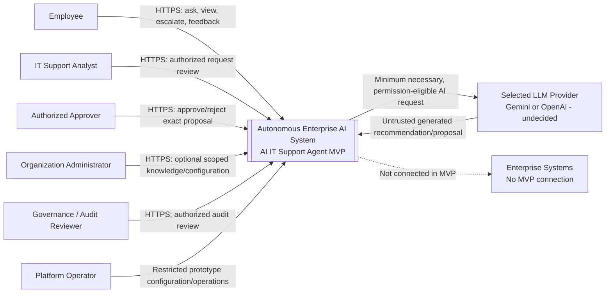
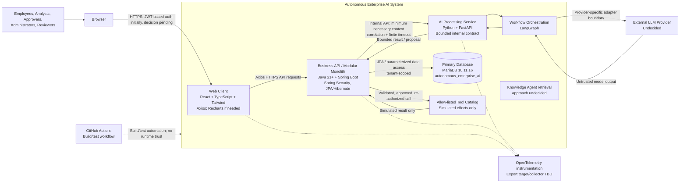
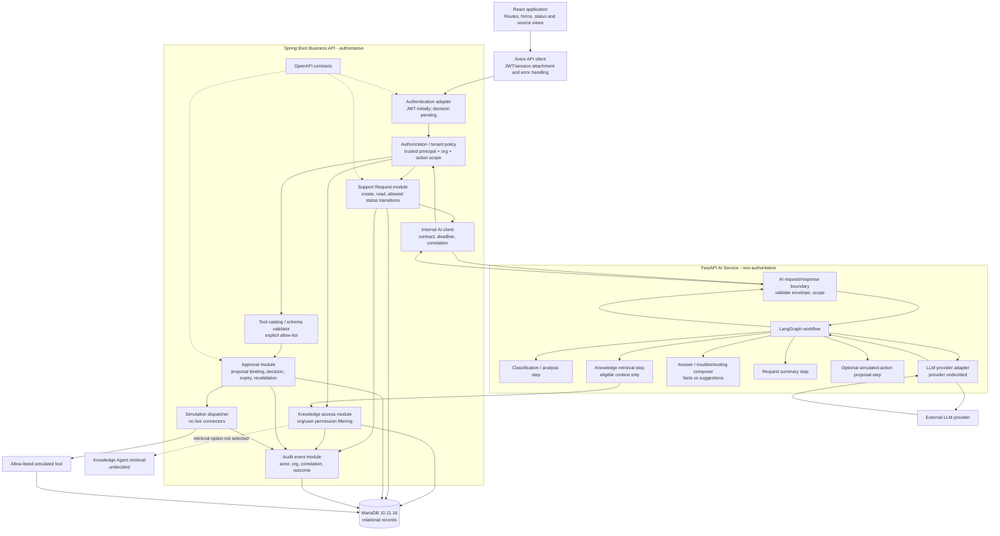
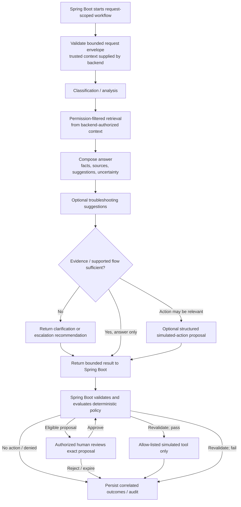
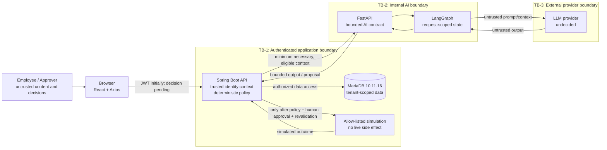

# System Architecture: Autonomous Enterprise AI System

## 1. Document Control

| Field | Value |
|---|---|
| Product | Autonomous Enterprise AI System |
| Initial use case | AI IT Support Agent |
| Document | System Architecture |
| Version | 1.0 |
| Status | Draft for enterprise architecture review |
| Date | 2026-11-13 |
| Source baseline | PRD v1.0, SRS v1.0, Use Cases v1.0, Threat Model v1.0 |
| Owner | Enterprise Architecture |
| Scope | MVP logical and high-level architecture |

This architecture describes a proposed logical design constrained by the approved product, software, use-case, and security requirements. It is not evidence that the components or controls are implemented, and it makes no claim of production readiness, compliance, or security certification.

## 2. Architecture Overview

The Autonomous Enterprise AI System is a bounded AI IT-support prototype. A React web client calls a Java 21+ Spring Boot business API, which is the authoritative application and policy boundary. The API persists organization-scoped request, approval, knowledge metadata, and audit data in MariaDB 10.11.16. Knowledge Agent retrieval technology remains undecided. For AI-assisted processing, the API calls a Python FastAPI service; LangGraph coordinates a finite, configured workflow and an undecided external LLM provider. The AI service returns recommendations or structured proposals to the Java API for validation.

The product deliberately separates four decision types:

| Decision type | Authority | Examples |
|---|---|---|
| AI-generated recommendation | FastAPI/LangGraph workflow using the LLM | Classification, answer draft, troubleshooting suggestions, summary, possible simulated-action proposal. Untrusted and not authoritative. |
| Deterministic business decision | Spring Boot API and its policy/application logic | Identity context, tenant/resource access, tool allow-list/schema checks, proposal eligibility, approval state, request status, execution gating. |
| Human approval decision | Authenticated, authorized reviewer through the application | Explicit approve/reject for the exact unchanged simulated proposal; it does not override backend policy. |
| Simulated tool outcome | Allow-listed simulation invoked only through the Java API | A bounded prototype result with no live enterprise side effect. |

The MVP uses controlled demo identity and synthetic or explicitly approved demo knowledge. It does not integrate with live ticketing, identity, device, email, software deployment, or other enterprise systems. Redis is optional and justified only by measured need; Docker/containerization is planned for a later phase.

## 3. Architecture Goals and Principles

1. **Business authority is explicit:** Spring Boot owns application workflows, deterministic authorization, approval state, and execution gating.
2. **AI is bounded and non-authoritative:** FastAPI/LangGraph can recommend or propose; they cannot authenticate, authorize, approve, or directly invoke tools.
3. **Least privilege and data minimization:** Pass only task-relevant, permission-eligible data to each component and the selected provider.
4. **Tenant isolation is end-to-end:** Organization and user permissions are enforced server-side for relational data, vector search, workflow state, approval records, audit views, and any future cache.
5. **Human control before action:** Every enabled MVP simulation requires explicit authorized approval of an immutable proposal, followed by execution-time policy revalidation.
6. **Safe-by-default integration boundary:** MVP tools are an allow-listed simulated catalog; no live integration credentials or enterprise mutations are available.
7. **Modular monolith before microservices:** Keep business capabilities as modules within the Spring Boot application and AI workflow as a bounded FastAPI service; do not introduce unnecessary distributed services.
8. **Failure is explicit:** Timeouts and component failures fail closed for protected content/actions, never become success-shaped fallbacks, and expose an accurate state or escalation path.
9. **Auditability by design:** Sensitive workflows create correlated, attributable audit events with minimal sensitive content.
10. **Provider-neutral boundary:** Keep the LLM provider replaceable and undecided until a documented architecture and data-handling decision is made.
11. **Local-first development:** Initial development must not require Docker or Redis; use the agreed stack and local service prerequisites.
12. **No unsupported assurance:** Architecture and demonstrations must not claim production readiness, certification, or compliance.

## 4. Architecture Drivers and Constraints

### Drivers

- Demonstrate employee self-service and useful IT support while retaining human escalation.
- Establish reusable foundations for bounded agent orchestration, permission-aware retrieval, approvals, and audit review.
- Enable enterprise review of authorization, privacy, tenant isolation, provider data handling, and safe failure.
- Preserve clear contracts between the frontend, authoritative business API, AI service, data store, and model provider.
- Support measurable prototype response quality and a p95 answer-only target from the SRS without implying an SLA.

### Constraints

- **Approved MVP:** internal support requests, demo identity, curated synthetic/approved demo knowledge, bounded AI response/proposal workflow, optional feedback, allow-listed simulated actions, human review, and important audit events.
- **Not in MVP:** live service-desk, identity, device, email, software deployment, or other enterprise integration; live system mutation; unrestricted tools; production SLAs; formal certification/compliance claims.
- **Authoritative service:** Java 21+ / Spring Boot with Spring Security and Spring Data JPA/Hibernate; Maven.
- **AI boundary:** Python / FastAPI; LangGraph stateful coordination; provider not finalized.
- **Persistence:** MariaDB 10.11.16 is the primary relational store. Local database environment: XAMPP; management interface: phpMyAdmin; database name: `autonomous_enterprise_ai`. Knowledge Agent retrieval technology is unresolved.
- **Frontend:** React, TypeScript, Tailwind CSS, Axios; Recharts only for lightweight prototype metrics presentation if required by the agreed product surface, not a standalone analytics product.
- **Other:** JWT-based authentication initially, subject to the documented authentication decision; OpenAPI/Swagger; OpenTelemetry; GitHub Actions.
- **Optional/deferred:** Redis only when justified; Docker/containerization in a later phase and not required for local development.
- Secrets are stored outside source control and never committed to Git.

## 5. System Context Diagram (C4 Level 1)



The system context excludes any direct user-to-LLM or agent-to-enterprise-system execution path. A model response returns to the application as untrusted content for validation and presentation.

## 6. Container Architecture Diagram (C4 Level 2)



MariaDB 10.11.16 is the source of truth for application state. Knowledge Agent retrieval is shown separately because no vector-search alternative is selected. Redis is not shown because it is optional and not required by the MVP. Docker is not shown as a local-development prerequisite; containerization is a later deployment decision. OpenTelemetry is instrumentation, not a claim that a collector or observability platform is already selected.

## 7. Component Architecture Diagram (C4 Level 3)

The following is a logical component view, not a required package/class decomposition. Business components remain modules within the Spring Boot application; no extra microservices are implied.



The diagram distinguishes logical AI steps from deterministic Spring Boot modules. In implementation, authorization should be applied before data access and passed as trusted, minimal context; the AI service must not call `Executor`, `Catalog`, or approval components directly.

## 8. Technology Stack and Responsibilities

| Technology | Architectural responsibility | MVP status / boundary |
|---|---|---|
| React | Browser user interface for support conversations, requests, source attribution, escalation, review, and status. | Required frontend framework. |
| TypeScript | Static typing for frontend components and API contracts. | Required. |
| Tailwind CSS | Frontend styling and design-system utility layer. | Required. |
| Axios | HTTP client from the browser to the Java business API. | Required; authentication/session handling must follow the chosen JWT/session design. |
| Recharts | Optional lightweight visual presentation of prototype metrics if such a view is included. | Do not infer a production analytics dashboard or broader reporting scope. |
| Java 21+ | Runtime for authoritative business API and policy modules. | Required. |
| Spring Boot | Business API, modular application services, and internal AI client. | Authoritative backend. |
| Spring Security | Authentication integration and server-side authorization enforcement. | JWT-based authentication initially, subject to the open identity decision. |
| Spring Data JPA / Hibernate | Relational persistence for application entities and transactions. | Required persistence framework; use tenant-scoped access patterns. |
| Maven | Java build and dependency management. | Required. |
| Python | AI service runtime. | Required. |
| FastAPI | Internal AI processing API boundary. | Not the authoritative business or policy API. |
| LangGraph | Stateful orchestration for bounded configured AI steps. | No direct tool authorization or unrestricted execution. |
| MariaDB 10.11.16 | Primary relational system of record. | Required; local environment is XAMPP, management interface phpMyAdmin, database `autonomous_enterprise_ai`. |
| Knowledge Agent retrieval | Search over curated, permission-filtered knowledge. | Alternative not selected; see ADR-0008. |
| JWT | Initial authentication token approach. | Subject to authentication decision; claims must be verified and server-derived context trusted. |
| OpenAPI / Swagger | Business and internal API contract documentation. | Required for service interfaces. |
| OpenTelemetry | Common instrumentation for traces/metrics/log correlation. | Use where available; exporter, collector, retention, and backend remain open. |
| GitHub Actions | Build/test automation and quality checks. | CI only; not a runtime dependency. Secrets use protected configuration, not repository files. |
| Redis | Optional cache. | Not required; introduce only for a justified, measured need and tenant-safe cache design. |
| Docker | Containerization. | Planned for a later phase, not required for initial local development. |
| Gemini API / OpenAI API | External LLM provider. | Provider is undecided; no selection is made here. |

No additional database, broker, API gateway, service mesh, or microservice is required by this architecture.

## 9. Frontend Architecture

### Responsibilities

- Provide employee flows to create, view, and track internal requests; display responses, citations, suggestions, uncertainty, escalation, and accurate processing state.
- Provide approver flows that display the exact proposal, target/context, parameters, expected effect, and simulation label before explicit approval/rejection.
- Provide role-scoped operational/audit review and optional feedback/knowledge configuration only where the corresponding MVP-SRS Should capability is enabled.
- Use Axios as the API boundary. Browser-side display or validation improves usability but is never authoritative for identity, authorization, status, or action eligibility.
- Use React and TypeScript for page, feature, and shared UI structure; Tailwind CSS for styling.
- Use Recharts only if a lightweight MVP metrics display is explicitly required; metrics must remain the prototype evaluation described in the SRS.

### Security and failure behavior

- Attach JWT/session credentials according to the final authentication design; never store secrets in source code or browser bundles.
- Treat all displayed model output, request content, and source metadata as untrusted until the business API validates and returns them.
- Do not infer authorization from a hidden route, role label, client-side organization ID, or opaque request identifier.
- Present backend outcomes accurately; distinguish answered, escalated, awaiting approval, rejected, failed, and unavailable.
- Provide keyboard-operable controls and clear labels for question, source, status, escalation, and approval flows.

## 10. Java Backend Architecture

The Java 21+ Spring Boot application is a **modular monolith** and the authoritative business API. The modules below are logical responsibilities, not separate deployables.

1. **API / contract module:** Exposes authenticated business operations and OpenAPI/Swagger contracts for requests, status, escalation, review/approval, and simulated action lifecycle.
2. **Identity adapter:** Integrates the configured JWT-based authentication approach initially. Validates tokens and derives a trusted principal and organization context; the final identity model remains a decision.
3. **Authorization and tenant policy:** Applies deterministic user, organization, role, resource, and action policy on each protected operation.
4. **Support request module:** Creates organization-scoped internal requests, reads permitted records, and performs only allowed workflow status transitions.
5. **Knowledge access module:** Coordinates organization- and user-permission-aware knowledge search, ensuring unauthorized content is filtered before AI/model input.
6. **AI orchestration client:** Calls the FastAPI internal service using a defined contract, minimum necessary trusted context, request/organization correlation, and finite deadlines. Validates the response envelope and proposals.
7. **Policy and proposal module:** Validates tool name, schema, actor, organization, action eligibility, approval state, and proposal integrity.
8. **Approval module:** Presents and records explicit human decisions tied to an exact proposal, enforces validity/expiry and invalidation, and revalidates policy at execution.
9. **Tool catalog and simulation dispatcher:** Exposes only explicit allow-listed simulated actions. No real enterprise connectors or credentials are provided.
10. **Persistence module:** Uses Spring Data JPA/Hibernate with MariaDB 10.11.16 transactions for application state. The retrieval store/search path is not yet selected.
11. **Audit module:** Records critical request, retrieval reference, policy, approval, configuration, and tool events with actor, organization, time, outcome, and correlation context.
12. **Error and state module:** Applies explicit status/error mapping and fail-closed behavior; no success-shaped fallback for unavailable services or unconfirmed execution.

Spring Security enforces authentication and request authorization, but business authorization must still be explicit for each resource/action. Database persistence, critical audit events, and approval transitions must be consistent enough to prevent stale approval or duplicate simulation.

## 11. Python AI Service Architecture

FastAPI hosts the bounded AI-processing boundary. It is called by the Spring Boot API over an internal contract and is not exposed as an independent business API or tool-execution surface.

### Responsibilities

- Validate the internal request envelope and correlation context.
- Coordinate LangGraph workflows for configured classification, permission-filtered retrieval use, answer composition, troubleshooting suggestions, summaries, clarification/escalation recommendations, and optional simulated action proposals.
- Call the selected LLM provider through a provider-specific adapter with minimum necessary, permission-eligible data.
- Return bounded structured outputs and source references for Java-side validation.
- Enforce finite timeouts and surface invalid output/provider/service errors explicitly.

### Prohibited responsibilities

- Resolve or override trusted identity and organization membership.
- Make authorization, approval eligibility, or request-status decisions.
- Retrieve unauthorized content or apply permissions after generation.
- Directly execute tools, access live enterprise systems, or hold ambient enterprise credentials.
- Report action success without a confirmed Java backend result.

Service-to-service authentication, network controls, and protected transport are required design topics but remain unresolved implementation/deployment decisions. Do not assume they are already deployed.

## 12. LangGraph Agent Orchestration Architecture

LangGraph coordinates bounded stateful workflow steps. Named agents are logical workflow roles rather than independent security principals.



### Workflow controls

- The API provides trusted principal/organization context; the graph does not infer it from prompts.
- The workflow graph contains only configured nodes and finite transitions. Its state is correlated and isolated by request and organization.
- Retrieval results must be permission-filtered before they enter graph/model context.
- User request and retrieved content are untrusted instructions/data.
- Model output and proposals are validated by the business API; the graph has no direct edge to the simulated tool executor.
- Every enabled simulated action goes through deterministic policy, authorized human approval, and execution-time revalidation.
- AI/provider failures, invalid outputs, or expired deadlines return accurate unavailable/failed/escalated states.

## 13. Knowledge Retrieval and RAG Architecture

1. **Corpus:** A small curated synthetic or explicitly approved demo collection; broad unrestricted ingestion is out of MVP scope.
2. **Metadata:** Each knowledge record/chunk has organization scope and applicable permission attributes sufficient for the MVP access model.
3. **Authorization first:** Trusted organization and user permissions are resolved by the Java API before retrieval. Query predicates are applied before eligible content reaches FastAPI/LangGraph or the LLM.
4. **Search:** MariaDB 10.11.16 stores relational metadata. The retrieval approach (separate vector database, external vector-search service, or temporary non-vector search) remains unresolved; any implementation must apply deterministic organization and permission constraints before content reaches AI/model input.
5. **Prompt context:** The AI service receives only the eligible subset and minimum context needed to answer the support request.
6. **Citation validation:** The model may return source references, but the Java API verifies each against actual retrieved, authorized sources before presenting citations.
7. **Response semantics:** Present source-backed facts separately from suggestions and uncertainty. If evidence is insufficient or conflicting, say so and provide clarification/escalation rather than fabricate a citation.
8. **Content trust:** Retrieved documents, including approved documents, remain untrusted input. Their instructions cannot modify policy, permissions, workflow, or tool allow-lists.
9. **Optional administration:** If enabled, knowledge changes are authenticated, organization-scoped, permission-attributed, and auditable. This remains MVP-Should.
10. **Failure:** Retrieval failure does not become an unsupported verified answer. The system reports unavailable/insufficient evidence and offers escalation where possible.

Redis is not required for retrieval. If later justified, cache keys and invalidation must preserve organization, user permissions, and source freshness.

## 14. Policy and Human Approval Architecture

### Deterministic policy boundary

The Spring Boot API evaluates every protected read, proposal, approval, and execution. Policy input comes from verified user/service identity, trusted organization context, explicit action/resource identifiers, validated schemas, and persisted workflow state. Policy evaluation may determine whether a proposal can be shown for review; that is not permission to execute.

### Approval lifecycle

1. Validate proposal schema and tool allow-list membership.
2. Evaluate actor/organization/action policy deterministically.
3. Persist an exact proposal in an approval-required state and display its parameters and simulated effect.
4. Authenticate and authorize the reviewer for organization and action.
5. Record an explicit approve/reject decision bound to the exact proposal.
6. Invalidate or require new review for proposal or relevant policy changes; expire stale approvals.
7. Immediately before execution, revalidate reviewer/action authorization, proposal integrity, approval state, and simulation-only tool status.
8. Persist the simulation result and audit events before reporting success.

Approval expiry duration is unresolved and must be configured before approvals are enabled. Rejection, missing/expired approval, policy denial, persistence failure, or ambiguous state prevents execution.

```mermaid
sequenceDiagram
    actor Employee
    participant AI as FastAPI / LangGraph
    participant API as Spring Boot Policy API
    actor Approver
    participant Tool as Simulated Tool
    participant DB as MariaDB / Audit

    Employee->>API: Submit support request
    API->>AI: Minimum necessary, trusted context
    AI-->>API: Untrusted recommendation / action proposal
    API->>API: Validate schema, allow-list, actor, org, policy
    alt Proposal is not eligible
        API->>DB: Record denial / outcome
        API-->>Employee: Denied, failed, or escalated state
    else Proposal is eligible for review
        API->>DB: Persist exact proposal as approval-required
        API-->>Approver: Show exact parameters and simulated effect
        Approver->>API: Explicit approve or reject
        API->>API: Authenticate reviewer; bind decision to proposal
        alt Rejected, expired, changed, or unauthorized
            API->>DB: Record decision / invalidation
            API-->>Employee: No execution; truthful status
        else Approved and currently authorized
            API->>API: Revalidate policy, proposal, approval, simulation
            API->>Tool: Invoke allow-listed simulation
            Tool-->>API: Simulated outcome
            API->>DB: Persist outcome and correlated audit
            API-->>Employee: Report confirmed simulated result
        end
    end
```

The sequence has no AI-to-tool invocation. The model cannot participate as an approver. Any failure to revalidate, execute, or persist the required state stops a success response.

## 15. Tool Execution Architecture

- **Registry:** A small explicit allow-list of documented, constrained tool identifiers and schemas.
- **Proposal source:** The AI service may return a structured proposal. The proposal is untrusted until Java validation.
- **Validation:** Spring Boot validates identifier, exact schema, organization, actor, action scope, and approval state.
- **Authorization:** Deterministic policy is evaluated before review and again immediately before execution.
- **Human approval:** Every enabled MVP simulation requires explicit authorized approval bound to the exact proposal.
- **Dispatcher:** Only the Spring Boot backend can dispatch, and only to a simulated implementation. There is no direct AI-to-tool path.
- **Result:** Tool effects are simulations only; the API records a confirmed result and audit event and then returns an accurate status.
- **Retry:** Do not repeat an ambiguous/non-idempotent invocation unless non-execution is established and a duplicate-safe retry is supported.
- **Out of scope:** No live ticketing, identity, password, access, endpoint, email, software deployment, shell, arbitrary database, or network action.

## 16. Data Architecture

### Logical data domains

| Domain | Example logical records | Organization scope / controls |
|---|---|---|
| Identity and authorization context | User/service principal, organization association, role/action scope | Trusted identity integration; do not accept client/model organization claims as authority. |
| Support workflow | Internal support request, owner, workflow status, escalation context | Every request is organization-scoped; actor/resource authorization applies to reads and transitions. |
| Knowledge | Source, chunk, embedding, source reference, permission attributes | Organization and user permission filters apply before model input. |
| Agent workflow | Request correlation, bounded workflow status, output references | Request- and organization-scoped; no cross-user/tenant state reuse. |
| Proposal and approval | Action type, validated parameters, proposal integrity, reviewer, decision, expiry | Exact proposal binding; authorized reviewer; expiry and execution-time revalidation. |
| Tool outcome | Simulated tool identifier, result, timing, outcome | Linked to authorized proposal and request; no live side effect. |
| Audit | Event type, actor/service, organization, timestamp, correlation, outcome, resource references | Access controlled and tenant scoped; minimize content; retention policy unresolved. |
| Optional feedback/configuration | Response feedback; curated knowledge/admin settings | MVP-Should only; organization scope and attribution. |

MariaDB 10.11.16 is the primary source of truth. InnoDB transactions and foreign keys are required for modeled relational integrity; JPA/Hibernate and MariaDB-compatible migrations must be version-pinned and verified. MariaDB's JSON type is an alias for LONGTEXT with JSON validation, not a native binary JSON type; indexing must use MariaDB-supported mechanisms and measured access patterns. InnoDB full-text search is available for supported text columns, with tokenization and stopword limitations. The vector retrieval alternative remains undecided. Transaction boundaries should preserve request/approval/execution linkage and prevent stale or duplicate action transitions. The exact schema, migrations, indexing, database roles, encryption, key management, backup, retention, and deletion decisions are implementation work, not assumed capabilities.

## 17. Authentication and Authorization Architecture

- **Initial approach:** JWT-based authentication is the requested starting point, subject to the unresolved authentication decision documented in the SRS and Threat Model.
- **Validation:** Spring Security validates the selected JWT issuer/signature, expiry, and required claims according to the eventual decision. No issuer, algorithm, audience, key distribution, or token lifetime is selected by this document.
- **Principal:** The backend resolves a trusted principal and organization context. Request payload, browser state, prompt content, or LLM output cannot override it.
- **Authorization:** Spring Boot enforces role, organization, resource, and action policies on every protected endpoint and again before simulated execution.
- **Reviewer:** Approval rights are explicit and scoped to organization and action; viewing a proposal is not approval.
- **AI service:** A service identity and internal-call authentication/transport controls must be designed; AI responses remain untrusted and cannot assert user authority.
- **Client:** UI route hiding and client-side checks are usability features only; API policy is authoritative.
- **Open decisions:** Demo identity mechanism, JWT issuer/provisioning, refresh/revocation/session lifecycle, reviewer role assignment, and service-to-service identity.

## 18. Organization-Level Data Isolation

1. Organization context is derived from verified server-side authentication or service context.
2. Every organization-owned relational object, vector query, workflow state, proposal, approval, audit query, and optional feedback/configuration record is associated with an organization.
3. Spring Boot enforces tenant/resource scope on all reads, writes, status transitions, and configuration operations; opaque IDs do not grant access.
4. Knowledge search applies organization and user permission filters before candidate content is passed to the AI service/model.
5. Agent state and internal API payloads are correlated and isolated by request and organization; no state reuse may expose another context.
6. Source names, snippets, errors, analytics, and audit views are subject to the same access checks.
7. Acceptance tests use at least two organizations and differing user permissions, verifying request, knowledge, proposal, approval, and audit denial.
8. If Redis is introduced later, cache keys and invalidation include tenant, permission, and freshness context. Redis is not part of MVP correctness.

## 19. API Communication Architecture

### Browser to Spring Boot

- HTTPS business API documented with OpenAPI/Swagger.
- Axios sends authenticated user requests under the selected JWT-based approach.
- The API validates identity, organization, payload, resource, and operation; client-side checks are not trusted.
- API errors return safe, truthful states without protected data.

### Spring Boot to FastAPI

- Internal bounded API contract; Spring Boot remains the API authority for business state.
- Request includes minimum necessary trusted context, request/organization correlation, eligible knowledge references/content as designed, and a finite deadline.
- FastAPI returns bounded content/proposal and workflow outcome; Spring Boot validates it before display or state change.
- FastAPI exposes no unauthenticated public tool-execution endpoint.
- Service identity, internal network exposure, authentication, and transport protection remain deployment decisions to resolve.

### FastAPI to LLM provider

- Provider adapter isolates Gemini/OpenAI-specific request/response handling; provider remains undecided.
- Only task-relevant, permission-eligible data is sent; secrets and unnecessary personal data are excluded.
- Provider credentials/configuration are supplied from trusted configuration outside prompts/source control.
- Provider data terms and organizational approval are required before non-synthetic organizational data is processed.

### Backend to persistence and simulated tools

- Spring Data JPA/Hibernate accesses MariaDB 10.11.16 under organization-scoped business rules.
- The selected Knowledge Agent retrieval path must apply permission constraints before generation; the retrieval technology is undecided.
- Only validated, authorized, human-approved actions reach the simulated dispatcher.
- Redis, if later justified, is optional and cannot become the source of truth.

## 20. Error Handling and Resilience

- **Finite deadline:** Answer-only MVP requests have a bounded end-to-end deadline no greater than 10 seconds, consistent with the SRS; approval wait is outside that deadline. Downstream timeouts fit within the remaining budget.
- **Retries:** At most one retry for transient, idempotent downstream reads when time permits. No retries of authorization/policy denials. Non-idempotent tool execution is not retried after ambiguous outcome unless non-execution is established and duplicate safety is assured.
- **AI/provider failure:** Mark unavailable/failed or offer escalation; never treat invalid or missing model output as verified facts or successful action.
- **Retrieval failure/no evidence:** State that an answer cannot be verified; offer clarification/escalation.
- **Policy/authentication failure:** Fail closed for protected content, approval, and tool execution.
- **Approval failure:** Missing, rejected, expired, changed, or unvalidated approval prevents execution.
- **Persistence/audit failure:** Do not report a fully successful workflow when critical state or audit persistence fails; avoid unsafe replay.
- **Tool timeout:** Return failed/unknown as appropriate; no success claim without confirmed result.
- **Status:** Java backend state is authoritative. UI must not substitute a cached model narrative for current status.
- **No production resilience claims:** This logical architecture does not define availability, disaster recovery, or production SLA.

## 21. Security and Trust Boundaries



### Trust boundaries

| Boundary | Trust interpretation | Architectural control |
|---|---|---|
| Browser -> Spring Boot | Browser and all client fields are untrusted. | Authenticate; derive principal/organization server-side; validate inputs and authorize each operation. |
| Spring Boot -> FastAPI/LangGraph | AI service is a constrained processor, not a policy authority. | Internal contract, minimum data, request correlation, finite timeouts, validate all output. |
| FastAPI -> LLM provider | External third-party trust boundary; provider undecided. | Synthetic/demo data by default, data minimization, secret separation, provider review before real data. |
| Application -> MariaDB / retrieval component | Persistent organization data and any retrieval embeddings/index are sensitive. | Organization/user scope, controlled access, integrity linkage, audit and data lifecycle review; retrieval provider boundary remains undecided. |
| Backend -> simulated tools | Side-effect boundary, although MVP effects are simulated. | Strict allow-list/schema, deterministic authorization, human approval, revalidation, bounded simulation. |
| Human approver -> approval API | Human decision is trusted only after identity and role verification. | Explicit decision, exact proposal binding, expiry, audit; approval does not override policy. |
| Operator/admin -> configuration | Privileged configuration boundary. | Explicit role, organization scope, attributable changes; prevent silent tool expansion. |

### Mandatory security properties

- Treat LLM output, request/ticket descriptions, retrieved documents, citations, and tool parameters as untrusted input.
- Enforce authorization in deterministic Spring Boot policy, never solely in prompts or LLM responses.
- Filter knowledge by organization and user permissions before it reaches the model.
- Require human approval for each enabled MVP simulated action and revalidate at execution time.
- Keep all MVP external actions simulated; no direct enterprise integrations or production credentials.
- Audit sensitive request, retrieval, policy, approval, configuration, and tool workflows.
- Store secrets outside source control; never commit them to Git or place them in prompts/logs.
- Do not assume encryption, network segmentation, immutable audit, secret vault, or production controls exist until designed and evidenced.

## 22. Observability and Audit Architecture

- Instrument frontend/API/AI-service request paths using OpenTelemetry where practical, propagating a correlation identifier across Spring Boot, FastAPI, LangGraph, and tool outcomes.
- Capture prototype-level request outcomes, latency, failures, approval decisions, and tool outcomes without unnecessary sensitive content.
- Persist application audit events for material request lifecycle changes, retrieval source references/access context, deterministic policy decisions, approval/rejection, tool attempt/result, and enabled configuration changes.
- Include event type, timestamp, actor/service, organization, request/correlation identifier, outcome, and relevant proposal/resource reference where applicable.
- Do not put credentials, secrets, full prompts/documents, or unnecessary personal data into routine logs. Audit records are sensitive and tenant-scoped.
- Use MariaDB 10.11.16 as the authoritative application/audit persistence for MVP. An external SIEM, collector, alerting product, immutable log storage, or specific retention policy is not selected.
- OpenTelemetry exporter/collector, trace sampling, metric cardinality, retention, access separation, and alert ownership are open decisions.
- A critical audit persistence failure must not result in a success-shaped approval/execution response.

## 23. Local Development Architecture

Initial development should run without Docker or Redis:

1. Run the React/TypeScript frontend using the project's chosen local frontend tooling.
2. Run the Spring Boot business API on the locally configured Java 21+ runtime and Maven build.
3. Run the Python FastAPI service and LangGraph workflow in the selected Python environment.
4. Connect application services to MariaDB 10.11.16 using the local XAMPP environment and the `autonomous_enterprise_ai` database, with a synthetic/demo dataset. phpMyAdmin is the management interface. Do not assume that XAMPP or phpMyAdmin is the production deployment architecture.
5. Configure a selected LLM provider only after the provider decision; use synthetic/demo data and keep provider credentials in local environment/configuration outside source control.
6. Use JWT-based authentication only after the initial mechanism/configuration decision; use controlled demo identities.
7. Use OpenAPI/Swagger for API inspection and OpenTelemetry instrumentation as configured; no external observability backend is assumed.
8. Use GitHub Actions for build/test automation; CI secrets use protected GitHub configuration and must not be stored in tracked files.

Developer-local configuration and test data must not include real secrets or real employee data. Containerization and a shared development deployment may be considered later; they are not prerequisites for MVP implementation.

## 24. Scalability and Future Evolution

### MVP scaling posture

- Keep the business backend a modular monolith to minimize deployment and distributed-consistency complexity.
- Keep the AI service as one bounded service because it has a distinct Python/LangGraph runtime; do not split logical agents into microservices.
- Use MariaDB 10.11.16 for relational workloads. The Knowledge Agent retrieval strategy remains open; measure retrieval quality and operational/security trade-offs before selecting infrastructure.
- Apply finite timeouts and bounded workflows; measure response p50/p95 using the SRS environment and target.
- Avoid availability, throughput, multi-region, or disaster-recovery claims not specified in the product requirements.

### Possible future evolution (not MVP commitments)

- Consider containerization with Docker after prototype validation and deployment requirements are defined.
- Consider Redis only if measured latency/load needs justify caching and tenant-safe invalidation is designed.
- Evaluate a limited real integration only after separate threat modeling, identity/provider/data review, operational readiness, and explicit approved scope.
- Reassess service decomposition only when concrete independent scaling, ownership, or availability drivers justify it.
- Expand to additional workflows only with use-case-specific authorization, data, approval, evaluation, and threat-model reviews.

## 25. Architecture Risks and Trade-offs

| Risk / trade-off | Consequence | Architectural response / limitation |
|---|---|---|
| AI output is nondeterministic | Wrong answers, misleading classifications, or malformed proposals. | Label facts vs suggestions, validate structure/citations, escalate uncertainty, and keep authorization/action gates deterministic. |
| Permission-aware vector search is easy to misconfigure | Cross-organization disclosure may occur before UI filtering. | Filter before model input; test multiple tenants and permissions; treat a regression as a release blocker. |
| Human approval may create latency or fatigue | Lower convenience or reviewers may approve without adequate attention. | Show exact proposal and expected simulated effect; no broad standing approval; evaluate flow usability. |
| Modular monolith concentrates business responsibilities | Requires disciplined module boundaries and can become coupled. | Keep explicit API/domain boundaries; avoid microservices without an evidenced need. |
| Separate Python AI runtime adds operational boundary | Internal service failure, impersonation, or contract drift. | Defined internal contract, minimum context, correlation, finite timeout, output validation; service identity details remain open. |
| Third-party LLM provider is external and undecided | Data-handling terms, latency, availability, and behavior are unknown. | Keep provider adapter replaceable; synthetic data by default; provider review is a gate for real data. |
| Relational persistence and Knowledge Agent search are separate unresolved concerns | Search availability or stale permission metadata could affect retrieval while relational workflows remain available. | Keep MariaDB as relational source of truth; evaluate retrieval options independently; fail safely and filter before model input. |
| Auditability vs privacy/retention | More event detail improves investigation but increases sensitive data exposure and lifecycle burden. | Record decision-relevant metadata, minimize content, scope audit access, decide retention before real data. |
| JWT is an initial direction, not a complete identity design | Token lifecycle, issuer, claims, revocation, and service identity remain undefined. | Do not infer a final security model; resolve the authentication decision and test claims/tenant mapping before deployment. |
| Prototype controls may be mistaken for production controls | Stakeholders may overestimate readiness or assurance. | Explicitly label the prototype, document unresolved decisions, and make no certification or production-readiness claims. |

## 26. Open Architecture Decisions

1. **LLM provider:** Gemini API or OpenAI API; compare data use/retention, regional handling, provider security, model behavior, cost, latency, and organizational approval. No provider is selected here.
2. **JWT/authentication design:** Demo identity source, issuer, signing algorithm and key lifecycle, audience/claim mapping, expiration/refresh/revocation, browser storage/session handling, and future enterprise identity provider.
3. **Service-to-service security:** FastAPI service identity, internal API authentication, network exposure, and transport protection.
4. **Approval validity:** Numerical expiry duration, configuration ownership, and exact invalidation semantics before approvals are enabled.
5. **Data lifecycle:** Retention/deletion for requests, feedback, knowledge, embeddings, and audit events before real employee data is considered.
6. **Secrets management:** Approved local, CI, and later deployment secret storage/rotation/access approach; secrets must remain outside source control/Git.
7. **Database deployment controls:** MariaDB roles, encryption/key management, backup/restore, migration workflow, environment separation, and operational access.
8. **Observability deployment:** OpenTelemetry exporter/collector, storage backend, trace sampling, access controls, retention, alert ownership, and handling of sensitive attributes.
9. **API abuse controls:** Request size, rate/concurrency limits, provider cost guardrails, and operational response for the selected deployment.
10. **Tool catalog governance:** Who reviews/enables each simulation, its schema and expected effect, and who can disable it. No enabled tool until allow-list review is complete.
11. **Knowledge lifecycle:** Content owner/approver, permission metadata model, source freshness, and optional administrator management enablement.
12. **Redis:** Introduce only if measurement establishes a need; decide cache scope/invalidation only then.
13. **Docker/containerization and deployment topology:** Later phase; determine hosting/network/environment controls before any shared or external deployment.
14. **Frontend metrics:** Whether a small Recharts view is needed for prototype evaluation, without expanding into a production analytics dashboard.
15. **Optional MVP-Should features:** Whether feedback and administrator knowledge/configuration are enabled.
16. **Knowledge Agent retrieval:** Compare a separate vector database, an external vector-search service, and temporary non-vector retrieval against quality, pre-retrieval permission filtering, revocation freshness, privacy/data handling, latency, cost, operations, and failure behavior. Do not select an alternative without evidence.

Until relevant decisions are resolved, use synthetic/demo data, keep dependent capabilities disabled, and do not claim that a future control is already present.

## 27. Architecture Traceability Matrix

| Architecture area | PRD alignment | SRS alignment | Use case / threat-model alignment |
|---|---|---|---|
| Product boundary and internal support request | PRD Sections 2, 5, 10, 15, 16 | SRS Sections 3–5, 14, 27 | UC-002, UC-003, UC-011; no live ticketing in MVP |
| Frontend and status/evidence presentation | PRD FR-004, FR-005, FR-013, FR-018, FR-020 | SRS-FR-004, SRS-FR-005, SRS-FR-013, SRS-FR-018, SRS-FR-020; SRS-NFR-006, SRS-NFR-008 | UC-003, UC-005, UC-006, UC-011 |
| Authoritative Java API and deterministic policy | PRD FR-001, FR-006, FR-008; NFR-001 | SRS-FR-001, SRS-FR-006, SRS-FR-008; SRS-AUTHZ-001–009; SRS-API-001–004 | UC-001, UC-008, UC-011; THR-001, THR-006 |
| Python/FastAPI and LangGraph bounded processing | PRD FR-006, FR-019; NFR-009, NFR-013 | SRS-AI-001–009; SRS-API-004–006, SRS-API-009; SRS-NFR-009, SRS-NFR-013, SRS-NFR-017–018 | UC-004, UC-006, UC-007, UC-012; THR-007, THR-008, THR-012, THR-013, THR-016 |
| Permission-aware MariaDB-backed knowledge metadata and unresolved retrieval | PRD FR-003, FR-015, FR-019; NFR-002–003 | SRS-FR-003, SRS-FR-015, SRS-TEN-001–007, SRS-RAG-001–009, SRS-DB-001–003 | UC-005, UC-014; THR-004, THR-008–010 |
| Approval and simulated tools | PRD FR-007–011, FR-014; Section 18 | SRS-FR-007–011, SRS-FR-014, SRS-HITL-001–010, SRS-TOOL-001–010 | UC-008–UC-010; THR-006, THR-011, THR-015, THR-021 |
| Organization isolation and authentication | PRD FR-001–003; NFR-001–002 | SRS-AUTH-001–006, SRS-AUTHZ-001–009, SRS-TEN-001–007 | UC-001, UC-003, UC-005; THR-001, THR-009, THR-017 |
| Audit and operational visibility | PRD FR-012, FR-018; NFR-004, NFR-011 | SRS-FR-012, SRS-AUD-001–009, SRS-REP-001–005, SRS-NFR-011 | UC-013; THR-003, THR-018 |
| Safe failure, timeouts, and resilience | PRD FR-020; NFR-005, NFR-007 | SRS-NFR-005, SRS-NFR-007, SRS-NFR-015–019, SRS-ERR-001–011, SRS-PR-001–008 | UC-002, UC-007, UC-010; THR-005, THR-020, THR-021 |
| Provider privacy and secrets | PRD FR-019; Sections 16–17 | SRS-NFR-003, SRS-NFR-013–014, SRS-AI-009, SRS-API-006, SRS-SEC-008–012, SRS-DB-007–008 | UC-002, UC-012; THR-014 |
| Optional admin/feedback and future components | PRD FR-016–017, Sections 15–16, 22 | SRS-FR-016–017, SRS-REP-004, SRS-DB-004; SRS-NFR-012 | UC-014–015; THR-019; optional features remain conditional |

This matrix points to existing approved requirements; it does not create new product scope. All referenced identifiers and their normative wording remain governed by the SRS.
