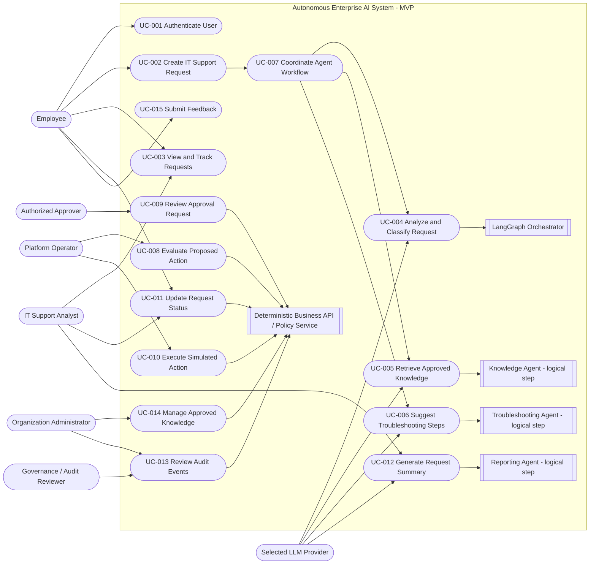

# Use Cases: Autonomous Enterprise AI System

## 1. Document Control

| Field | Value |
|---|---|
| Product | Autonomous Enterprise AI System |
| Initial use case | AI IT Support Agent |
| Document | Use Case Specification |
| Version | 1.0 |
| Status | Draft for engineering and stakeholder review |
| Date | 2026-11-13 |
| Source documents | [PRD.md](./PRD.md), [SRS.md](./SRS.md) |
| Owner | Business Analysis and Enterprise Architecture |

This document elaborates the approved MVP behavior in the PRD and SRS; it does not add authority, live integrations, or product scope. “Ticket” means an internal support request and workflow record, not a live service-desk ticket. Named AI agents are logical, bounded workflow roles coordinated by LangGraph; they do not imply unrestricted or independently deployed agents.

## 2. Introduction and Purpose

This document describes user- and system-level use cases for the AI IT Support Agent. It is intended to align product, engineering, QA, security, and business stakeholders on actors, workflow boundaries, expected outcomes, and failure handling.

The scenarios distinguish:

- **AI recommendations:** classifications, summaries, retrieved-source-based answers, troubleshooting suggestions, and action proposals. These may be uncertain and are not authorization decisions.
- **Deterministic system decisions:** authentication, organization and knowledge access checks, policy evaluation, approval-state validation, ticket/request status, and tool execution gating. These are enforced by the Java Spring Boot business API.
- **Human decisions:** an authorized human explicitly approves or rejects the exact proposed simulated action.

## 3. System Scope

### In scope for MVP

- Authenticated demo-user access and trusted server-side organization context.
- Creation, viewing, and status tracking of internal IT support requests.
- Bounded AI classification, permission-aware retrieval from curated demo knowledge, source-attributed answers, troubleshooting suggestions, and request summaries.
- A LangGraph-orchestrated workflow whose outputs are validated by the authoritative business API.
- Deterministic policy evaluation and an explicitly allow-listed set of simulated actions.
- Human approval before every enabled simulated action.
- Escalation, operational review of important audit events, and prototype evaluation feedback.
- Optional organization-administrator management of curated knowledge and permitted roles/actions when that MVP-Should capability is enabled.

### Out of scope

- Creating, updating, or querying a live ticket in an external service-desk system.
- Live password resets, account/access changes, device operations, software installations, or any other real enterprise-system mutation.
- Unrestricted tool execution, arbitrary agent access, or model-controlled authorization.
- Broad knowledge ingestion without organization and permission metadata and review.
- A standalone analytics dashboard, production integrations, production SLAs, or claims of production readiness, compliance, or security certification.

## 4. System Actors and Responsibilities

| Actor | Responsibilities | Boundaries |
|---|---|---|
| Employee | Authenticates, creates and views own IT support requests, requests escalation, follows guidance, and may submit optional feedback. | Cannot choose trusted identity/organization via request data or approve actions unless separately authorized as a reviewer. |
| IT support analyst | Reviews escalated requests and provides human support; may also act as an authorized reviewer when separately granted the relevant approval role. | Access is organization- and role-scoped. The analyst cannot make arbitrary ticket status changes or bypass policy. |
| Authorized approver | Reviews the exact simulated proposal and explicitly approves or rejects it. | Must be authenticated and authorized for the organization/action. Approval alone never overrides backend policy. |
| Organization administrator | If optional administration is enabled, manages the organization's curated knowledge set and permitted roles/actions. | Can manage only authorized organization-scoped content/settings. |
| Governance / audit reviewer | Reviews permitted audit events and workflow outcomes. | Requires explicit audit access; an administrator role alone does not grant access to all audit data. |
| Platform operator | Maintains prototype configuration and the allow-listed simulated tool catalog. | Has no implicit end-user authority and cannot expand the action surface without attributable configuration. |
| AI Orchestrator | Logical LangGraph workflow role; coordinates configured analysis, retrieval, response, and proposal steps. | Cannot authenticate users, grant access, decide policy, approve, or directly execute tools. |
| Knowledge Agent | Logical workflow role that requests and summarizes eligible curated knowledge with source references. | Receives only permission-filtered content; cannot retrieve across organization boundaries. |
| Troubleshooting Agent | Logical workflow role that suggests bounded diagnostic steps based on the request and eligible knowledge. | Suggestions are not confirmed facts or actions; no live-system access. |
| Reporting Agent | Logical workflow role that drafts a concise summary of an authorized internal support request for review. | Summary is AI-generated content, not an authoritative status, audit record, or independent analytics product. |
| Policy service / business API | Deterministic system authority for identity context, access, policy, approval state, request status, and simulated execution gating. | This is not an AI decision and must fail closed when required checks cannot be completed. |
| LLM provider | External model provider used by the AI service after provider selection. | Provider is undecided. Receives only minimum necessary, permission-eligible data; does not authorize or execute operations. |

## 5. Use Case Diagram using Mermaid

AI roles shown inside the system boundary are logical LangGraph workflow steps, not independent authorization principals. The business API/policy service is the sole system authority for authorization and execution gating.

## 6. Use Case Index

| ID | Use case | Primary actor | MVP classification |
|---|---|---|---|
| UC-001 | User login and authentication | Employee | MVP-Must |
| UC-002 | Employee creates an IT support ticket | Employee | MVP-Must; internal request only |
| UC-003 | Employee views and tracks tickets | Employee | MVP-Must |
| UC-004 | AI analyzes and classifies a ticket | AI Orchestrator | MVP-Must |
| UC-005 | Knowledge Agent retrieves approved knowledge with source citations | Knowledge Agent | MVP-Must |
| UC-006 | Troubleshooting Agent suggests diagnostic steps | Troubleshooting Agent | MVP-Must |
| UC-007 | Orchestrator coordinates the agent workflow | AI Orchestrator | MVP-Must |
| UC-008 | Policy service evaluates a proposed action | Policy service / business API | MVP-Must |
| UC-009 | Approver reviews and decides an approval request | Authorized approver | MVP-Must for enabled simulations |
| UC-010 | System executes an approved simulated tool action | Policy service / business API | MVP-Must for enabled simulations |
| UC-011 | Employee or IT agent updates ticket status | Employee or IT support analyst | MVP-Must within defined workflow transitions only |
| UC-012 | Reporting Agent generates a ticket summary | IT support analyst | MVP-Must as bounded request summary |
| UC-013 | Administrator reviews audit events | Authorized governance / audit reviewer | MVP-Must for authorized audit review |
| UC-014 | Administrator manages approved knowledge documents | Organization administrator | MVP-Should; only if optional admin configuration is enabled |
| UC-015 | User submits feedback on AI recommendations | Employee | MVP-Should; only if feedback is enabled |

“IT agent” in UC-011 means a human IT support analyst, not an AI agent. The AI workflow may recommend an outcome, but only the business API changes the recorded request state.

## 7. Detailed Use Cases with Unique IDs (UC-001 onwards)

### UC-001 — User Login and Authentication

- **Use Case ID and Name:** UC-001 — User login and authentication
- **Primary Actor:** Employee
- **Supporting Actors:** Authentication mechanism for controlled demo identities; Java Spring Boot business API
- **Preconditions:**
  1. The user has a controlled MVP demo identity.
  2. The authentication mechanism has been selected and configured; the SRS does not prescribe a provider or protocol.
- **Trigger:** The employee opens the support application and requests an authenticated session.
- **Main Success Flow:**
  1. The client presents the configured authentication entry point.
  2. The user authenticates using the configured demo mechanism.
  3. The business API validates the authentication result.
  4. The business API resolves the user and organization from trusted server-side context.
  5. The client displays the authenticated support experience and available capabilities.
- **Alternative Flows:**
  - **A1 — Already authenticated:** The system validates the existing session and resumes the authenticated experience.
  - **A2 — User has multiple permitted capabilities:** The UI exposes only operations allowed by the server-validated role and organization context.
- **Exception Flows:**
  - **E1 — Invalid, missing, or expired authentication:** The protected operation is denied; the user is prompted to authenticate again.
  - **E2 — Identity or organization cannot be resolved:** The system fails closed, exposes no protected data, and reports a safe error.
- **Postconditions:**
  - **Success:** The business API has trusted user and organization context for subsequent requests.
  - **Failure:** No protected record, knowledge, approval, or tool operation is available.
- **Related SRS Requirement IDs:** SRS-AUTH-001, SRS-AUTH-002, SRS-AUTH-003, SRS-AUTH-004, SRS-AUTH-005, SRS-AUTHZ-001, SRS-API-002, SRS-ERR-002
- **Security and Approval Considerations:** Client-supplied identity/organization fields and prompts are not identity evidence. Authentication is not authorization; every protected operation is separately checked by deterministic backend policy. Login does not approve any action.

### UC-002 — Employee Creates an IT Support Ticket

- **Use Case ID and Name:** UC-002 — Employee creates an IT support ticket (internal support request)
- **Primary Actor:** Employee
- **Supporting Actors:** Java Spring Boot business API; AI Orchestrator; MariaDB 10.11.16; Python FastAPI AI service; selected LLM provider
- **Preconditions:**
  1. The employee is authenticated with server-resolved organization context.
  2. The MVP support request workflow is available.
- **Trigger:** The employee submits a description of an IT issue or question.
- **Main Success Flow:**
  1. The employee enters and submits the issue description.
  2. The business API validates the request and derives the actor and organization from trusted context.
  3. The business API creates an organization-scoped internal support request and correlates it to the initiating user.
  4. The business API starts the bounded AI workflow using only necessary request context.
  5. The system presents the request identifier/status and, when ready, the response or next step.
  6. The system records material request and workflow events for audit.
- **Alternative Flows:**
  - **A1 — Clarification needed:** The system asks the employee a bounded clarifying question; the employee's reply remains part of the same authorized request context.
  - **A2 — Employee requests human help:** The request enters the supported escalation path.
  - **A3 — Request maps to a simulated action:** The system creates a proposal; it does not execute it as part of ticket submission.
- **Exception Flows:**
  - **E1 — Invalid request data:** The API rejects the submission with a safe validation message; no request is falsely reported as created.
  - **E2 — Authentication, authorization, persistence, or organization resolution failure:** The operation fails closed and exposes no cross-organization data.
  - **E3 — AI service/provider unavailable or times out:** The request outcome is marked accurately as failed/unavailable or offered for escalation; no action is executed.
- **Postconditions:**
  - **Success:** An internal, organization-scoped support request exists with an accurate workflow state.
  - **Failure:** No successful request or action is claimed without backend confirmation.
- **Related SRS Requirement IDs:** SRS-FR-001, SRS-FR-002, SRS-FR-013, SRS-FR-018, SRS-AUTH-001, SRS-TEN-001, SRS-TKT-001, SRS-TKT-003, SRS-AI-001, SRS-AI-007, SRS-API-001, SRS-ERR-001, SRS-ERR-004
- **Security and Approval Considerations:** The issue description is untrusted input and cannot change identity, permissions, workflow policy, or tool allow-lists. Store and forward only task-relevant data. Creating a request is not approval. No live external ticket is created.

### UC-003 — Employee Views and Tracks Tickets

- **Use Case ID and Name:** UC-003 — Employee views and tracks tickets
- **Primary Actor:** Employee
- **Supporting Actors:** IT support analyst; Java Spring Boot business API; MariaDB 10.11.16
- **Preconditions:**
  1. The employee is authenticated.
  2. An internal support request exists, or the employee is viewing the empty request list.
- **Trigger:** The employee opens the request list or selects a request to view its status.
- **Main Success Flow:**
  1. The employee requests their support requests or a specific request.
  2. The business API verifies identity, organization, and record-level access.
  3. The system returns only requests the employee is authorized to see.
  4. The UI displays the current recorded outcome: answered, escalated, awaiting approval, rejected, or failed, as applicable.
  5. The employee may open an authorized request to view its available response, source references, and next step.
- **Alternative Flows:**
  - **A1 — No requests exist:** The UI presents an empty state and the option to create a support request.
  - **A2 — Request is escalated:** The UI presents the available status and human-support path without promising an external ticket assignment or SLA.
- **Exception Flows:**
  - **E1 — Request belongs to another user/organization or access is denied:** The API denies access without returning protected details.
  - **E2 — Status service is unavailable:** The UI reports unavailable status rather than showing a stale value as current or successful.
- **Postconditions:**
  - **Success:** The employee sees only authorized request details and the current recorded outcome.
  - **Failure:** No protected request content is disclosed and no status is misrepresented.
- **Related SRS Requirement IDs:** SRS-FR-002, SRS-FR-018, SRS-AUTHZ-003, SRS-TEN-002, SRS-TEN-005, SRS-TKT-002, SRS-TKT-004, SRS-REP-001, SRS-API-002, SRS-API-008
- **Security and Approval Considerations:** Request identifiers are not authorization. Reads are scoped by trusted organization and user policy. Viewing status or a proposal does not constitute approval.

### UC-004 — AI Analyzes and Classifies a Ticket

- **Use Case ID and Name:** UC-004 — AI analyzes and classifies a ticket
- **Primary Actor:** AI Orchestrator (logical AI workflow role)
- **Supporting Actors:** Employee; Python FastAPI AI service; LangGraph; LLM provider; Java Spring Boot business API
- **Preconditions:**
  1. An authenticated employee has submitted an internal support request.
  2. The business API has resolved the request's organization and authorized the bounded AI operation.
- **Trigger:** The business API starts the configured AI workflow for a new or updated request.
- **Main Success Flow:**
  1. The AI service receives the minimum request context through the defined internal API.
  2. The analysis step treats the description as untrusted content and classifies the request for the configured support workflow.
  3. The AI service returns a bounded classification and any uncertainty or clarification need.
  4. The business API validates the output and uses it only to route the configured workflow.
  5. The system records the workflow outcome and correlation reference.
- **Alternative Flows:**
  - **A1 — Ambiguous request:** The AI recommends clarification; the employee is asked for more information.
  - **A2 — Unsupported category:** The AI recommends human escalation or bounded guidance; no unregistered workflow is invoked.
- **Exception Flows:**
  - **E1 — Prompt injection or instructions in the description:** The content is treated as data; policy, identity, and tools remain unchanged.
  - **E2 — Invalid model output or service/provider timeout:** The business API rejects the output and marks the request unavailable/failed or offers escalation.
- **Postconditions:**
  - **Success:** A validated classification is available as an AI recommendation to the configured orchestrator.
  - **Failure:** No classification is treated as a policy or authorization decision.
- **Related SRS Requirement IDs:** SRS-FR-006, SRS-FR-020, SRS-AI-001, SRS-AI-002, SRS-AI-004, SRS-AI-005, SRS-AI-007, SRS-AI-008, SRS-API-004, SRS-ERR-004, SRS-ERR-010
- **Security and Approval Considerations:** Classification is probabilistic output, not a deterministic business decision. Ticket text is untrusted. No permission, approval, or execution authority is delegated to the model.

### UC-005 — Knowledge Agent Retrieves Approved Knowledge with Source Citations

- **Use Case ID and Name:** UC-005 — Knowledge Agent retrieves approved knowledge with source citations
- **Primary Actor:** Knowledge Agent (logical AI workflow role)
- **Supporting Actors:** Employee; Java Spring Boot business API; MariaDB 10.11.16; Knowledge Agent retrieval (technology undecided); LangGraph; LLM provider
- **Preconditions:**
  1. A support request and trusted user/organization context exist.
  2. The MVP curated knowledge collection contains synthetic or explicitly approved demo material with organization and permission attributes.
- **Trigger:** The orchestrator requests evidence to answer or summarize the support question.
- **Main Success Flow:**
  1. The business API determines the trusted organization and applicable user permissions.
  2. The retrieval service searches the curated knowledge collection using organization and permission constraints before content is passed to the AI service/model.
  3. The Knowledge Agent receives only eligible retrieved content and its actual source references.
  4. The agent prepares a grounded summary and returns source references with the result.
  5. The business API verifies the references are actual and eligible before the UI displays source-backed facts and citations.
- **Alternative Flows:**
  - **A1 — No eligible source:** The system states that it cannot verify an answer and offers clarification or escalation.
  - **A2 — Sources conflict:** The system describes uncertainty or conflict and offers human support rather than selecting an unsupported fact.
- **Exception Flows:**
  - **E1 — Retrieval/database unavailable:** The system does not present unavailable evidence as retrieved or verified; it exposes a safe failure/escalation state.
  - **E2 — Retrieved content contains instructions:** The content is treated as untrusted data and cannot change system workflow, permissions, or tool policy.
  - **E3 — Citation is absent, fabricated, or unauthorized:** The business API suppresses it; it is not shown as a verified source.
- **Postconditions:**
  - **Success:** Only permission-eligible knowledge and verified source references contribute to the displayed answer.
  - **Failure:** No unauthorized source content or invented citation is disclosed.
- **Related SRS Requirement IDs:** SRS-FR-003, SRS-FR-004, SRS-FR-005, SRS-FR-015, SRS-FR-019, SRS-TEN-002, SRS-TEN-003, SRS-TEN-004, SRS-RAG-001, SRS-RAG-002, SRS-RAG-003, SRS-RAG-004, SRS-RAG-005, SRS-RAG-006, SRS-RAG-007, SRS-RAG-009, SRS-ERR-003
- **Security and Approval Considerations:** Permission filtering occurs before model input, not after generation. Both the organization boundary and user permissions are enforced deterministically. Knowledge text and citations are untrusted until validated; retrieval does not authorize any action.

### UC-006 — Troubleshooting Agent Suggests Diagnostic Steps

- **Use Case ID and Name:** UC-006 — Troubleshooting Agent suggests diagnostic steps
- **Primary Actor:** Troubleshooting Agent (logical AI workflow role)
- **Supporting Actors:** Employee; Knowledge Agent; AI Orchestrator; LLM provider; Java Spring Boot business API
- **Preconditions:**
  1. The employee has an authorized support request.
  2. The workflow has the request details and, when available, permission-filtered knowledge.
- **Trigger:** The orchestrator requests troubleshooting guidance for a supported IT issue.
- **Main Success Flow:**
  1. The Troubleshooting Agent uses the request and eligible evidence to draft bounded diagnostic steps.
  2. The agent distinguishes supported steps from suggestions and notes material uncertainty.
  3. The business API validates the response envelope and eligible source references.
  4. The UI presents the steps as recommendations for the employee to consider.
  5. If the steps do not resolve the issue, the employee may request human support.
- **Alternative Flows:**
  - **A1 — No sufficient evidence:** The agent provides no purportedly verified diagnostic procedure, states the limitation, and offers clarification/escalation.
  - **A2 — Steps require a consequential system change:** The agent may only describe or propose an allow-listed simulated action; it cannot perform a change.
- **Exception Flows:**
  - **E1 — Unsafe, unsupported, or malformed output:** The business API rejects or withholds it and returns a safe failure/escalation state.
  - **E2 — Untrusted instructions in the request or retrieved material:** They do not alter policy or authorize execution.
- **Postconditions:**
  - **Success:** The employee receives bounded troubleshooting suggestions with facts and suggestions clearly distinguished.
  - **Failure:** No suggestion is represented as an executed or verified system action.
- **Related SRS Requirement IDs:** SRS-FR-004, SRS-FR-005, SRS-FR-013, SRS-AI-002, SRS-AI-004, SRS-AI-005, SRS-AI-006, SRS-AI-007, SRS-RAG-005, SRS-RAG-006, SRS-NFR-006
- **Security and Approval Considerations:** Suggestions are not deterministic decisions. The agent has no device, account, network, or enterprise-system access. Any MVP action remains simulated, allow-listed, policy-checked, and subject to human approval.

### UC-007 — Orchestrator Coordinates the Agent Workflow

- **Use Case ID and Name:** UC-007 — Orchestrator coordinates the agent workflow
- **Primary Actor:** AI Orchestrator (LangGraph workflow)
- **Supporting Actors:** Java Spring Boot business API; AI analysis, Knowledge, Troubleshooting, and Reporting logical roles; LLM provider; employee
- **Preconditions:**
  1. The business API has created or authorized processing of an internal request.
  2. A configured LangGraph workflow and bounded internal service contract are available.
- **Trigger:** The business API starts or resumes an authorized request workflow.
- **Main Success Flow:**
  1. The orchestrator receives a request-scoped, organization-scoped context from the business API.
  2. It coordinates only configured classification, permission-aware retrieval, answer composition, clarification, escalation recommendation, summary, or simulated action proposal steps relevant to the request.
  3. It passes only minimum necessary context to each step and maintains state correlated to the initiating request and organization.
  4. It returns a bounded response, optional source references, and optional structured action proposal to the business API.
  5. The business API validates outputs and independently makes all authorization and state-transition decisions.
  6. Important workflow transitions and outcomes are made available for audit correlation.
- **Alternative Flows:**
  - **A1 — Clarification branch:** The orchestrator pauses for the employee's clarification and continues within the same authorized request context.
  - **A2 — Escalation branch:** The orchestrator recommends escalation; the business API records the permitted workflow outcome.
  - **A3 — No action proposal:** The workflow returns an answer or uncertainty state without creating an approval request.
- **Exception Flows:**
  - **E1 — Agent/service failure, invalid output, or deadline exceeded:** The business API rejects incomplete outputs, reports failure/unavailable, and offers escalation where possible.
  - **E2 — Cross-request or cross-organization state detected:** Processing is stopped and no context is reused or exposed.
  - **E3 — Agent requests an unconfigured step/tool:** The request is rejected without side effects.
- **Postconditions:**
  - **Success:** A bounded, correlated workflow result is returned for deterministic business API validation.
  - **Failure:** No AI workflow can authorize or execute an operation.
- **Related SRS Requirement IDs:** SRS-FR-006, SRS-FR-019, SRS-AI-001, SRS-AI-002, SRS-AI-003, SRS-AI-004, SRS-AI-006, SRS-AI-008, SRS-API-004, SRS-API-005, SRS-API-009, SRS-ERR-004, SRS-ERR-005, SRS-ERR-010
- **Security and Approval Considerations:** LangGraph coordinates state; it is not the policy authority. User and retrieved content are untrusted. Workflow state is isolated by request and organization. The Spring Boot API validates every model output and controls approvals and tool execution.

### UC-008 — Policy Service Evaluates a Proposed Action

- **Use Case ID and Name:** UC-008 — Policy service evaluates a proposed action
- **Primary Actor:** Policy service / Java Spring Boot business API
- **Supporting Actors:** AI Orchestrator; employee; organization policy/configuration; MariaDB 10.11.16
- **Preconditions:**
  1. The AI workflow has returned a structured proposal for a configured simulated tool.
  2. The proposal is associated with a trusted user, organization, and internal request.
- **Trigger:** The business API receives a proposal or a request to proceed to its approval/execution stage.
- **Main Success Flow:**
  1. The API validates the tool identifier and exact parameter schema against the allow-list.
  2. The API resolves the actor, organization, action scope, and relevant role from trusted context.
  3. The policy service evaluates whether the proposal may be presented for human review.
  4. If eligible, the API records a proposal-bound approval-required state and returns the exact proposal and expected simulated effect for review.
  5. The API records the policy decision and correlation details.
- **Alternative Flows:**
  - **A1 — Proposal is valid but not authorized:** The API denies the proposal and records an appropriate outcome without exposing protected details.
  - **A2 — Action is not in the enabled allow-list:** The API rejects it; the agent may provide bounded guidance or recommend escalation.
- **Exception Flows:**
  - **E1 — Malformed/extra parameters:** Reject without side effect.
  - **E2 — Policy service or required persistence unavailable:** Fail closed; do not create an approval-ready or executable proposal.
  - **E3 — Organization, role, or approval context is untrusted or ambiguous:** Reject or require trusted context resolution; do not infer authorization from the model.
- **Postconditions:**
  - **Success:** An eligible simulated proposal is recorded as pending explicit human review, not executed.
  - **Failure:** No unauthorized or unregistered action is approved or executed.
- **Related SRS Requirement IDs:** SRS-FR-006, SRS-FR-007, SRS-FR-008, SRS-FR-014, SRS-AUTHZ-001, SRS-AUTHZ-002, SRS-AUTHZ-007, SRS-TOOL-001, SRS-TOOL-002, SRS-TOOL-003, SRS-TOOL-004, SRS-AUD-001, SRS-AUD-002, SRS-ERR-002
- **Security and Approval Considerations:** This is a deterministic business API decision, not an LLM recommendation. Passing policy evaluation only permits display for review; it is not execution permission or human approval. All MVP effects remain simulated.

### UC-009 — Approver Reviews and Decides an Approval Request

- **Use Case ID and Name:** UC-009 — Approver reviews and decides an approval request
- **Primary Actor:** Authorized approver
- **Supporting Actors:** IT support analyst (when separately authorized); Java Spring Boot business API; policy service; employee
- **Preconditions:**
  1. A valid simulated proposal is recorded in an approval-required state.
  2. The approver is authenticated and is authorized for the proposal's organization and action.
- **Trigger:** The approver opens a pending proposal for review.
- **Main Success Flow:**
  1. The business API verifies the approver's identity, organization, and action-specific approval permission.
  2. The UI displays the request context, exact action, target/context, parameters, expected effect, and simulation label.
  3. The approver reviews the proposal and explicitly selects approve or reject.
  4. The business API binds the decision to the exact unchanged proposal and records the decision, actor, and time.
  5. On rejection, the business API records a rejected outcome and prevents execution.
  6. On approval, the business API records an approval state for execution-time revalidation; approval by itself does not execute the action.
- **Alternative Flows:**
  - **A1 — Approver requests more information:** The proposal remains unexecuted and may be escalated or returned for clarification according to configured workflow.
  - **A2 — Proposal expires before decision:** It is no longer eligible for approval/execution and must be re-proposed if still supported.
- **Exception Flows:**
  - **E1 — Actor not authorized or cross-organization access:** Deny without revealing protected proposal details.
  - **E2 — Proposal changed or relevant policy context changed:** Invalidate the approval path and require a new review.
  - **E3 — Approval/audit persistence failure:** Do not report a recorded approval or permit execution.
- **Postconditions:**
  - **Success:** An attributable approval or rejection is recorded against the exact proposal.
  - **Failure:** No execution authority is created by a failed, stale, or unauthorized decision.
- **Related SRS Requirement IDs:** SRS-FR-009, SRS-FR-010, SRS-FR-011, SRS-FR-014, SRS-HITL-001, SRS-HITL-002, SRS-HITL-003, SRS-HITL-004, SRS-HITL-005, SRS-HITL-006, SRS-HITL-009, SRS-AUTHZ-004, SRS-AUTHZ-008, SRS-AUTHZ-009, SRS-AUD-001, SRS-AUD-002, SRS-AUD-009
- **Security and Approval Considerations:** An explicit authorized human decision is mandatory. The LLM, employee request, or mere viewing cannot approve. Approval is time-bounded, proposal-bound, and insufficient without execution-time policy revalidation.

### UC-010 — System Executes an Approved Simulated Tool Action

- **Use Case ID and Name:** UC-010 — System executes an approved simulated tool action
- **Primary Actor:** Policy service / Java Spring Boot business API
- **Supporting Actors:** Authorized approver; allow-listed simulated tool; MariaDB audit/persistence
- **Preconditions:**
  1. The proposal identifies an enabled, documented simulated tool and has valid parameters.
  2. An authorized human explicitly approved the unchanged proposal.
  3. The approval is current and proposal/policy integrity can be revalidated.
- **Trigger:** The business API receives or schedules execution of the approved simulation.
- **Main Success Flow:**
  1. The business API revalidates the actor, organization, action, allow-list entry, exact proposal, approval, and current policy.
  2. The API confirms the configured tool is a simulation and has no live enterprise side effect.
  3. The API invokes the simulated tool with validated parameters under a finite timeout.
  4. The tool returns a simulated outcome.
  5. The API persists the result and correlated audit event.
  6. The UI reports success only after the backend confirms and records successful simulation.
- **Alternative Flows:**
  - **A1 — Policy denies at execution time:** Do not invoke the tool; record rejection/failed state.
  - **A2 — Tool result is a confirmed simulated failure:** Record and display failure; do not claim success.
- **Exception Flows:**
  - **E1 — Missing, rejected, expired, changed, or invalid approval:** Do not invoke the tool.
  - **E2 — Tool timeout or ambiguous result:** Do not claim success and do not automatically repeat unless non-execution is established and a duplicate-safe retry is supported.
  - **E3 — Audit or result persistence fails:** Do not present full success; follow safe failure handling and prevent unsafe replay.
  - **E4 — Unknown tool, invalid parameters, or live-system operation requested:** Reject without side effect.
- **Postconditions:**
  - **Success:** Only the approved, revalidated simulated effect is recorded and shown.
  - **Failure:** No unapproved/live effect occurs; outcome is accurately reported as rejected, failed, or unknown.
- **Related SRS Requirement IDs:** SRS-FR-007, SRS-FR-008, SRS-FR-009, SRS-FR-010, SRS-FR-011, SRS-FR-012, SRS-FR-020, SRS-HITL-007, SRS-HITL-008, SRS-TOOL-002, SRS-TOOL-003, SRS-TOOL-005, SRS-TOOL-006, SRS-TOOL-007, SRS-TOOL-008, SRS-TOOL-009, SRS-AUTHZ-008, SRS-AUD-009, SRS-ERR-007
- **Security and Approval Considerations:** Human approval is required for every enabled MVP simulation. Backend policy remains authoritative after approval. No production credentials or live integrations are available to the tool. A proposal or model response cannot directly call a tool.

### UC-011 — Employee or IT Agent Updates Ticket Status

- **Use Case ID and Name:** UC-011 — Employee or IT agent updates ticket status (bounded workflow transition)
- **Primary Actor:** Employee or IT support analyst
- **Supporting Actors:** Java Spring Boot business API; authorized approver where relevant; AI Orchestrator
- **Preconditions:**
  1. An internal support request exists and the actor is authenticated.
  2. The actor is authorized to access that request in its organization.
- **Trigger:** The employee requests human escalation, or an authorized analyst makes an approval/rejection decision that affects the request outcome.
- **Main Success Flow:**
  1. The actor submits an allowed workflow event (employee escalation request, or reviewer decision on an associated proposal).
  2. The business API verifies actor, organization, record access, event type, and any approval permission.
  3. The business API applies the corresponding defined request outcome (such as escalated, awaiting approval, rejected, or failed) or keeps the current outcome if no transition is valid.
  4. The system persists the state transition and audit reference.
  5. The UI displays the resulting current status.
- **Alternative Flows:**
  - **A1 — Employee does not request escalation:** The request remains in its existing workflow state.
  - **A2 — Analyst reviews but does not approve/reject:** The request remains awaiting review/approval; no action executes.
  - **A3 — A workflow result marks the request answered:** The business API records the result only after a validated response is available.
- **Exception Flows:**
  - **E1 — Actor attempts an unsupported arbitrary status value or transition:** Reject without changing the record.
  - **E2 — Actor lacks access or request belongs to another organization:** Deny without disclosing record details.
  - **E3 — Persistence failure or concurrent stale update:** Do not report a successful transition; return the authoritative stored state or a safe error.
- **Postconditions:**
  - **Success:** The request has an allowed, system-recorded outcome reflecting a valid workflow event.
  - **Failure:** No arbitrary, cross-organization, stale, or AI-only status update is applied.
- **Related SRS Requirement IDs:** SRS-FR-013, SRS-FR-018, SRS-FR-020, SRS-AUTHZ-003, SRS-AUTHZ-008, SRS-TEN-002, SRS-TKT-002, SRS-TKT-003, SRS-TKT-007, SRS-AI-006, SRS-DB-006, SRS-ERR-001, SRS-ERR-009
- **Security and Approval Considerations:** “Update” is limited to workflow transitions already defined by the SRS; employees and analysts cannot freely edit status. The business API owns status. An AI recommendation is not a state transition, and approval is still required before any simulated action.

### UC-012 — Reporting Agent Generates a Ticket Summary

- **Use Case ID and Name:** UC-012 — Reporting Agent generates a ticket summary
- **Primary Actor:** IT support analyst
- **Supporting Actors:** Reporting Agent (logical AI workflow role); Java Spring Boot business API; LangGraph; LLM provider
- **Preconditions:**
  1. An internal support request exists.
  2. The analyst is authorized to view the request and any included context.
- **Trigger:** The analyst requests a concise summary for review of an escalated or otherwise authorized support request.
- **Main Success Flow:**
  1. The business API verifies analyst access and selects only request context the analyst may see.
  2. The Reporting Agent receives the minimum necessary context through the bounded AI workflow.
  3. The agent drafts a concise summary, distinguishing user-reported details, source-backed information, and AI-generated inference where relevant.
  4. The business API validates the result and presents it as an AI-generated summary to the analyst.
  5. The summary remains a convenience for review; the authoritative request state and audit events remain those stored by the business API.
- **Alternative Flows:**
  - **A1 — Request lacks enough context:** The agent marks gaps or asks for clarification rather than inventing details.
  - **A2 — No summary requested:** No summary is generated; ordinary request review is unchanged.
- **Exception Flows:**
  - **E1 — Analyst lacks request access:** Deny without sending request content to the AI service.
  - **E2 — Provider/service timeout or invalid summary:** Report unavailable/failed; do not create a success-shaped summary.
  - **E3 — Request text contains embedded instructions:** Treat them as untrusted content, not workflow or policy instructions.
- **Postconditions:**
  - **Success:** An authorized analyst sees a clearly labeled AI-generated summary for the permitted request.
  - **Failure:** No unauthorized request content is processed or summary treated as a system record.
- **Related SRS Requirement IDs:** SRS-FR-019, SRS-AUTHZ-003, SRS-TKT-004, SRS-AI-001, SRS-AI-002, SRS-AI-004, SRS-AI-007, SRS-AI-008, SRS-NFR-003, SRS-API-008, SRS-ERR-004
- **Security and Approval Considerations:** The summary is a recommendation/derived presentation, not an authoritative ticket status, verified fact, audit record, or approval. Only authorized, minimized request context may be provided to the model.

### UC-013 — Administrator Reviews Audit Events

- **Use Case ID and Name:** UC-013 — Administrator reviews audit events
- **Primary Actor:** Governance / audit reviewer; organization administrator only when separately authorized for audit review
- **Supporting Actors:** Java Spring Boot business API; MariaDB audit store; IT support analyst
- **Preconditions:**
  1. The actor is authenticated and has an explicit audit-review permission.
  2. Audit events exist for an authorized organization/request scope.
- **Trigger:** The reviewer requests audit events for a request or a permitted organization-scoped review.
- **Main Success Flow:**
  1. The reviewer specifies an authorized scope or request reference.
  2. The business API checks reviewer role, organization scope, and audit-read permission.
  3. The system returns relevant event metadata: event type, time, actor/service, organization, correlation, outcome, and associated resource/proposal references where applicable.
  4. The reviewer correlates request, agent, retrieval, policy, approval, and simulated-tool outcomes.
  5. The system records the audit access where required by operational policy.
- **Alternative Flows:**
  - **A1 — No matching events:** The system returns an empty result without implying the workflow succeeded.
  - **A2 — Administrator lacks audit permission:** The administrator must use an appropriately authorized reviewer role; administrative status alone is insufficient.
- **Exception Flows:**
  - **E1 — Cross-organization query or unauthorized request:** Deny without disclosing whether protected events exist.
  - **E2 — Audit store unavailable:** Report unavailable; do not fabricate or substitute events.
  - **E3 — Sensitive content is not needed for the review:** It remains omitted/redacted according to access policy and data minimization.
- **Postconditions:**
  - **Success:** An authorized reviewer can inspect permitted event metadata and correlate relevant workflow outcomes.
  - **Failure:** No unauthorized audit data is disclosed.
- **Related SRS Requirement IDs:** SRS-FR-012, SRS-AUTHZ-007, SRS-TEN-001, SRS-TEN-002, SRS-TEN-005, SRS-AUD-001, SRS-AUD-002, SRS-AUD-003, SRS-AUD-004, SRS-AUD-005, SRS-AUD-006, SRS-AUD-007, SRS-ERR-010
- **Security and Approval Considerations:** Audit reads are permission- and organization-scoped. An administrator does not automatically receive platform-wide audit access. Audit events minimize sensitive content and cannot be replaced by AI-generated explanations.

### UC-014 — Administrator Manages Approved Knowledge Documents

- **Use Case ID and Name:** UC-014 — Administrator manages approved knowledge documents
- **Primary Actor:** Organization administrator
- **Supporting Actors:** Java Spring Boot business API; MariaDB 10.11.16; Knowledge Agent retrieval (technology undecided); authorized knowledge/content owner
- **Preconditions:**
  1. The optional MVP administrator knowledge-configuration capability is enabled.
  2. The administrator is authenticated and authorized for the organization.
  3. Content is curated synthetic or explicitly approved demo material suitable for the MVP.
- **Trigger:** The administrator adds, updates, or removes a document from the organization's configured knowledge set.
- **Main Success Flow:**
  1. The administrator submits a document or a permitted change with organization and permission attributes.
  2. The business API validates administrator authorization, organization scope, and required metadata.
  3. The system stores or updates the curated knowledge record in MariaDB and its searchable representation using the retrieval approach selected in a separate architecture decision.
  4. The system attributes the change to the administrator and records a relevant audit event.
  5. Subsequent retrieval applies organization and user permissions before returning content to the AI service.
- **Alternative Flows:**
  - **A1 — Document is unchanged:** The system reports no change and does not create a misleading update event.
  - **A2 — Capability is not enabled:** The administrator cannot manage knowledge through the product; the MVP curated dataset remains controlled outside this optional use case.
- **Exception Flows:**
  - **E1 — Missing organization/permission metadata or authorization:** Reject the change; do not index it for retrieval.
  - **E2 — Ingestion/storage/indexing failure:** Do not report the document as available to search; surface a safe error.
  - **E3 — Document contains instructions, malicious content, or conflicting claims:** Treat the document content as untrusted data; it cannot modify agent policy. Content curation/approval remains a governance responsibility.
- **Postconditions:**
  - **Success:** An attributable, organization-scoped curated document is available for permission-filtered retrieval.
  - **Failure:** No unauthorized, unscoped, or partially persisted content is exposed to users or the LLM.
- **Related SRS Requirement IDs:** SRS-FR-015, SRS-FR-017, SRS-AUTHZ-005, SRS-TEN-001, SRS-TEN-002, SRS-TEN-004, SRS-RAG-001, SRS-RAG-002, SRS-RAG-003, SRS-RAG-007, SRS-RAG-008, SRS-DB-001, SRS-DB-002, SRS-DB-003, SRS-TOOL-010, SRS-AUD-001, SRS-AUD-002
- **Security and Approval Considerations:** This is an optional MVP-Should capability, not a mandatory expansion of scope. Broad ingestion is excluded. Documents remain untrusted input even when curated; access attributes must be enforced before generation. No document text can grant permissions or authorize actions.

### UC-015 — User Submits Feedback on AI Recommendations

- **Use Case ID and Name:** UC-015 — User submits feedback on AI recommendations
- **Primary Actor:** Employee
- **Supporting Actors:** Java Spring Boot business API; authorized product/operational reviewer
- **Preconditions:**
  1. The optional MVP feedback capability is enabled.
  2. The employee is authenticated and can access the response/request being rated.
- **Trigger:** The employee submits feedback on a response or resolution.
- **Main Success Flow:**
  1. The employee selects the available feedback option for an accessible response.
  2. The business API validates the user's access and associates feedback with the correct organization and request.
  3. The system records feedback for prototype evaluation, minimizing unnecessary free-text content.
  4. Authorized evaluation/review processes use feedback only as an input to product assessment.
- **Alternative Flows:**
  - **A1 — Feedback capability disabled:** The UI does not offer submission; other support workflows are unaffected.
  - **A2 — User chooses not to submit:** No feedback record is created.
- **Exception Flows:**
  - **E1 — Request is inaccessible or belongs to another organization:** Reject without revealing request data.
  - **E2 — Feedback persistence fails:** Report that feedback was not recorded; do not imply success.
- **Postconditions:**
  - **Success:** Feedback is stored with permitted attribution for evaluation.
  - **Failure:** No feedback is misattributed or used as an authorization decision.
- **Related SRS Requirement IDs:** SRS-FR-016, SRS-AUTHZ-003, SRS-TEN-001, SRS-TEN-002, SRS-REP-002, SRS-REP-004, SRS-REP-005, SRS-DB-004, SRS-ERR-001
- **Security and Approval Considerations:** Feedback is optional and is MVP-Should. It does not approve, reject, or modify any proposed action, grant access, or establish that a recommendation is factually correct. Feedback access is organization-scoped and should avoid unnecessary sensitive details.
